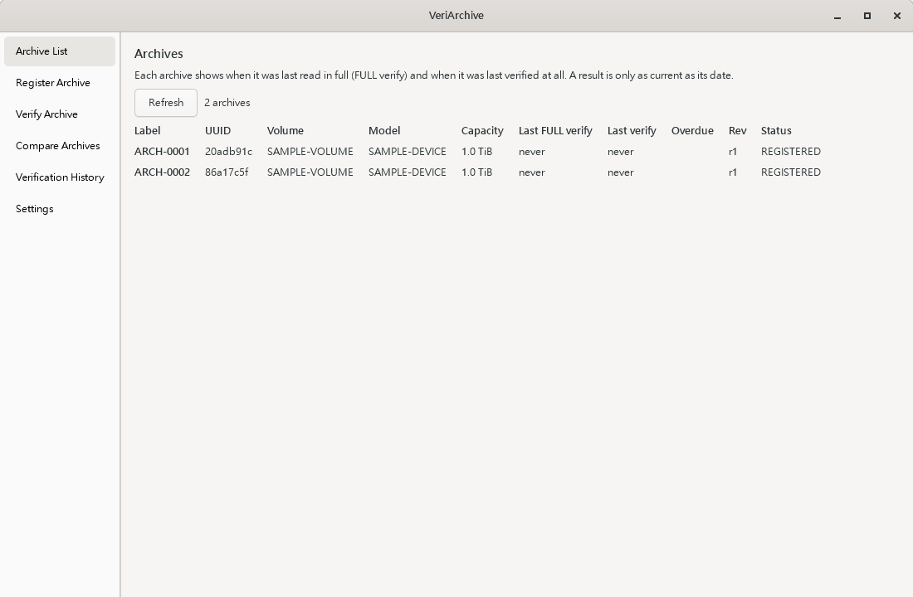
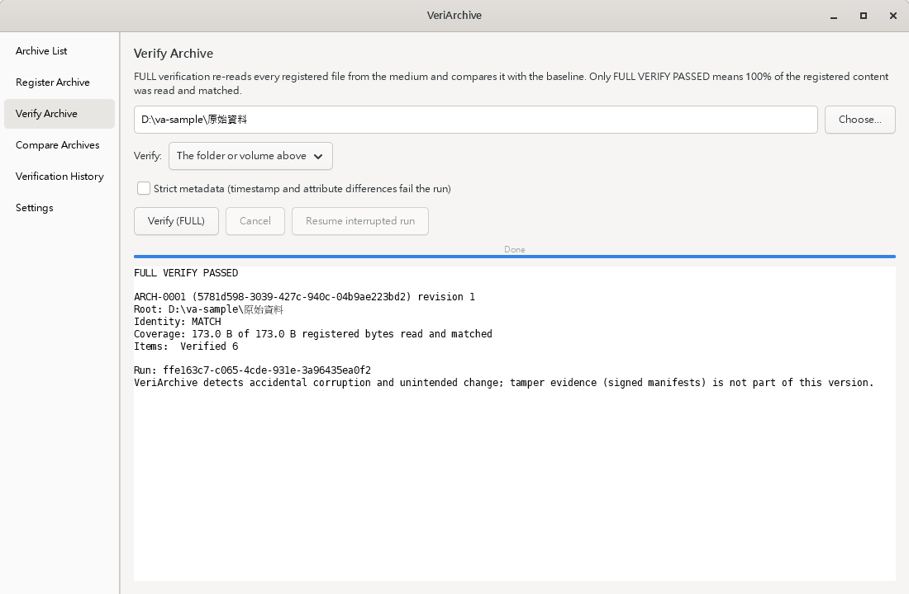
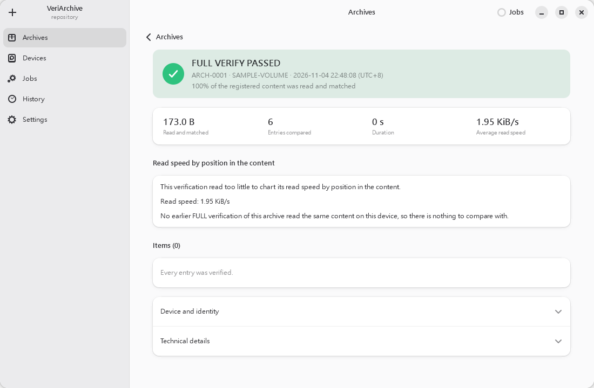
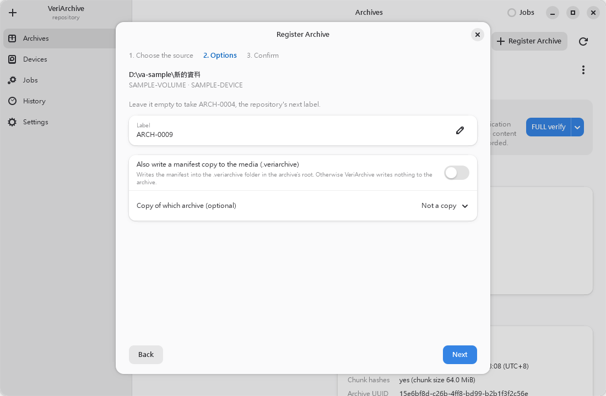
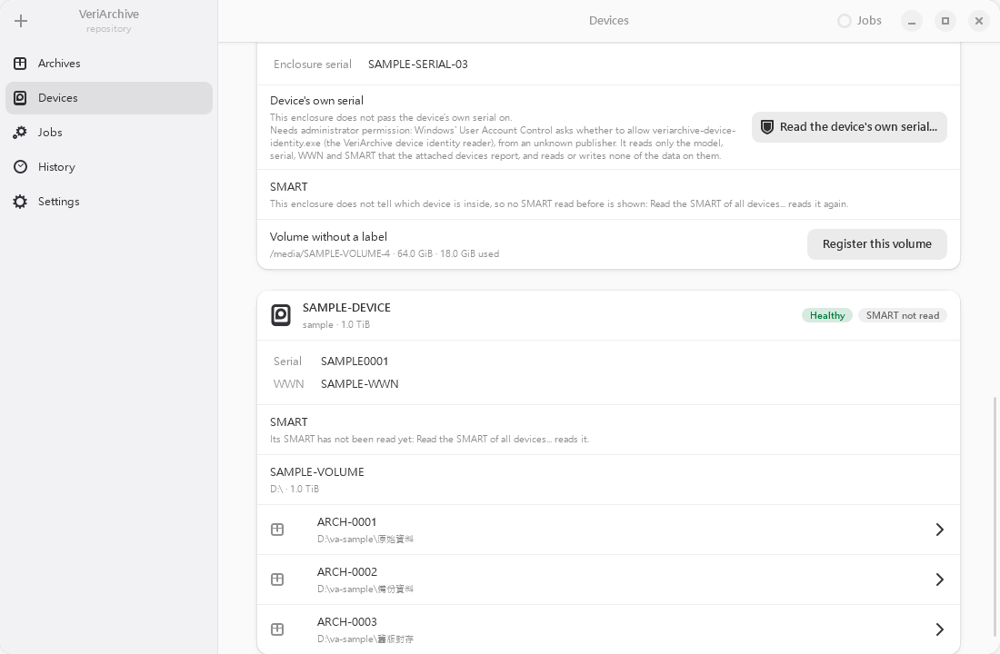
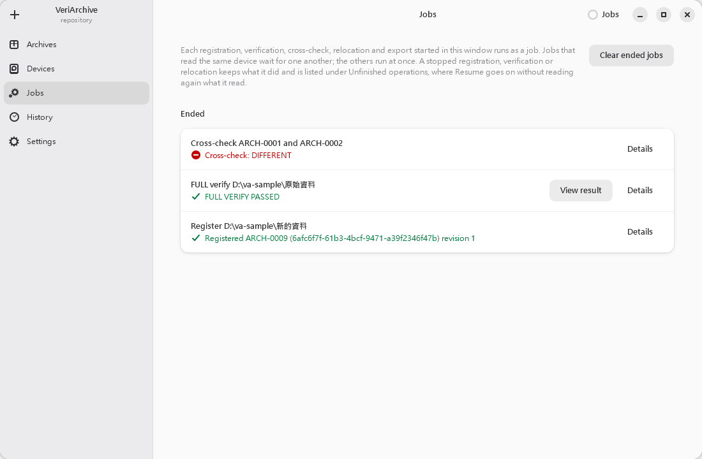
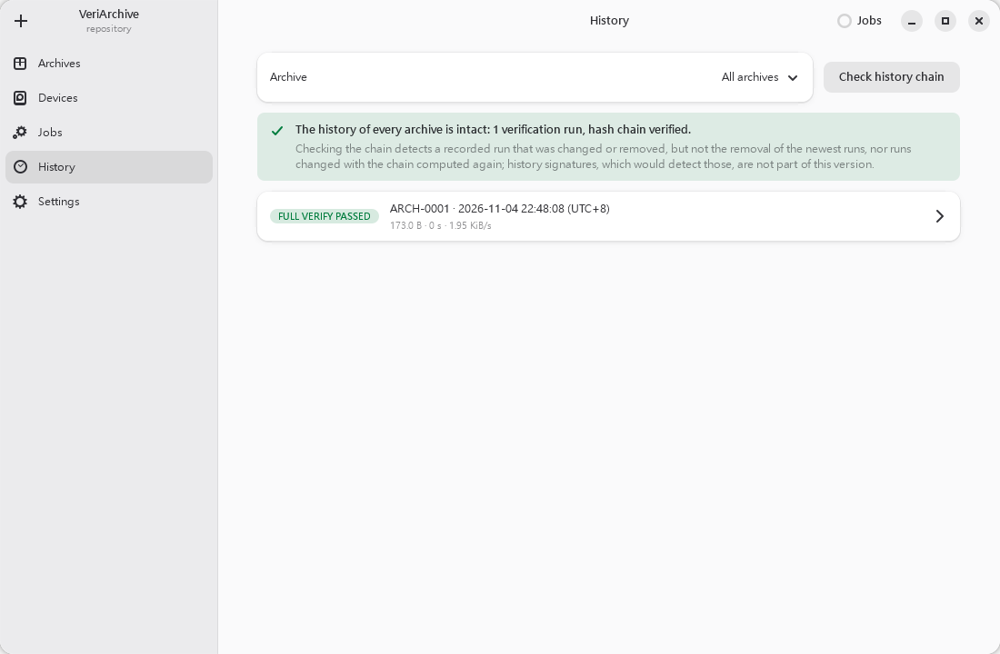
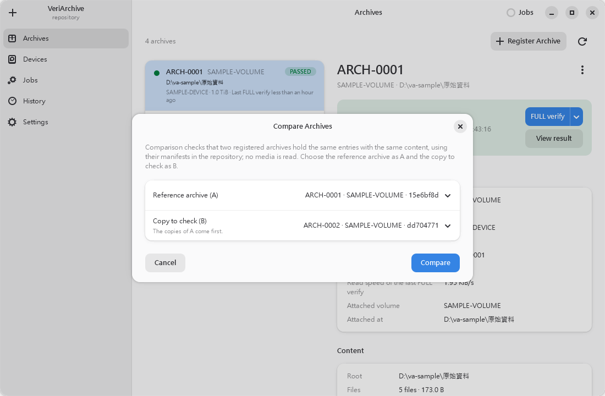
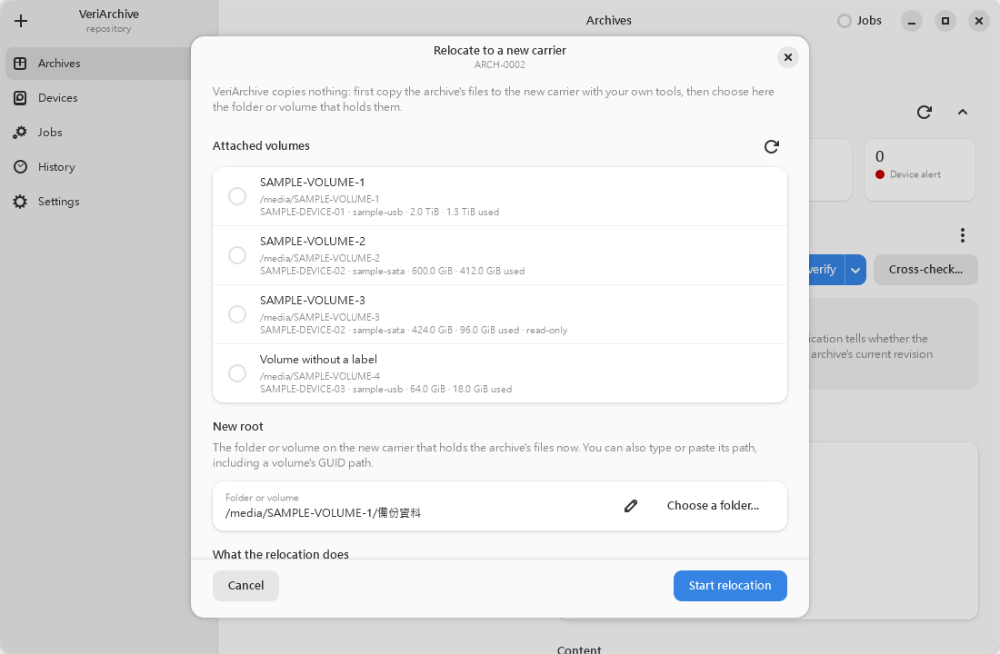
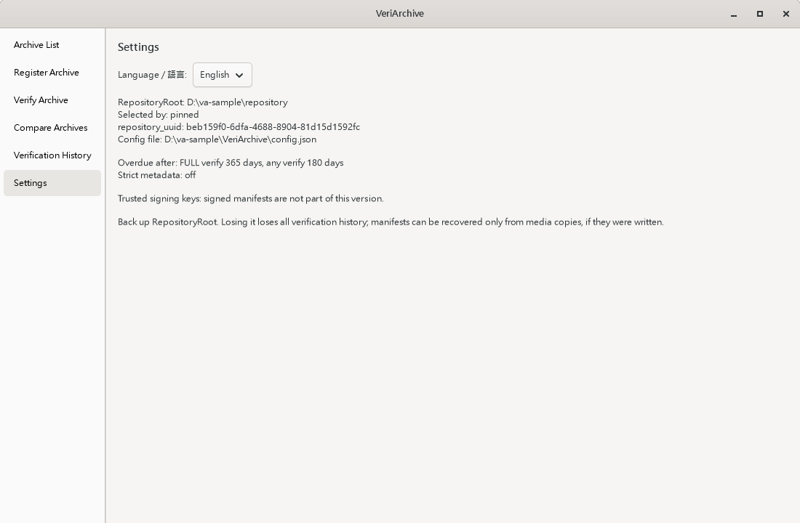

# VeriArchive

VeriArchive records integrity evidence for archive disks and later proves whether the archived
files were modified, corrupted, deleted, or added to. It detects; it never repairs, restores, or
creates backups. Windows and Linux, one codebase.

- **Register** a folder or volume: every file is read once and its BLAKE3 and SHA-256 are stored
  in a manifest (`.vam`), the baseline.
- **Verify** later: the media is identified (filesystem and device identity), every registered
  byte is re-read from the disk (bypassing the cache) and compared with the baseline.
- Results always carry their mode and date: "Last FULL verify: PASSED on …" — never a bare status.
- Verification history is hash-chained. Checking the chain (`repo verify-history`) detects a
  recorded run that was changed or removed, but not the removal of the newest runs, nor runs
  changed with the chain computed again; history signatures, which would detect those, are not
  part of this version.
- A **verification report** says what one run found as one self-contained HTML file (no script
  and nothing loaded from elsewhere; a light and a dark style, and A4 printing), with the archive's
  runs, the state of the history chain when it was made and the run's hash in it, saved from the
  run's result page or by `veriarchive-cli report` (decision 0048). It is not signed: the
  repository stays the record.

VeriArchive detects accidental corruption and unintended change. Tamper evidence (signed
manifests) is not part of this version.

## Screenshots

The pages of the graphical interface, showing sample data made by
[`tools/screenshots/`](tools/screenshots/README.md).

| Archives | Verifying an archive |
|---|---|
|  |  |
| **A verification's result** | **Register Archive** |
|  |  |
| **Devices** | **Jobs** |
|  |  |
| **History** | **Compare Archives** |
|  |  |
| **Relocate to a new carrier** | **Settings** |
|  |  |

## Documentation

- [`docs/user-guide.md`](docs/user-guide.md) / [`docs/user-guide.zh-TW.md`](docs/user-guide.zh-TW.md):
  how to use VeriArchive (English / 繁體中文): the graphical interface step by step, with
  screenshots, and the command line.
- [`design/HANDOFF.md`](design/HANDOFF.md): the specification (principles, contracts, milestones).
- [`design/decisions/`](design/decisions/): decisions that amend the specification.
- [`GLOSSARY.md`](GLOSSARY.md): the words used in code, documents and output.
- [`design/REVIEW_STATUS.md`](design/REVIEW_STATUS.md): what is implemented and what still needs
  verification on real hardware and CI.

## Build

Windows commands run in an **MSYS2 UCRT64** shell. Dependencies: GCC ≥ 14, CMake ≥ 3.28, Ninja,
SQLite ≥ 3.40, OpenSSL 3, GLib ≥ 2.72, GTK4 ≥ 4.14 and libadwaita ≥ 1.5 (for the GUI). BLAKE3 and nlohmann/json are
downloaded at configure time when not installed.

```sh
cmake --preset windows-ucrt64-debug        # or linux-debug
cmake --build --preset windows-ucrt64-debug
ctest --preset windows-ucrt64-debug
```

Release presets are `windows-ucrt64-release` and `linux-release`. CI runs on GitLab
(`.gitlab-ci.yml`): Windows UCRT64, Ubuntu 24.04 and Fedora.

### Windows package

A self-contained Windows build (programs, every DLL they need, GTK resources and the licenses of
every library they use, bundled or compiled in) runs on machines without MSYS2:

```sh
cmake --preset windows-ucrt64-release
cmake --build --preset windows-ucrt64-release
cd build/windows-ucrt64-release && cpack   # VeriArchive-<version>-windows-x86_64.zip
```

The zip holds `bin`, `lib` and `share` at its root, with no folder of its own, so unzipping a new
version into the program folder updates it whatever the version number (decision 0038).
`cmake --install build/windows-ucrt64-release --prefix <folder> --component VeriArchive` installs
the same tree into a folder. Installing into a folder that holds an earlier install updates it in
place; files the install does not write, such as `bin/config.json` and the repository in
`bin/data`, are left as they are. The `veriarchive_package` test checks that the installed tree
runs with only Windows on `PATH` and never imports `msys-2.0.dll` (R-121), also after a second
install over the first, and that the zip unzips into an installed folder as such an update. It
also checks that the device identity reader, the one program that runs with administrator
permission, is in `bin` and imports only Windows' own DLLs, none that `bin` holds (it is linked
statically, decision 0047).

### Editor (clangd)

`.clangd` reads the compile database in `build/dev-clangd`. Make it on each machine (it is not
committed) with the host's debug preset:

```sh
cmake --preset windows-ucrt64-debug -B build/dev-clangd -DCMAKE_EXPORT_COMPILE_COMMANDS=ON   # or linux-debug
```

The Windows presets name the compiler by its target (`x86_64-w64-mingw32-g++`, the same program as
`g++`), so clangd knows the MinGW headers without further settings.

## Command line

```sh
veriarchive-cli repo init                       # create the repository (first run)
veriarchive-cli repo info
veriarchive-cli media list                      # volumes and the disks behind them
veriarchive-cli register K:\Backups\2026        # baseline a folder or volume root
veriarchive-cli verify --full K:\Backups\2026   # re-read and compare everything
veriarchive-cli verify --full <archive_uuid>    # find the archive on attached disks
veriarchive-cli archive list                    # last FULL verify, last verify, OVERDUE
veriarchive-cli archive compare <uuid_a> <uuid_b>   # does copy B hold what archive A holds?
veriarchive-cli history <uuid>
veriarchive-cli repo verify-history             # check the history hash chain
veriarchive-cli report <run_id> --out run.html  # the verification report of one run, as HTML
veriarchive-cli export-sha256sums <uuid> --out sums.txt   # sha256sum -c, run in the archive's root
```

More: `register --new-revision | --force-new-archive | --copy-of UUID | --write-media-copy |
--resume`, `verify --full ... --resume RUN_ID`,
`archive show | retire | relocate [--resume] | abandon-registration | abandon-relocation`, `export`, `import`,
`repo rebuild-index`.
Every command accepts `--json`. Exit codes: 0 passed, 2 passed with warnings, 3 failed, 4
incomplete, 10 usage, 11 repository, 12 needs an operator decision.

`archive compare` compares the manifests of two registered archives, typically an archive and its
copy on other media, entry by entry: presence, type and content (BLAKE3 and SHA-256), not metadata.
It reads no media and records nothing; the result is IDENTICAL (exit 0), IDENTICAL_WITH_WARNINGS
(2) or DIFFERENT (3). It compares what each registration read; a FULL verify of each archive
proves that its disk still holds it (decision 0020).

The repository location is resolved explicitly (`--repository`, `VERIARCHIVE_REPOSITORY`), then
from the pinned config, and only on first initialisation falls back to `<program>/data` or
`~/VeriArchive`. A configured location that is unavailable is an error, never a fallback. A
repository inside the config file's folder is pinned relative to it, so a portable program
folder with its `data` can be moved as a whole (decision 0019). Back up the repository: losing it
loses the verification history.

## Graphical interface

`veriarchive-gui` is built with GTK4 and libadwaita (decision 0046). Its pages are Archives (the
unfinished operations, the archives with where each is attached now and the details of the one
chosen, from which it is verified, compared, given a new revision, exported, relocated or
retired), Devices (the attached devices, their health, volumes and archives), Jobs, History (the
runs of every archive, each with its result page, from which the verification report of a run
that reached a result is saved) and Settings; Register Archive and Compare Archives are dialogs.
Every registration, verification, comparison, relocation and export runs as a job with its
progress, which Stop ends; interrupted registrations, verifications and relocations can be
resumed, and unfinished ones abandoned. A device moved to another USB enclosure is verified
in full once you confirm that it is the same device, by its own serial or on your word; the
confirmation is recorded in the hash-chained history, and only a pass records the new enclosure
(decision 0047). The GUI runs unprivileged: only to read a device's own serial behind its
enclosure, on your request, does it start the device identity reader
(`veriarchive-device-identity.exe`, Windows only), which Windows asks you to allow with
administrator permission each time. The command line never asks for it.

Only the command line shows every revision of an archive (`archive show`), imports manifests
(`import`), writes a list for `sha256sum -c` (`export-sha256sums`), rebuilds the index
(`repo rebuild-index`), registers over a lost manifest (`register --lost-manifest`), chooses the
reading strategy (`--io hdd|ssd`) and writes `--json`.

## Interface language

The CLI and the GUI speak English and Traditional Chinese (decision 0017): `--lang en|zh-TW`,
then `VERIARCHIVE_LANG`, then `"language"` in the config file (the GUI's Settings page sets it),
then the system's display language. `--json` output and exit codes are always English.
