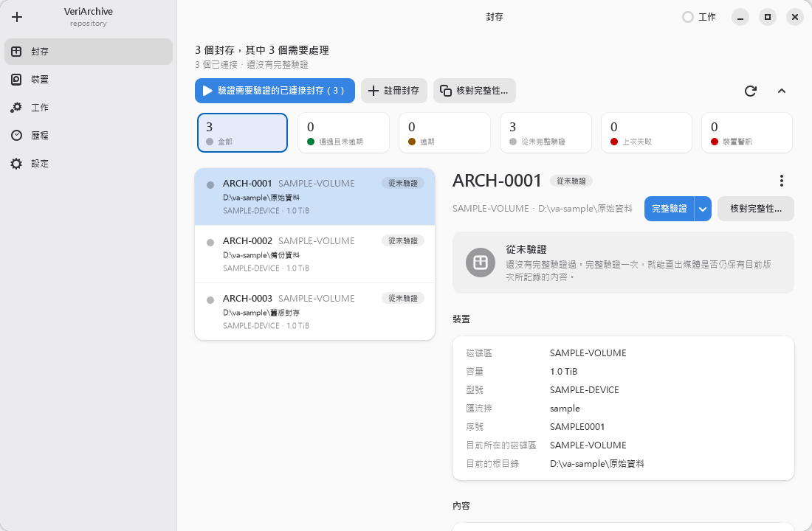
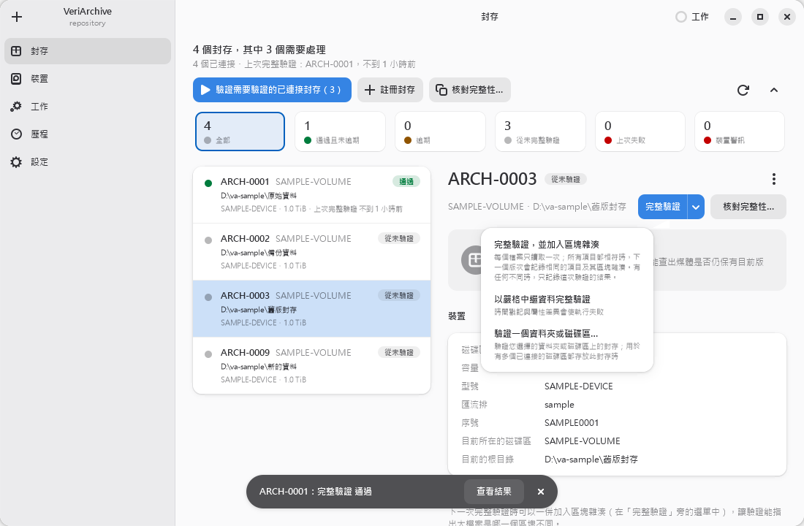
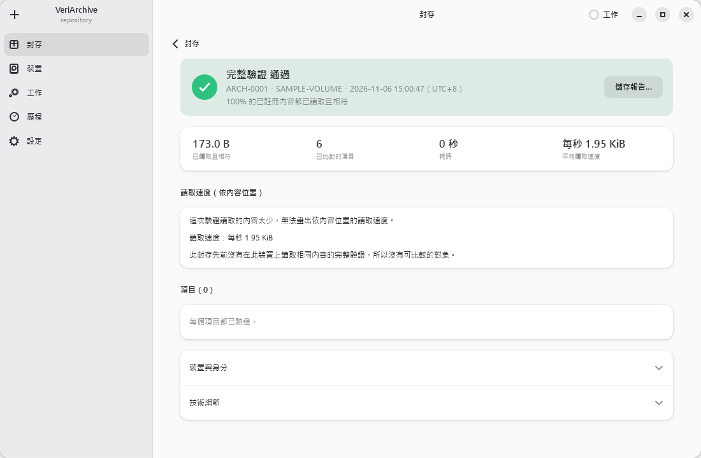
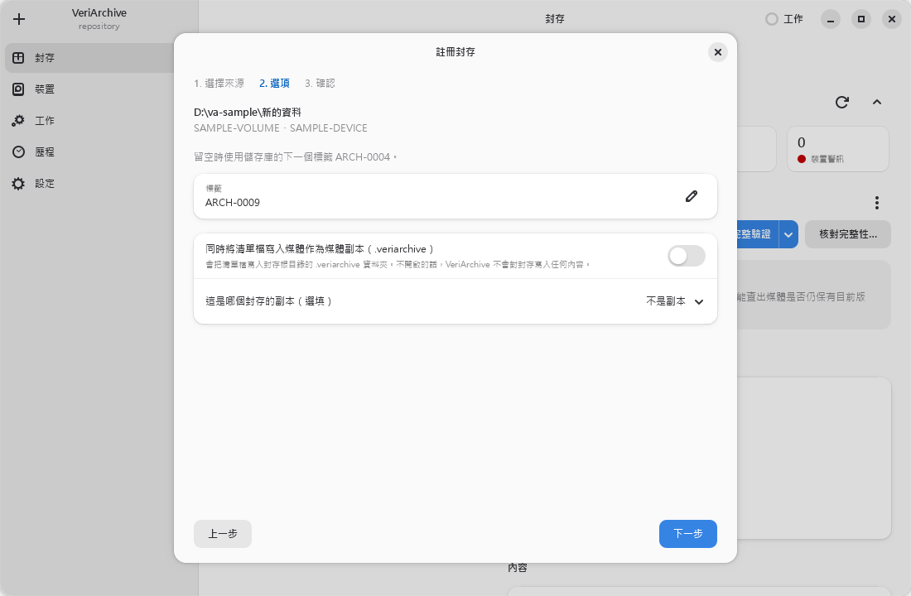
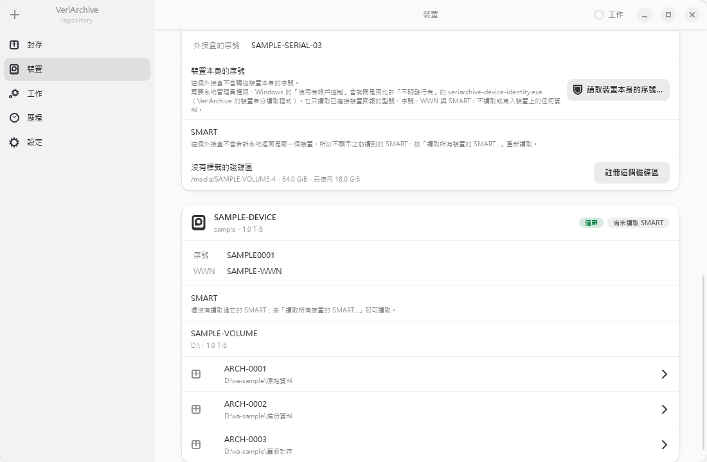
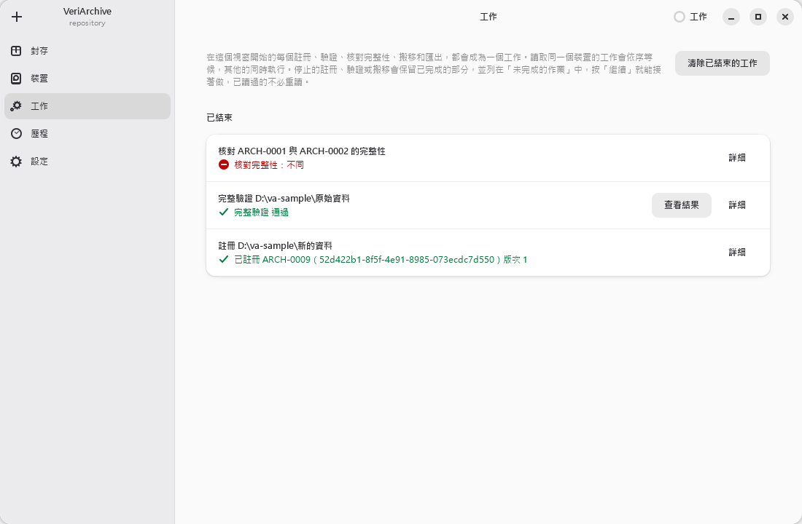
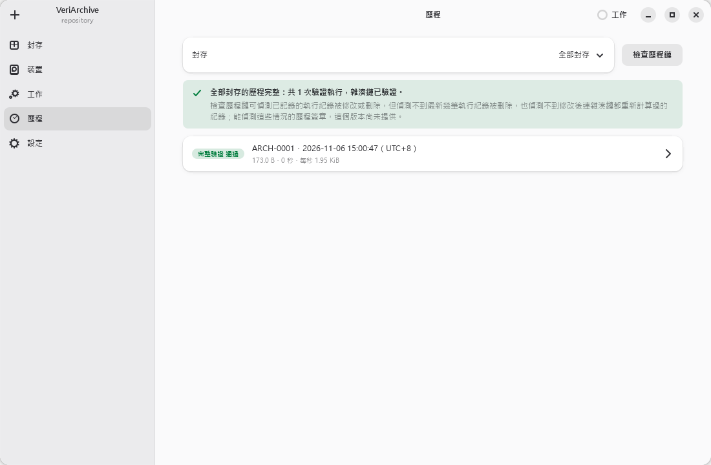
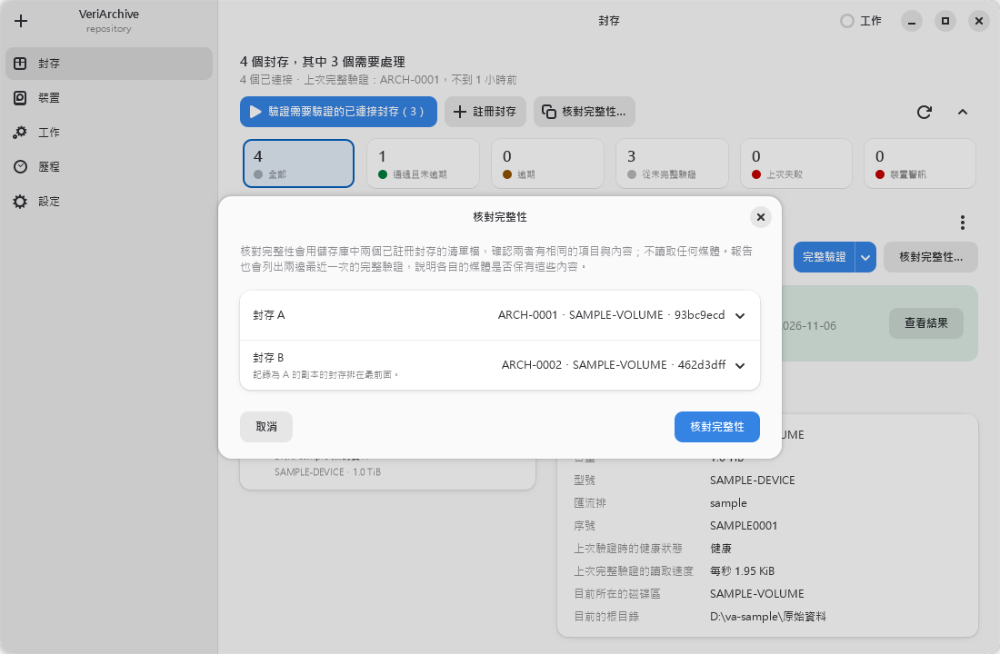
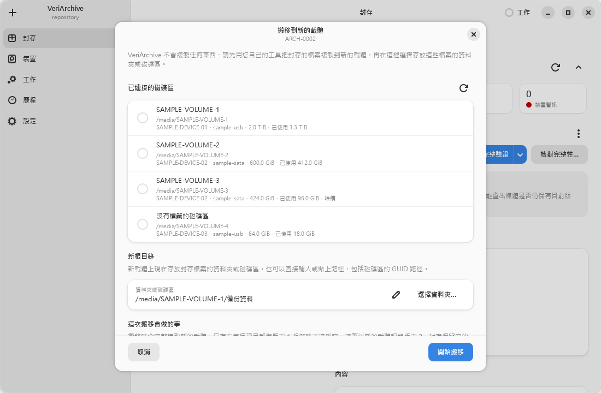
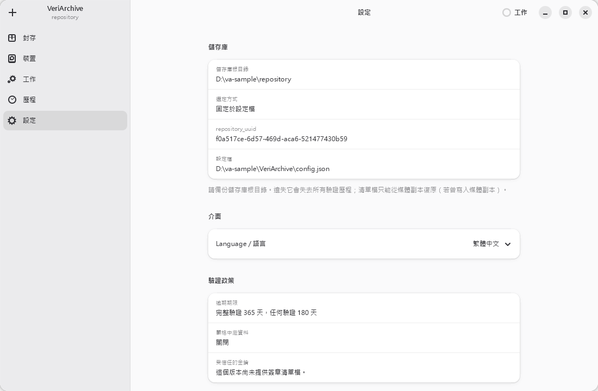

# VeriArchive

[English](README.md) | 繁體中文

VeriArchive 為封存用的磁碟留下完整性證據，日後可以證明封存的檔案有沒有被修改、損毀、刪除或多出檔案。
它只負責偵測：不會修復、不會還原，也不會建立備份。Windows 與 Linux 共用同一套程式碼。

- **註冊**資料夾或磁碟區：每個檔案讀一次，把它的 BLAKE3 與 SHA-256 存進清單檔（`.vam`），作為基準。
- 日後**驗證**：先辨識媒體（檔案系統與裝置的身分），再從磁碟重新讀取每一個已註冊的位元組（不經過快取），
  和基準比對。
- 結果一定註明模式與日期，例如「上次完整驗證：通過，於 …」，不會只給一個狀態。
- 驗證歷程以雜湊鏈串起。檢查雜湊鏈（`repo verify-history`）能發現某次已記錄的執行被修改或刪除，但發現不了
  最新幾次執行被刪除，也發現不了修改後又重新計算雜湊鏈的執行；能發現這些情況的歷程簽章不在這個版本中。
- **驗證報告**以一個獨立的 HTML 檔說明一次執行的結果（不含指令碼，也不從別處載入任何東西；有淺色與深色樣式，
  可用 A4 列印），內含該封存的各次執行、產生報告時歷程雜湊鏈的狀態，以及這次執行的雜湊值；可以從執行的結果頁
  儲存，或用 `veriarchive-cli report` 產生（決策 0048）。報告沒有簽章：紀錄仍以儲存庫為準。

VeriArchive 偵測的是意外損毀和非預期的變更。防竄改證據（簽章清單檔）不在這個版本中。

## 截圖

圖形介面的各頁，畫面中是 [`tools/screenshots/`](tools/screenshots/README.md) 產生的範例資料。

| 封存 | 驗證封存 |
|---|---|
|  |  |
| **驗證結果** | **註冊封存** |
|  |  |
| **裝置** | **工作** |
|  |  |
| **歷程** | **核對完整性** |
|  |  |
| **搬移到新的載體** | **設定** |
|  |  |

## 文件

- [`docs/user-guide.zh-TW.md`](docs/user-guide.zh-TW.md) / [`docs/user-guide.md`](docs/user-guide.md)：
  VeriArchive 使用說明（繁體中文／English）：一步一步說明圖形介面（附截圖），以及命令列。
- [`design/HANDOFF.md`](design/HANDOFF.md)：規格（原則、契約、里程碑）。
- [`design/decisions/`](design/decisions/)：修訂規格的決策紀錄。
- [`GLOSSARY.md`](GLOSSARY.md)：程式碼、文件與輸出使用的用語。
- [`design/REVIEW_STATUS.md`](design/REVIEW_STATUS.md)：已實作的項目，以及還需要在實際硬體與 CI 上確認的項目。

除了使用說明，這些文件都只有英文版。

## 建置

Windows 上的指令在 **MSYS2 UCRT64** shell 中執行。相依套件：GCC ≥ 14、CMake ≥ 3.28、Ninja、SQLite ≥ 3.40、
OpenSSL 3、GLib ≥ 2.72，以及圖形介面需要的 GTK4 ≥ 4.14 與 libadwaita ≥ 1.5。BLAKE3 與 nlohmann/json
沒有安裝時，會在 configure 時下載。

```sh
cmake --preset windows-ucrt64-debug        # 或 linux-debug
cmake --build --preset windows-ucrt64-debug
ctest --preset windows-ucrt64-debug
```

Release 的 preset 是 `windows-ucrt64-release` 與 `linux-release`。CI 在 GitLab 上執行（`.gitlab-ci.yml`）：
Windows UCRT64、Ubuntu 24.04 與 Fedora。

### Windows 套件

自成一體的 Windows 版本（程式、它們需要的每個 DLL、GTK 資源，以及用到的每個程式庫的授權條款，不論隨附或
編譯在內）可以在沒有 MSYS2 的電腦上執行：

```sh
cmake --preset windows-ucrt64-release
cmake --build --preset windows-ucrt64-release
cd build/windows-ucrt64-release && cpack   # VeriArchive-<version>-windows-x86_64.zip
```

zip 的根目錄直接是 `bin`、`lib` 和 `share`，沒有自己的資料夾，所以不論版本號碼，把新版本解壓縮到程式資料夾
就會更新它（決策 0038）。`cmake --install build/windows-ucrt64-release --prefix <folder> --component VeriArchive`
會把同樣的目錄樹安裝到一個資料夾。安裝到已有較早版本的資料夾時，會就地更新；安裝不會寫入的檔案，例如
`bin/config.json` 和 `bin/data` 裡的儲存庫，都維持原樣。`veriarchive_package` 測試會檢查：安裝好的目錄樹在
`PATH` 只有 Windows 時可以執行，而且從不匯入 `msys-2.0.dll`（R-121），在第一次安裝上再安裝一次之後也是如此；
zip 解壓縮到已安裝的資料夾時，也能這樣更新。它也會檢查裝置身分讀取程式，也就是唯一以系統管理員權限執行的
程式，位於 `bin`，而且只匯入 Windows 本身的 DLL，不匯入 `bin` 裡的任何 DLL（它是靜態連結的，決策 0047）。

### 編輯器（clangd）

`.clangd` 讀取 `build/dev-clangd` 裡的編譯資料庫。每台電腦用本機的 debug preset 各自產生一份（它不提交進
版本庫）：

```sh
cmake --preset windows-ucrt64-debug -B build/dev-clangd -DCMAKE_EXPORT_COMPILE_COMMANDS=ON   # 或 linux-debug
```

Windows 的 preset 以目標平台稱呼編譯器（`x86_64-w64-mingw32-g++`，和 `g++` 是同一個程式），所以 clangd
不需要其他設定就認得 MinGW 的標頭檔。

## 命令列

```sh
veriarchive-cli repo init                       # 建立儲存庫（第一次執行）
veriarchive-cli repo info
veriarchive-cli media list                      # 磁碟區與它們背後的磁碟
veriarchive-cli register K:\Backups\2026        # 為資料夾或磁碟區根目錄建立基準
veriarchive-cli verify --full K:\Backups\2026   # 重新讀取全部內容並比對
veriarchive-cli verify --full <archive_uuid>    # 在已連接的磁碟上找到這個封存
veriarchive-cli archive list                    # 上次完整驗證、上次驗證、逾期
veriarchive-cli archive compare <uuid_a> <uuid_b>   # 副本 B 是否保有封存 A 的內容？
veriarchive-cli history <uuid>
veriarchive-cli repo verify-history             # 檢查歷程雜湊鏈
veriarchive-cli report <run_id> --out run.html  # 一次執行的驗證報告（HTML）
veriarchive-cli export-sha256sums <uuid> --out sums.txt   # 供 sha256sum -c 使用，在封存的根目錄執行
```

其他：`register --new-revision | --force-new-archive | --copy-of UUID | --write-media-copy |
--resume`、`verify --full ... --resume RUN_ID`、
`archive show | retire | relocate [--resume] | abandon-registration | abandon-relocation`、`export`、`import`、
`repo rebuild-index`。
每個命令都接受 `--json`。結束代碼：0 通過、2 通過但有警告、3 失敗、4 未完成、10 用法錯誤、11 儲存庫問題、
12 需要操作者決定。

`archive compare` 逐項比較兩個已註冊封存的清單檔，通常是一個封存和它在其他媒體上的副本：比較項目是否存在、
類型和內容（BLAKE3 與 SHA-256），不比較中繼資料。它不讀取任何媒體，也不記錄任何東西；結果是 IDENTICAL
（結束代碼 0）、IDENTICAL_WITH_WARNINGS（2）或 DIFFERENT（3）。它比較的是兩次註冊各自讀到的內容；要證明
磁碟仍保有封存，得對每個封存做完整驗證（決策 0020）。

儲存庫的位置依序決定：先看明確指定的（`--repository`、`VERIARCHIVE_REPOSITORY`），再看設定檔裡釘選的位置，
只有第一次初始化時才退而使用 `<program>/data` 或 `~/VeriArchive`。已設定但無法使用的位置是錯誤，絕不會改用
其他位置。位於設定檔所在資料夾內的儲存庫，以相對於該資料夾的路徑釘選，所以可攜式的程式資料夾連同它的 `data`
可以整個搬走（決策 0019）。請備份儲存庫：遺失儲存庫，就會失去驗證歷程。

## 圖形介面

`veriarchive-gui` 以 GTK4 和 libadwaita 建構（決策 0046）。它的頁面有：封存（各封存狀態的概覽，其中的數字可以
篩選清單，並有「驗證需要驗證的已連接封存」；各封存目前連接在哪裡；以及所選封存的詳細資料，往下捲動時標題列會固定在
上方，可以從這裡驗證、核對完整性、建立新版次、匯出、搬移或停用它）、裝置（已連接的裝置、它們的健康狀態、磁碟區與
封存）、工作（這個視窗的工作，以及不論在哪裡啟動、尚未完成的作業）、歷程（所有封存的執行，每次執行都有結果頁；
得出結果的執行可以從結果頁儲存驗證報告），以及設定；註冊封存和核對完整性是對話方塊（決策 0049）。核對完整性就是
視窗中的比較：它不把任何一邊當成原始資料，報告也會列出兩邊最近一次的完整驗證。每次註冊、驗證、核對完整性、搬移和
匯出都以工作執行並顯示進度，按「停止」即可結束；中斷的註冊、驗證和搬移可以在「工作」頁繼續，未完成的也可以在那裡
放棄。裝置換到另一個 USB 外接盒後，只要您確認它是同一個裝置，以裝置本身的序號確認或由您確認，就會完整驗證；這次確認
會記錄在以雜湊鏈串起的歷程中，而且只有驗證通過，才會記錄新的外接盒（決策 0047）。圖形介面以一般權限執行：只有在您
要求讀取外接盒後方裝置本身的序號時，它才會啟動裝置身分讀取程式（`veriarchive-device-identity.exe`，僅 Windows），
Windows 每次都會詢問您是否允許它取得系統管理員權限。命令列從不要求這個權限。

只有命令列能顯示封存的每個版次（`archive show`）、匯入清單檔（`import`）、寫出供 `sha256sum -c` 使用的清單
（`export-sha256sums`）、重建索引（`repo rebuild-index`）、在清單檔遺失時重新註冊（`register --lost-manifest`）、
選擇讀取策略（`--io hdd|ssd`），以及輸出 `--json`。

## 介面語言

命令列和圖形介面都支援英文與繁體中文（決策 0017）：依序看 `--lang en|zh-TW`、`VERIARCHIVE_LANG`、設定檔中的
`"language"`（圖形介面的「設定」頁會設定它），最後是系統的顯示語言。`--json` 的輸出一律是英文，結束代碼也不隨
語言改變。
