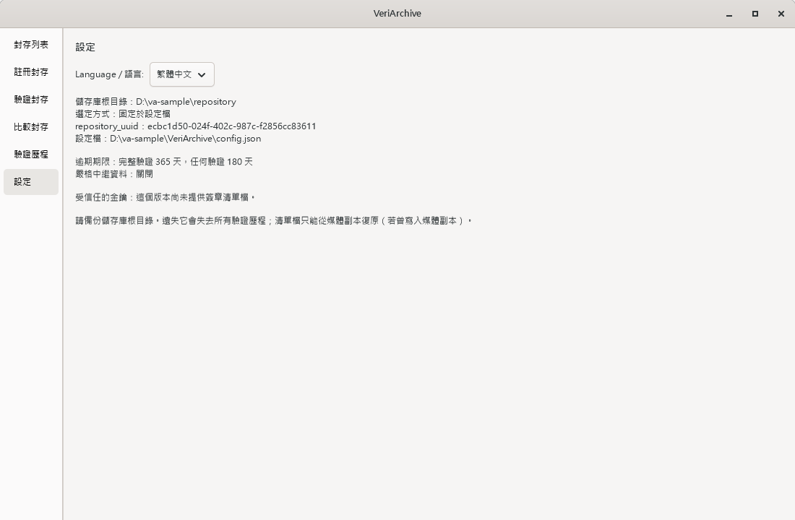
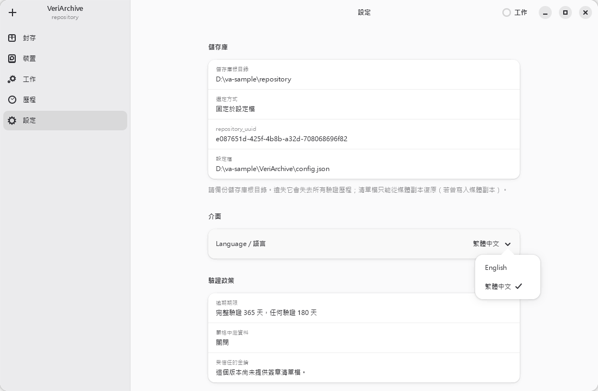
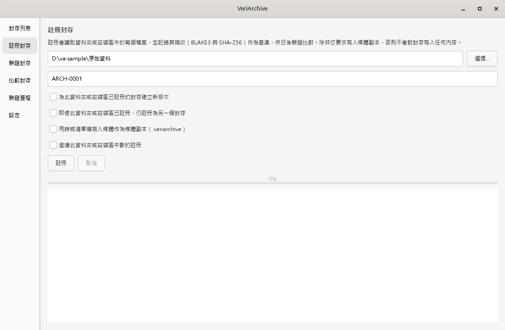
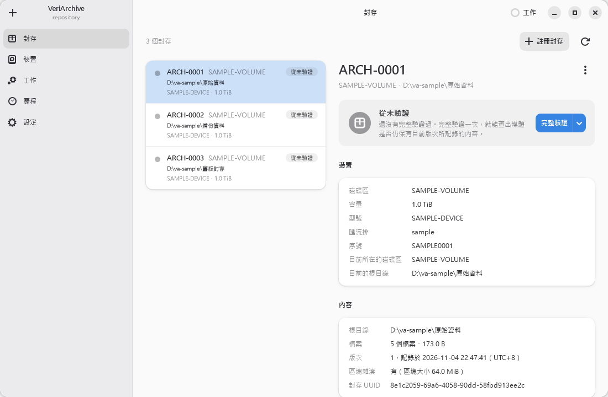
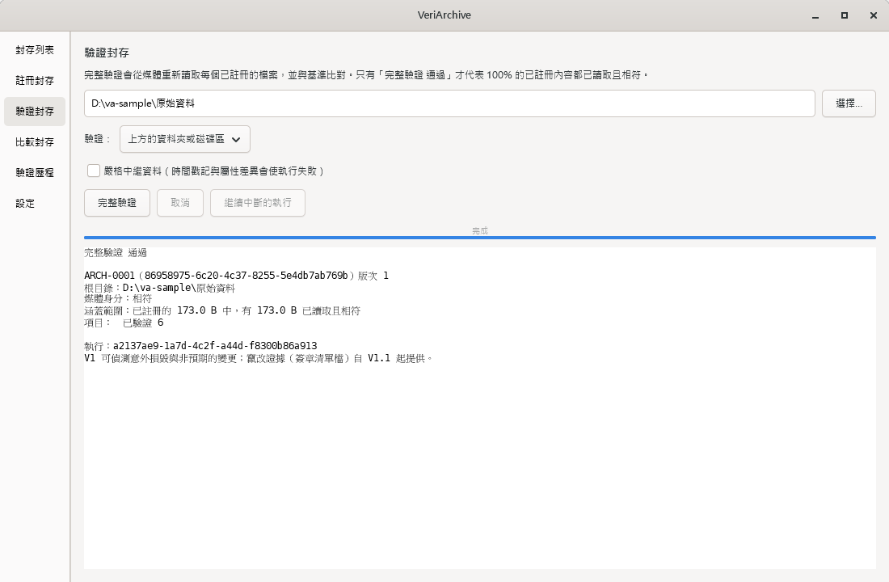
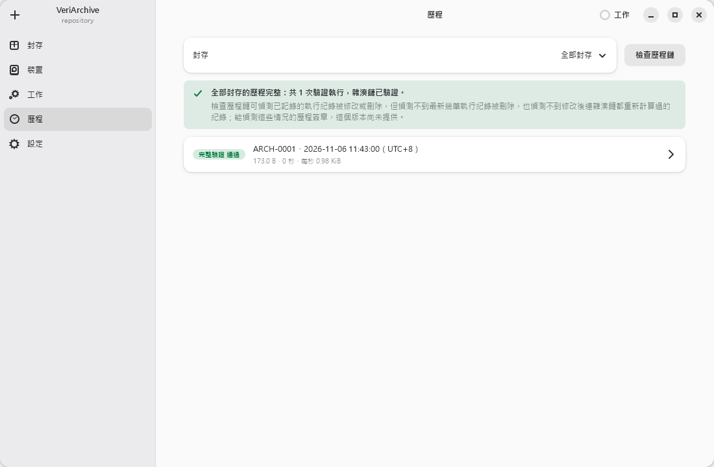
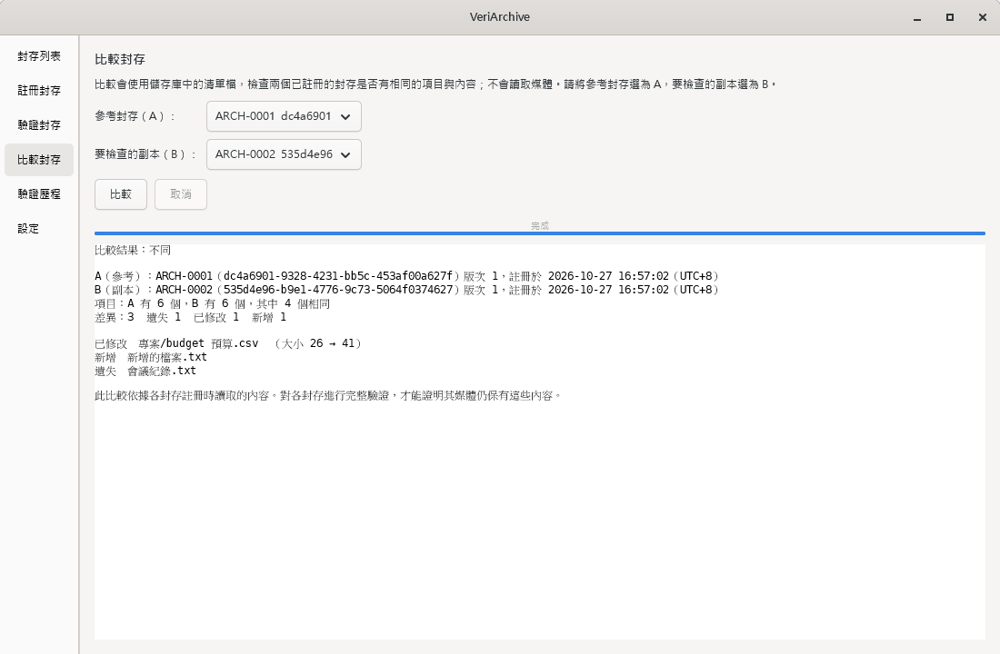

# VeriArchive 圖解使用說明

這份說明用圖形介面（`veriarchive-gui.exe`）的實際畫面，一步一步帶你完成：建立儲存庫、註冊封存、驗證封存、查看歷程，以及**確認備份和原始資料完全相同**。

截圖裡的資料全都是範例資料，包括封存列表的磁碟區、型號和容量（`SAMPLE-VOLUME`、`SAMPLE-DEVICE`、1.0 TiB）。這份說明是公開的，截圖不能拿真實硬碟上的資料來示範，所以兩個封存是一顆硬碟上的兩個資料夾（`原始資料`、`備份資料`），裡面放的是範例檔案；產生截圖時，程式也會把磁碟區名稱、硬碟型號、序號和容量這些身分資料換成固定的範例值，不會顯示這顆硬碟真正的資料。實際使用時，一般是註冊整顆硬碟：輸入 `F:\` 這樣的磁碟區根目錄（見第 2 節），封存列表會顯示那顆硬碟實際的磁碟區名稱、型號和容量；其他操作都和截圖相同。

命令列的用法和更多細節，請看[使用說明](user-guide.zh-TW.md)。

## 開始之前：程式資料夾

VeriArchive 是免安裝的攜帶式程式：

1. 把 `VeriArchive-<版本>-windows-x86_64.zip` 解壓縮到任何資料夾，例如 `D:\VeriArchive`。
2. 執行 `bin\veriarchive-gui.exe`。

第一次建立儲存庫後，所有紀錄都放在程式旁邊：

- `bin\data`：儲存庫，裡面有每個封存的清單檔（基準）和驗證歷程。
- `bin\config.json`：設定檔，裡面以**相對路徑**記錄儲存庫的位置（`"repository": "data"`）。

所以整個程式資料夾可以直接搬到別的磁碟，或複製到另一台電腦繼續使用。

> **請定期備份整個程式資料夾，尤其是 `bin\data`。** 儲存庫遺失了，驗證歷程也就跟著遺失。

更新程式時，把新版 zip 解壓縮後**覆蓋**到同一個資料夾即可。zip 裡沒有 `bin\data` 和 `bin\config.json`，所以既有的紀錄不會被蓋掉。請不要先刪除舊的資料夾。

## 1. 設定：建立儲存庫、選擇語言

第一次開啟程式時，畫面會停在「設定」頁，並顯示「初始化儲存庫」按鈕。按下它，程式會在程式資料夾裡建立儲存庫。建立之後，這一頁會顯示：

| 項目 | 意義 |
|---|---|
| 儲存庫根目錄 | 儲存庫實際所在的資料夾 |
| 選定方式 | 這次用的儲存庫是怎麼決定的，例如「固定於設定檔」 |
| repository_uuid | 這個儲存庫的識別碼 |
| 設定檔 | 目前使用的設定檔 |
| 逾期期限 | 超過幾天沒有完整驗證或任何驗證，就標示「逾期」 |
| 嚴格中繼資料 | 開啟時，修改時間或屬性不同也會讓驗證失敗 |

最下面的提醒很重要：**請備份儲存庫根目錄**。

### 切換語言

在「Language / 語言」選單選 English 或繁體中文：

- 選擇會存進設定檔，視窗也會立刻換成新的語言。
- 已經輸入的資料夾、勾選的選項，以及畫面上的報告都會保留，報告也會改用新語言顯示。
- 正在註冊或驗證時不能切換語言，請等作業結束再切換。

## 2. 註冊封存：建立基準

註冊會把一整顆硬碟裡的每個檔案讀一次，記下它們的指紋（BLAKE3 與 SHA-256），當作日後驗證和比較的**基準**。只想註冊其中一部分時，也可以只註冊一個資料夾。

畫面上的「資料夾或磁碟區」就是指這兩種對象。「磁碟區」是程式對 `F:\` 這種位置的正式說法：一顆資料硬碟通常只有一個磁碟區，所以註冊 `F:\` 就是註冊整顆硬碟；硬碟分成幾個磁碟區時，每個磁碟區各註冊一次。

註冊整顆硬碟的步驟：

1. 在上方的欄位輸入硬碟的磁碟區根目錄，例如 `F:\`（也可以按「選擇…」挑選）。
2. 標籤可以不填。要填的話，格式是 `ARCH-` 加上四位以上數字，例如 `ARCH-0001`；不填時，程式會自動編號。
3. 按「註冊」。進度列會顯示完成比例、速度與剩餘時間，例如「計算雜湊中：2.16 TiB / 9.44 TiB（23%）・每秒 240 MiB・約剩 8～9 小時」，按「取消」可以隨時中止。完成比例依位元組計算，是精確的；剩餘時間是估計值，所以用範圍表示，剛開始的一分鐘會顯示「剩餘時間估算中」。

只註冊一個資料夾時，第 1 步改成按「選擇…」挑選那個資料夾，或直接輸入它的路徑，例如 `F:\照片`；其他步驟都一樣。截圖裡註冊的 `D:\va-sample\原始資料` 就是一個資料夾（原因見開頭的說明）。

下面四個選項平常都不用勾：

| 選項 | 什麼時候用 |
|---|---|
| 為此資料夾或磁碟區已註冊的封存建立新版次 | 已經註冊過，而且內容是你刻意更新的，要重新建立基準 |
| 即使此資料夾或磁碟區已註冊，仍註冊為另一個封存 | 已經註冊過，但要另外建立一個封存 |
| 同時將清單檔寫入媒體作為媒體副本 | 在被註冊的磁碟上多留一份清單檔（`.veriarchive` 資料夾）。**不勾的話，註冊完全不會寫入被註冊的磁碟** |
| 繼續此資料夾或磁碟區中斷的註冊 | 上次註冊中途被取消，從中斷處接著做，已計算過的檔案不必重讀。上次的程式若仍在執行，會停下來告訴你是哪一個；再也無法完成的註冊，可以在「封存列表」的未完成作業按「放棄…」 |

注意事項：

- **註冊期間請不要修改那顆磁碟**，否則基準會記到正在變動的內容。
- 傳統硬碟每秒大約讀 150 到 250 MB。幾 TB 的磁碟，註冊可能要十幾個小時。
- 圖形介面一次只執行一項長時間作業。要兩顆磁碟同時註冊，請用命令列：開兩個視窗，各執行一次 `veriarchive-cli register`。

## 3. 封存列表：每個封存的最新狀態

每一列是一個封存：

| 欄位 | 意義 |
|---|---|
| 標籤、UUID | 封存的名稱和識別碼（UUID 只顯示前 8 碼） |
| 磁碟區、型號、容量 | 註冊時記錄的磁碟區名稱、硬碟型號和容量 |
| 上次完整驗證 | 最近一次完整讀取的結果和時間；還沒驗證過時顯示「從未」 |
| 上次驗證 | 最近一次任何驗證的結果和時間 |
| 逾期 | 太久沒驗證時會標示 |
| 版次、狀態 | 目前的版次；「已註冊」或「已停用」 |

結果一定附上時間，因為結果只代表**那個時間**的狀態。

## 4. 驗證封存：證明資料沒有變

完整驗證會把每一個已註冊的位元組從磁碟重新讀出來，和基準比對。

操作步驟：

1. 在上方輸入或選擇磁碟區根目錄（例如 `F:\`）或資料夾，「驗證：」選單保持「上方的資料夾或磁碟區」。也可以在「驗證：」選單直接挑選已註冊的封存，程式會在已接上的磁碟中找到它。
2. 按「完整驗證」。

報告怎麼看：

- **第一行**是結果，一定帶著模式，例如「完整驗證 通過」。只有這個結果才代表 100% 的已註冊內容都讀到了，而且相符。
- **媒體身分**：程式是否認出這顆磁碟，例如「相符」。
- **涵蓋範圍**：讀取並且相符的位元組數。
- **項目**：各種狀態的數量；有問題的檔案會逐一列在下面。

| 結果 | 意義 |
|---|---|
| 通過 | 每個已註冊的位元組都讀到了，而且相符 |
| 通過（有警告） | 內容相符，但有需要注意的地方，例如磁碟讀不到硬體序號 |
| 失敗 | 有檔案被修改、遺失、無法讀取，或磁碟身分不符，或儲存庫裡這個封存的清單檔無法使用（這時不會讀取媒體，報告會說明如何修復清單檔） |
| 未完成 | 驗證被取消或中斷。按「繼續中斷的執行」可以接著做，已驗證過的檔案不必重讀 |

## 5. 驗證歷程：每一次驗證的紀錄

1. 在「封存：」選單選一個封存，按「顯示執行紀錄」，就會列出每一次驗證的時間、模式、結果、版次、相符位元組和執行編號。
2. 按「檢查歷程鏈」，可以確認歷程紀錄沒有被修改或刪除。歷程是用雜湊一筆串一筆的，改動任何一筆都會被發現。

畫面上的時間是這台電腦的本地時間，括號裡是和 UTC 的時差，例如「2026-10-15 10:18:12（UTC+8）」。

## 6. 比較封存：確認備份和原始資料相同

假設你用自己的工具把 F 碟備份（複製）到 G 碟，想證明 G 碟的內容和 F 碟完全相同。VeriArchive 本身不做備份。

只驗證 G 碟做不到這件事，因為驗證只是拿 G 碟和 G 自己的基準比較。正確的做法是：

1. **把兩顆磁碟各自註冊成一個封存**（見第 2 節）：先註冊 `F:\`，再註冊 `G:\`。
2. 到「比較封存」頁：
   - 「參考封存（A）」選原始資料（F 碟的封存）；
   - 「要檢查的副本（B）」選備份（G 碟的封存）；
   - 按「比較」。

比較只讀儲存庫裡的兩份清單檔，**不會讀取任何磁碟**，所以很快就完成。

報告怎麼看：

- **第一行**：「比較結果：相同」、「比較結果：相同（有警告）」或「比較結果：不同」。
- **A、B 兩行**：各是哪個封存，以及註冊時間。
- **項目**和**差異**：兩邊各有多少項目、多少個相同，以及各種差異的數量。
- 下面逐一列出每一個不同的項目，一律「以 A 為準來看 B」：

| 狀態 | 意義 |
|---|---|
| 遺失 | A 有、B 沒有：備份少了這個檔案 |
| 新增 | B 有、A 沒有：備份多了這個檔案 |
| 已修改 | 兩邊內容不同；括號內是 A 和 B 的大小（位元組） |
| 類型改變 | 例如在 A 是檔案，在 B 是資料夾 |
| 無基準 | 註冊時其中一邊讀不到這個檔案，無法比較內容 |

截圖的範例裡，備份少了一個檔案、多了一個檔案，還有一個檔案的內容不同，所以結果是「不同」。

### 比較能證明什麼

比較的是**兩次註冊時讀到的內容**。「比較結果：相同」代表：註冊 G 碟時，G 碟上的每個檔案都和註冊 F 碟時讀到的完全一樣。

磁碟之後還是可能壞掉。要證明兩顆磁碟**現在**仍然保有這些內容，請定期對兩個封存各做一次完整驗證（第 4 節）。

修改時間和檔案屬性不在比較範圍內，因為很多複製工具不會保留它們，比較只看檔案在不在、類型和內容。

## 7. 其他提醒

- 程式不需要系統管理員權限，也不應該以系統管理員身分執行。
- 圖形介面如果意外關閉，原因會記錄在 `%APPDATA%\VeriArchive\veriarchive-gui.log`。回報問題時請附上這個檔案。
- 命令列、結束代碼和 `--json` 輸出的說明，請看[使用說明](user-guide.zh-TW.md)。
- 這些截圖由 `tools/screenshots/` 的工具用範例資料自動產生。介面改版後可以重新產生，說明見 [tools/screenshots/README.md](../tools/screenshots/README.md)。
