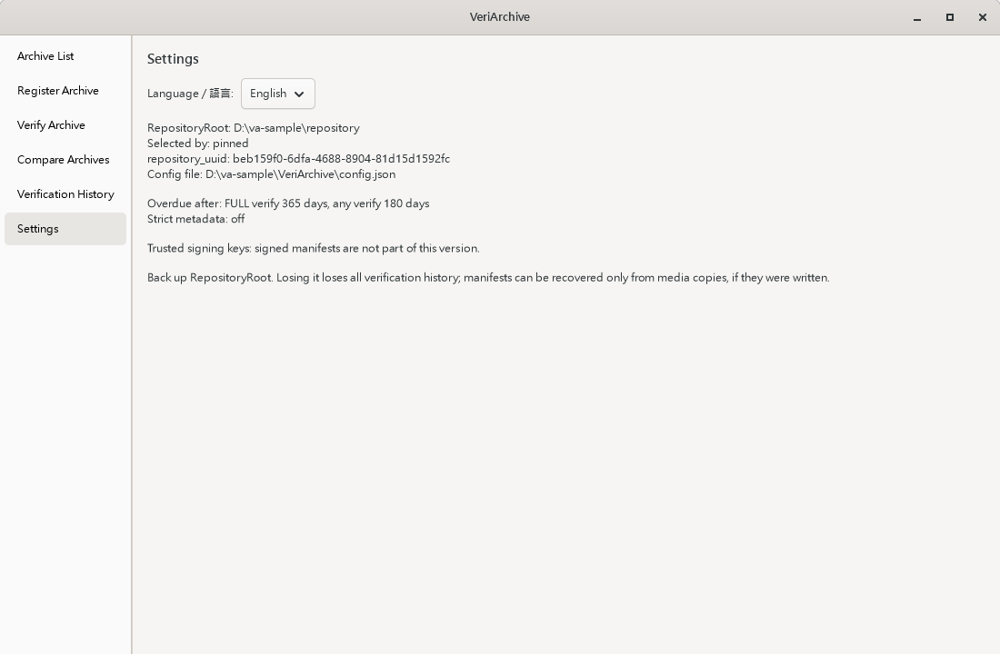
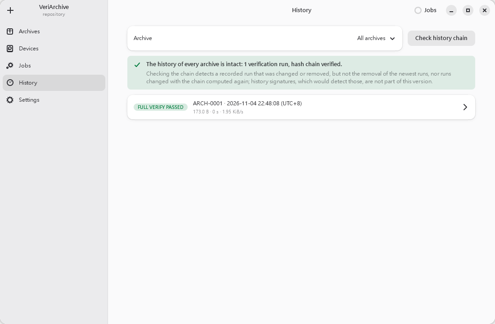

# VeriArchive user guide

VeriArchive records integrity evidence for archive disks and later proves whether the archived files were modified, corrupted, deleted, or added to. It only **detects**: it never repairs, restores, or makes backups.

The whole workflow is two steps:

1. **Register**: read every file of a folder or volume once and store its fingerprints (BLAKE3 and SHA-256) as the **baseline**.
2. **Verify**: later, re-read every registered byte from the disk, compare it with the baseline, and report what changed.

With pictures of the graphical interface (`veriarchive-gui.exe`) as it really looks, this guide takes you step by step through creating the repository, registering an archive, verifying it, viewing its history, and **confirming that a copy and the original are exactly the same**. Most sections explain the window first, then the command line (`veriarchive-cli.exe`).

All data in the screenshots is sample data, including the volume, model and capacity in the Archive List (`SAMPLE-VOLUME`, `SAMPLE-DEVICE`, 1.0 TiB). This guide is public, so its screenshots cannot show what a real disk holds: the two archives are two folders on one disk (`原始資料`, the original, and `備份資料`, its copy) that hold sample files; a third archive, `ARCH-0003` (the folder `舊版封存`), is sample data too and stands for an archive that an earlier version registered, still without chunk hashes (see "Verifying an archive"); and while the screenshots are made, VeriArchive also replaces the identity of that disk, its volume label, device model, serial and capacity, with fixed sample values, so the disk's real identity never shows. In real use you usually register a whole disk: type a volume root such as `F:\` (see "Registering an archive"), and the Archive List shows that disk's real volume label, model and capacity; everything else works as in the screenshots.

[繁體中文版](user-guide.zh-TW.md)

## Installing (Windows)

VeriArchive is a portable program that needs no installation:

1. Make a folder for the program, for example `D:\VeriArchive`, and unzip `VeriArchive-<version>-windows-x86_64.zip` into it; nothing else (such as MSYS2) is needed.
2. Run `bin\veriarchive-gui.exe` in that folder (`D:\VeriArchive\bin\veriarchive-gui.exe` in the example).

The zip holds no folder of its own: its `bin`, `lib` and `share` go straight into the folder it is unzipped into.

- `bin/veriarchive-gui.exe`: the graphical interface
- `bin/veriarchive-cli.exe`: the command line
- `lib/` and `share/`: image loaders, icons, settings and translations GTK needs; `share/doc/VeriArchive/`: this guide and a short README; `share/licenses/`: licenses of the libraries the program uses

To update the program, close VeriArchive, then unzip the new version's zip **into the same folder** (`D:\VeriArchive` in the example) and let it replace the files there. In Windows Explorer: right-click the zip, choose "Extract All...", type the program folder as the destination, and when asked, choose to replace the files in the destination. Explorer proposes a new folder named after the zip instead; a program unzipped there finds none of your records. The zip holds no `bin\data` and no `bin\config.json`, so the existing records are not overwritten. Do not delete the old folder first. To see which version runs, look at "Program version" in the Settings view, or run `veriarchive-cli --version` or `veriarchive-cli repo info`.

The first time a new version opens the repository, it may need to upgrade its database, after which earlier versions can no longer open it. Before the upgrade, the program keeps a copy of the database as it was in `bin\data`, named for the old schema version and the day, for example `veriarchive-schema-1-before-upgrade-2026-10-17.db`. With a large repository, copying and upgrading take a while: the window appears at once, showing "Upgrading the repository database..." and a moving progress bar, and only when that is done shows its views, the Settings view first, which tells you where the copy is. If you start the program again during the upgrade, the second window shows the same message and waits for the first one's upgrade to finish. The verification history lives only in the database, so keep this copy until you are sure you will stay with the new version. If the copy cannot be made (for example, the disk is full), nothing is upgraded, and the window says why where the message was.

### Moving the program folder

On first use, the repository (`data`) and the config file that remembers it (`config.json`) are created in the program's folder (`bin` in the zip), and the config file records the repository relative to that folder: `"repository": "data"`. Program, configuration and repository are therefore one folder. You can move or copy the whole unzipped folder, to another drive, to another computer, or onto a USB disk that gets another drive letter, and it keeps using its own repository. Backing up that folder also backs up the repository.

> **Back up the whole program folder regularly, especially `bin\data`.** Losing the repository loses the verification history with it.

- Copying the folder copies the repository; from then on each copy records its own verification history. Keep one of them as the folder you work with.
- A repository outside the program folder (`VeriArchive` in your home folder, or a place chosen with `--repository`) is remembered by its full path and does not move with the folder.
- A folder set up with an earlier version remembers the full path. To make it movable, open `bin\config.json` in a text editor and change the value of `"repository"` to `"data"`.

### After updating VeriArchive

A new version may need to upgrade the repository's database, which earlier versions then cannot open. The first time it opens the repository, it keeps a copy of the database as it is beside it, in the repository folder, named for the database's old schema version and the day, for example `veriarchive-schema-1-before-upgrade-2026-10-17.db`, and says once where the copy is: the command line in its error output (`note: the repository database was upgraded from schema version 1 to 3, ...`), the GUI in Settings, which it then shows first. Copying a large database takes a while: meanwhile the GUI's window shows "Upgrading the repository database..." with a moving progress bar in place of its views, also in a second start that waits for the first one's upgrade, and if the upgrade fails, it says why there. The verification history lives only in the database, so keep the copy until you are sure you will stay with the new version: an earlier version can open only the copy. If the copy cannot be made, for example because the disk is full, nothing is upgraded and the program stops with an error (exit code 11): make room and open the repository again.

## Interface language


The interface is available in English and Traditional Chinese. The first setting found wins:

1. `--lang en` or `--lang zh-TW` on the command line
2. the `VERIARCHIVE_LANG` environment variable
3. `"language"` in the config file
4. the Windows display language
5. English

In the GUI, the Settings view has a language drop-down, "Language / 語言" (English / 繁體中文). The choice is saved in the config file and the window is rebuilt in the new language at once; typed folders, chosen options, the window size and the reports shown are kept, and the reports are shown in the new language. It cannot be changed while a registration, verification or comparison runs.

`--json` output, exit codes and the codes inside JSON (`PASSED`, `Modified`, ...) are **always English**, so scripts behave the same in every language.

## First use: create the repository



The **repository** holds every manifest (baseline) and the verification history.

The first time you open the program, it shows the Settings view with the button "Initialise repository". Press it, and VeriArchive creates the repository in the program folder. Once it is created, the view shows:

| Item | Meaning |
|---|---|
| Program version | the version of VeriArchive that runs |
| RepositoryRoot | the folder the repository is in |
| Selected by | how the repository in use was chosen, for example "pinned" |
| repository_uuid | this repository's identifier |
| Config file | the config file in use |
| Overdue after | after how many days without a FULL verify, or without any verification, an archive is marked OVERDUE |
| Strict metadata | when on, a different modification time or attributes also fail a verification |

The reminder at the bottom is important:

> **Back up RepositoryRoot.** Losing it loses all verification history; manifests can be recovered only from media copies, if they were written.

CLI: `veriarchive-cli repo init`

By default the repository is created in `data` next to the program, or in `VeriArchive` in your home folder when the program folder is not writable. Its location is remembered in the config file and used from then on. To choose it yourself: `veriarchive-cli --repository D:\VeriArchiveRepo repo init`.

If a configured repository is unavailable later (for example an external disk is not attached), VeriArchive stops with an error that names the repository's folder and the config file that names it; it never falls back to another location.

## Registering an archive


Registration reads every file on a whole disk once and records their fingerprints (BLAKE3 and SHA-256) as the **baseline** for later verifications and comparisons. To register only part of a disk, you can register a single folder.

On the screen, "folder or volume" means these two. "Volume" is the program's word for a place such as `F:\`: a data disk usually holds a single volume, so registering `F:\` registers the whole disk; a disk divided into several volumes is registered once per volume.

To register a whole disk in the Register Archive view:

1. In the field at the top, type the disk's volume root, for example `F:\` (or pick it with "Choose...").
2. The label is optional. If you give one, it is `ARCH-` followed by four or more digits, for example `ARCH-0001`; without one, VeriArchive numbers the archive itself, skipping the numbers that labels in the repository already have.
3. Press "Register". The progress bar shows the share done, the speed and the time left (see "Reading the progress" below); "Cancel" stops at any time.

To register a single folder, step 1 becomes: pick that folder with "Choose...", or type its path, for example `F:\Photos`; the other steps are the same. The screenshot registers `D:\va-sample\原始資料`, which is a folder (the introduction says why).

The four options below are usually left unticked:

| Option | When to use it |
|---|---|
| New revision of the archive registered at this folder or volume | It is registered already and you changed its content on purpose: make a new baseline |
| Register as a separate archive even though this folder or volume is registered | It is registered already, but you want another archive of it |
| Also write a manifest copy to the media (.veriarchive) | Leaves one more copy of the manifest on the registered disk (the `.veriarchive` folder). **Unticked, registration writes nothing at all to the registered disk** |
| Resume an interrupted registration of this folder or volume | The last registration was cancelled halfway: continue where it stopped, without re-reading the files already hashed (or press "Resume" on its row among the unfinished operations of the Archive List). If the program that ran it still runs on this computer, it stops and says which one. A registration that an older version of VeriArchive left cannot be checked so: VeriArchive first asks the same question as the Archive List, saying what happens if that version still runs it; make sure that the older version's window or command has been closed, then press "Resume" in the question (see "Archive list and OVERDUE" below). A registration that can never be finished can be given up with "Abandon..." among the unfinished operations of the Archive List |

Keep in mind:

- **Do not modify the disk while it is being registered**; otherwise the baseline records content that is changing.
- An HDD reads about 150 to 250 MB per second. Registering a disk of several TB can take more than ten hours.
- The GUI runs one long operation at a time. To register two disks at the same time, use the command line: open two windows and run `veriarchive-cli register` in each.

CLI:

```text
veriarchive-cli register E:\ --label ARCH-0012
```

Options:

| Option | Purpose |
|---|---|
| `--write-media-copy` | Also write the manifest onto the disk (`.veriarchive` folder) as a media copy. By default nothing is written to the archive. |
| `--new-revision` | The folder or volume is already registered and its content changed on purpose: create a new revision (a new baseline). |
| `--force-new-archive` | The folder or volume is already registered, but register it as a separate archive. |
| `--resume` | Continue an interrupted registration without re-reading hashed files. While the program that ran it still runs on this computer, it stops and says which one. A registration that an older version of VeriArchive left cannot be checked so: the command says what happens if that version still runs it and stops (exit code 12) without changing anything; make sure that no window or command of that version still runs it, then add `--confirm` (see "Archive list and OVERDUE" below). Scripts that resume registrations of this version are not affected. |
| `--io hdd` or `--io ssd` | Reading strategy: `hdd` reads sequentially, `ssd` in parallel. Usually detected automatically. A device whose type is reported wrongly, as by some USB enclosures, can be set once in the config file by its serial, which `veriarchive-cli media list` shows, and that applies on the command line and in the window alike: `"io": {"rotational_override": {"<serial>": "hdd"}}` (or `"ssd"`). `--io` wins over it. |
| `--lost-manifest <uuid>` | The last resort for an archive whose latest manifest is lost: register its next revision from what the folder or volume holds now (see "Archive list and OVERDUE" below). It first only says what it would do; add `--confirm` to do it. |

Registering an already registered folder or volume again stops with exit code 12 and asks you to choose `--new-revision` or `--force-new-archive`.

A drive letter made with `subst` (such as `S:` for the folder `D:\Data`) is not a volume. A folder reached through one is registered by its real path: registering `S:\Photos` records `D:\Data\Photos` on the volume that holds it, and the reports show that path. It can be verified through the letter or by its real path.

VeriArchive registers and verifies folders on volumes attached to this computer. A folder on a network share is refused: a network path (`\\server\share\Photos`), a folder on a drive letter mapped to a share, and on Linux a folder on a network filesystem (NFS, SMB, sshfs) or on a share that GNOME or KDE opened (choosing such a share in their file dialogs, "Choose..." included, gives a folder below `/run/user/<uid>/gvfs` or `/run/user/<uid>/kio-fuse-...`). A phone or camera that GNOME shows there is refused as well. On Windows, a root written with `\\?\` in front (`\\?\D:\Photos`) is refused too: write it as `D:\Photos`. A volume that has no drive letter is the exception: Windows names it only by its GUID path, which `mountvol` lists, such as `\\?\Volume{...}\`. Type that path exactly as `mountvol` lists it, for the whole volume (`\\?\Volume{...}\`) or a folder on it (`\\?\Volume{...}\Photos`): it is registered, verified and relocated to like any other root, and is the same archive as through a drive letter the volume gets later. `verify --full <uuid>`, or picking the archive in "Verify:", finds an archive on such a volume too. For each refused root, `register`, `verify --full <root>` and `archive relocate` stop with exit code 10 before anything is read.

A folder or volume that holds VeriArchive's repository (by default `bin\data` in the program folder), or a folder inside the repository, is refused as well (exit code 10): the repository changes while the folder is read, so its verifications could never pass. Keep the program folder, with its repository, outside the folders and volumes you register.

Files that cannot be read at registration (permission, media errors) are recorded without hashes and are never reported as verified.

### Reading the progress

While files are hashed (registering, verifying, relocating), the GUI's progress bar and the CLI show one line, for example:

```text
hashing: 2.16 TiB of 9.44 TiB (23%) · 240 MiB/s · about 8-9 hours left
```

The CLI writes it to stderr, and not at all with `--json`.

On the command line, Ctrl+C or Ctrl+Break stops a registration, verification or relocation safely, and closing its window, signing out or shutting down the computer does the same: what it has done is kept, and it can be resumed (see the unfinished operations under "Archive list and OVERDUE"). After Ctrl+C its message gives the command that continues it, with the folder or volume written as you can type it.

- **The share done is exact**: it counts bytes, so a folder of large videos and a folder of small photos move it alike. It shows 100% only once the last file is done. Scanning comes first and shows only the entries found, as the total is not known yet.
- **The speed** is the average of the last three minutes.
- **The time left is an estimate**, shown as a range. The low end of the range picks the unit: minutes while it is under an hour, hours while it is under two days, then days ("about 55-175 minutes left", "about 47-96 hours left"). It counts each file's fixed cost (opening it; on an HDD, moving the head) as well as its bytes, so a stretch of small files does not make it jump. It reads "estimating time left" during the first minute and after minutes without progress, and the range widens when the speed varies or keeps dropping (an HDD reads its inner tracks more slowly). A pause, such as the computer sleeping, does not count as slow reading. Once every file is hashed, the line shows no time left while the results are written.

## Archive list and OVERDUE


The Archive List view, or `veriarchive-cli archive list`, shows for each archive:

- **Last FULL verify**: result and date of the last complete read
- **Last verify**: result and date of the last verification of any mode
- **OVERDUE**: no FULL verify for 365 days or no verification for 180 days (adjust under `policy` in the config file)

In the Archive List view, each row is an archive:

| Column | Meaning |
|---|---|
| Label, UUID | the archive's label and identifier (only the first 8 characters of the UUID are shown) |
| Volume, Model, Capacity | the volume label, device model and capacity recorded at registration |
| Last FULL verify, Last verify, Overdue | as above; before the first verification, the first two read "never" |
| Rev, Status | the current revision; REGISTERED or RETIRED |

A result always comes with its time, because it shows the state only **at that time**.

An archive whose manifest in the repository cannot be used (missing, unreadable or changed) is listed too, with a line that says what is wrong and how to fix it (in the Archive List view, in red under its row), and `archive list` then exits with code 2 (not for a retired archive whose manifest is lost, see below). Verifying that archive (by its uuid, or chosen in the Verify Archive view) records the failure in its history. A manifest that is missing, unreadable or changed is put back with `veriarchive-cli import <folder>/r0002.vam` (the file of that revision), from a backup of the repository, from an export of that revision, or from its media copy (in the `.veriarchive` folder on the archive's media, where registration wrote one): the import checks that the file is the one the repository recorded, and puts it back.

If none of these holds the manifest of the archive's latest revision, the manifest is lost. Where its first line cannot be used (the manifest is missing, its first line cannot be read, or its first line has changed), registering a new folder or volume and relocating stop on it until it is back, or until the archive is retired (below), as finding which archive a folder or volume holds reads the first line of every archive's latest manifest; a new revision of another archive's folder (`register --new-revision`, or the new revision box in the Register Archive view) is still registered where the folder is plainly that archive's, on the volume and the device its manifest records. A manifest changed only in its body stops neither, though verifying its archive fails on it. The last resort is to register the archive's next revision from what its folder or volume holds now: `veriarchive-cli register <root> --lost-manifest <uuid>`. Without `--confirm` it only says what it would do (exit code 12); run it again with `--confirm` to do it. What the folder or volume holds then becomes the new baseline without being compared with the lost revision, so damage since that revision was registered would not be found. The archive keeps its verification history and never goes back to an earlier revision. Where the lost manifest's first line cannot be used, the lost revision leaves its list of revisions; a manifest changed only in its body stays listed, as an earlier revision. It refuses a manifest that is not lost (one that can be used, or one where only the index differs: rebuild the index), a root that belongs to another archive (a folder containing another archive's folder or inside it, on the volume and the device that archive's manifest records), and a root whose `.veriarchive` folder still holds the lost manifest as a media copy (import that file instead). It takes another archive's very folder, on the volume and the device that archive's manifest records, or on a volume that may be that archive's or a sector-by-sector clone of it (the same filesystem on another device, or no device serial to compare), but names that archive before you confirm: VeriArchive cannot tell whether that folder was registered on purpose as both archives (`--force-new-archive`), so confirm only where it was, or, on a volume that may be a clone, where the volume is not that archive's. Where the folder contains another archive's folder or lies in it, on a volume that may be a sector-by-sector clone of that archive's volume, or that volume itself, it names that archive as possibly a clone before you confirm: confirm only where the folder is not that archive's. The Archive List view names this command in the problem line; it runs on the command line only.

If the device that held the archive is gone as well (broken, lost or wiped), no folder or volume is left to register its next revision from. Retire the archive then: `veriarchive-cli archive retire <uuid>`; the problem line names this too, after the last resort, as `archive retire <uuid> --confirm`. Where its lost manifest stops registering and relocating (above), the command first only says what retiring means (exit code 12); run it again with `--confirm` to do it. The archive keeps its verification history and its hash chain, but can no longer be verified or take a new revision, and it no longer stops registering a new folder or volume or relocating: retired, it is no longer taken as a possible owner of a folder or volume, as VeriArchive cannot tell from its lost manifest where it is. Should its device turn up again, nothing recognises it, and registering it makes a new archive. An archive whose manifest changed only in its body stops nothing: it is retired at once, as any archive, and is still recognised when its media is attached. `archive list`, `archive show` and the Archive List view show the archive as retired, with a line "manifest lost: ..." in place of the problem (in the view, not in red: it needs nothing more of you), and `archive list` no longer exits with code 2 for it. While a registration of the archive is unfinished, retiring it is refused: abandon that registration first, or finish it. An archive retired earlier whose manifest is lost later is treated the same way, and a retired archive takes no registration over its lost manifest. Should the manifest turn up after all, `import` puts it back, and the archive is recognised again as a retired archive.

The manifest of an earlier revision can be lost too: `archive show` marks that revision, and registering a new folder or volume, or verifying a folder, may stop on it where VeriArchive looks among the archive's previous carriers. Put it back with `import` as above; if nothing holds it, `veriarchive-cli repo rebuild-index` leaves that revision out of the index, after which a volume that held only that revision is no longer recognised as a previous carrier of the archive. Its verifications stay in the history.

Above the table of archives, "Unfinished operations" sometimes appears: the registrations, verifications and relocations that have not finished (also those started from the command line; a retired archive can still be verified, and its verifications are listed too, except for a retired archive whose manifest is lost: its interrupted verifications can never be resumed, so they are not listed), each with its progress and state. Where the state is "stopped; it can be resumed", the operation can continue from where it stopped, without reading again the files already read:

- Verifications and registrations: press "Resume" on the row. This works wherever the operation was started, in this window, in another window or on the command line, and whether or not the program was closed after the interruption (for example by a restart). VeriArchive switches to the Verify Archive or Register Archive view and shows the progress and result there; "Cancel" stops it if needed. A verification finds the archive on the attached disks by its UUID, so a disk that got another drive letter is no problem; but if more than one attached volume holds the archive (for example a device and a sector-by-sector clone of it), it cannot tell which one the run read, so it stops and names their roots: detach the other volumes and press "Resume" again, or continue at the root that the run read with `veriarchive-cli verify --full <root> --resume <RUN_ID>` on the command line. A registration reads its own folder or volume again (the path in the row's "Root" column). "Resume" is exactly the command-line resume (`verify --full <uuid> --resume <RUN_ID>` or `register <root> --resume`) and does not take the "Strict metadata" box of the Verify Archive view or the "Also write a manifest copy to the media (.veriarchive)" box of the Register Archive view: it writes no media copy, and uses strict metadata only where Settings shows "Strict metadata: on" (`strict_metadata` set under `policy` in the config file). To write a media copy when you resume a registration, type that folder or volume in the Register Archive view, tick "Resume an interrupted registration of this folder or volume" and the media copy box, and press "Register".
- Relocations: on the command line, with `veriarchive-cli archive relocate <uuid> <new root> --resume`. Pointing at the row's label shows the archive's UUID; the new root is the path in the row's "Root" column.

A stopped registration that can never be finished, for example because its media failed, can be given up there with "Abandon..." (CLI: `veriarchive-cli archive abandon-registration <uuid> --confirm`): its saved progress is lost and it can never be resumed, while recorded revisions and history stay. A stopped relocation can be given up there the same way, for example when its new carrier failed (CLI: `veriarchive-cli archive abandon-relocation <uuid> --confirm`): its saved progress is lost and it can never be resumed, while the archive, its revisions and history stay. So can a stopped verification that adds chunk hashes (see "Adding chunk hashes to an archive registered earlier" below). Some states ask you to abandon the operation, such as "new carrier differs; abandon it": the relocation found that what the new carrier holds differs from the archive, so it can never finish; abandon it, copy again, then relocate again.

Operations that still run, or may still run, have no "Resume", except a registration that an older version of VeriArchive left: that version never records when it last worked, so once it has made no progress for 3 minutes its row reads "no progress seen for N minutes; it may have stopped", and then has "Resume" and "Abandon..." as well. VeriArchive cannot tell whether that older version still runs it: the older version also makes no progress for minutes while it reads a large file or scans the folder or volume. So before you press either, make sure that no window or command of the older version still runs that registration. If one does, and it finishes after "Resume" has recorded the revision, it replaces the manifest that the resume recorded with its own: from then on every verification of the archive fails on that manifest, registering a new folder or volume and relocating stop on it until the archive gets a new revision, and unless a backup of the repository holds the manifest that the resume recorded, it is lost (see above). That is why "Resume" on such a row asks first, "Resume the unfinished registration of ...?": it says all this and asks you to make sure that the older version's window or command has been closed, and resumes only if you press "Resume" there; "Cancel" changes nothing. The resume box of the Register Archive view asks the same for such a registration, and so does `register <root> --resume` on the command line, which says it and stops until you run it again with `--confirm`. A stopped registration's "Resume" does not ask: the registration has said that it stopped, or it has recorded when it last worked or which program runs it, and its version cannot record its own manifest over the one that the resume records. "Abandon..." does not stop the older version either: it may still record the revision. While the window runs another operation, "Resume" asks you to wait until that one ends.

`archive list` and `archive show` print an archive's unfinished registration, its unfinished relocation and its unfinished verification that adds chunk hashes as one more line each under the archive: the revision, the folder or volume it reads, what it has done so far and its state, in the words of the Archive List view (for example "stopped; it can be resumed" or "new carrier differs; abandon it").

Times are shown in this computer's local time with the offset from UTC, for example `2026-10-14 08:13:53 (UTC+8)`. `--json` output and the history database always use UTC, for example `2026-10-14T00:13:53Z`.

More archive commands:

```text
veriarchive-cli archive show <uuid>               # details and every revision
veriarchive-cli archive retire <uuid>             # no longer expected to be verified; history is kept
                                                  # (--confirm where its manifest is lost, see above)
veriarchive-cli archive relocate <uuid> <root>    # after moving an archive to a new disk: confirm and verify it
veriarchive-cli archive compare <uuid> <uuid>     # do two archives hold the same content? (see below)
```

An interrupted `archive relocate` keeps what it has matched and is listed with the unfinished operations: continue it with `archive relocate <uuid> <root> --resume`, or give it up with `archive abandon-relocation <uuid> --confirm`. A relocation that finds an entry on the new carrier that differs from the archive, such as a modified or missing file, ends instead, also when it is interrupted after that, and its saved progress is removed: copy again, and the next relocation reads the whole new carrier. It lists every entry that differs, and names the 64 MiB chunks of a large file that differ, as a FULL verify does. A relocation accepts what a FULL verify accepts: a file whose recorded hash cannot be relied on while the file itself is fine (see PASSED_WITH_WARNINGS above) does not end it, and the relocation finishes with the same warning (exit code 2); the revision it records keeps that hash as it was recorded, until `register --new-revision` records the file again. An entry that cannot be read ends it only once everything else has been read; if the new carrier is unplugged before that, the relocation is interrupted, and its resume reads that entry again. If the saved progress of a relocation that ended cannot be removed, the relocation stays listed as "new carrier differs; abandon it": abandon it, then relocate again.

`archive show`, `retire`, `relocate`, `compare`, `history`, `export`, `export-sha256sums`, `verify --full` and `register --copy-of` accept the first 8 or more characters of a uuid, as long as no other archive starts with them.

## Verifying an archive


A FULL verification reads every registered byte from the disk again and compares it with the baseline.

Steps in the Verify Archive view:

1. At the top, type or choose the volume root (for example `F:\`) or the folder, and leave "Verify:" at "The folder or volume above". You can also pick a registered archive in "Verify:" instead; VeriArchive finds it on the attached disks. If more than one attached volume holds it (for example a device and a sector-by-sector clone of it), VeriArchive does not choose one: it stops and names their folders. Then type or choose the folder of the one to verify at the top, choose "The folder or volume above" in "Verify:", and press "Verify (FULL)"; or detach the other volumes and verify it again.
2. Press "Verify (FULL)".

CLI, by path or by archive uuid:

```text
veriarchive-cli verify --full E:\
veriarchive-cli verify --full 46d4c696-4999-4c7d-80eb-b626da614e77
```

With a uuid, or its first 8 or more characters, VeriArchive finds the archive on the attached disks. If more than one attached volume holds it, as a device and a sector-by-sector clone of it do, it does not choose one: it stops (exit code 12) and names their folders. Verify one of them by its folder, or detach the other volumes and verify it again. A folder or volume that is not there, and that is no archive's uuid either, is reported as not found (exit code 10); where no volume is attached as its drive letter, the message asks you to check that the device that holds it is attached. A uuid that names no registered archive, and an archive whose disk is not attached, are reported as not found as well (exit code 10); where the archive's disk is attached but its folder is not there (moved or renamed), the message names that folder. An empty folder that is no registered archive, such as a folder on Linux where a disk is mounted when it is attached, is reported the same way (exit code 10): the message asks you to check that the device is attached.

### Reading the result

```text
FULL VERIFY FAILED  ARCH-0001 (46d4c696-...) revision 1
  root: E:\
  identity: MATCH
  coverage: 7 of 13 registered bytes read and matched
  items:  Modified 1  New 1  Verified 1
  New  new.txt
  Modified  readme.txt  (content differs)
```

How to read the report:

- **The first line** is the result, for example "FULL VERIFY PASSED".
- **Identity**: whether VeriArchive recognised the disk, for example "MATCH".
- **Coverage**: how many bytes were read and matched.
- **Items**: how many items have each status; every entry with a problem is listed below.
- **Note** (Linux only): "driver: ntfs-3g" when the volume was read through ntfs-3g rather than the kernel's ntfs3 driver; it changes nothing in the result.

A result always carries its mode and date: only FULL VERIFY PASSED means 100% of the registered content was read and matched.

| Result | Meaning | Exit code |
|---|---|---|
| PASSED | every registered byte was read and matched | 0 |
| PASSED_WITH_WARNINGS | content matched, but something needs attention (no hardware serial to compare, an unreadable filesystem id, metadata differences, names in one folder that differ only in upper and lower case or in Unicode normalisation, which a volume or system that does not tell them apart cannot keep all, or a hash recorded for a file that cannot be relied on: the file is fine, and a new revision fixes the hash) | 2 |
| FAILED | files were modified, missing or unreadable, or the media identity is wrong, or the archive's manifest in the repository cannot be used (missing, unreadable or changed: then the media is not read at all, and the result says how to fix the manifest) | 3 |
| INCOMPLETE | the verification was interrupted (cancelled, or the device went away or stopped answering); it can be resumed | 4 |

Item statuses:

| Status | Meaning |
|---|---|
| Verified | content matches the baseline |
| Modified | content differs from the baseline |
| Missing | in the baseline, not found now |
| New | a file the baseline does not have |
| Unreadable | could not be read (permission, media error, ...) |
| MetadataMismatch | same content, different modification time (a warning by default); with "Strict metadata" or `--strict-metadata` mode and attributes are compared too, and a difference fails the run |
| TypeChanged | for example a file became a folder, or a folder became a file or a link; what such a folder holds is listed beside it, as New where the folder is new, as Missing where it went |
| Unbaselined | unreadable at registration, so there is no hash to compare. When everything else matched and the archive is not retired, the report suggests registering a new revision, which takes a baseline for it (`register <root> --new-revision`, or "New revision of the archive registered at this folder or volume" in the Register Archive view) |
| Unrepresentable | the name cannot exist on this operating system, and the archive was registered on another one (for example a name with `?`, registered on Linux and verified on Windows): a warning. Verified on the system that registered the archive, such an entry that is gone is Missing |
| SkippedMountPoint | another volume is mounted at this folder: it is not part of the archive and is not read. Where the archive recorded nothing there (the volume was mounted there at registration already), it changes no result; where it covers recorded files or folders, those are listed with this status and the run fails |

### Resuming an interrupted run

An interrupted verification ends INCOMPLETE and can be continued; files already verified are not read again:

- GUI: in the Archive List view, press "Resume" on the verification's row among the unfinished operations (see "Archive list and OVERDUE"). In the window where the verification was interrupted, "Resume interrupted run" in the Verify Archive view continues it as well; after another verification there, or once the program was closed, use "Resume" in the Archive List.
- CLI: `veriarchive-cli verify --full <archive_uuid> --resume <RUN_ID>`, for any interrupted verification, also one started in the GUI. Among the unfinished operations of the Archive List, pointing at the label of its row shows the archive's uuid, and pointing at its state shows the run's id.

If more than one attached volume holds the archive, as a device and a sector-by-sector clone of it do, a resume by the archive's uuid cannot tell which one the run read: it stops (exit code 12) and names them, with the root the run read. Resume it at the root on the volume it read with `veriarchive-cli verify --full <root> --resume <RUN_ID>`, or detach the other volumes and resume it again.

A device that is unplugged or switched off during a verification ends it INCOMPLETE, not FAILED: before VeriArchive reports a file as unreadable, it checks that the volume is still attached, so a device that went away is not taken for damage, and the result says what happened. A device that stops answering while the computer still lists it (a USB enclosure that hangs) fails every read with an input/output error, as damage does: when 10 entries (files or folders) in a row cannot be read because of such errors, with no entry read between them, the verification ends INCOMPLETE as well, lists none of them, and says that the device stopped answering; fewer in a row are reported unreadable, as damage. Attach the device again (unplug it first if it is still connected) and resume the run as above; what was verified is not read again. If it stops again at the same place, the device may be damaged: damage that spans 10 entries in a row stops the run in the same way instead of failing it. A registration and a relocation stop the same way and are resumed the same way: a registration with `register <root> --resume` or "Resume" in the Archive List, a relocation with `archive relocate <uuid> <root> --resume`.

### Adding chunk hashes to an archive registered earlier

Registering records, besides the BLAKE3 and SHA-256 of each whole file, the hash of each 64 MiB chunk of every larger file, so that a FULL verify can say where a large file differs ("content differs: chunk 1 of 3 differs, from byte 67,108,864"). An archive that an earlier version of VeriArchive registered has no chunk hashes. They are added to it once, by a FULL verify that adds them:

- GUI, Verify Archive view: pick the archive in the "Verify:" drop-down, tick "Full verify, and add chunk hashes", and press "Verify (FULL)". The checkbox can be ticked only while the drop-down names a registered archive without chunk hashes that is not retired; otherwise it is greyed out.
- CLI: `veriarchive-cli verify --full <archive_uuid> --add-chunk-hashes`, or the folder or volume in place of the uuid.

The screenshot at the start of this section first verified the folder above in full (its report is below), then picked the sample archive `ARCH-0003` in "Verify:" and ticked this checkbox, without pressing "Verify (FULL)" yet. That sample archive was registered the way earlier versions registered archives, without chunk hashes, so the checkbox can be ticked; an archive you registered with an earlier version shows the same.

It is a FULL verify in every respect: it reads the whole archive once, taking as long as any FULL verify, and its result is the verification's. The chunk hashes come from that same read. Only when every file matched does it record a new revision of the archive, holding the same entries with their chunk hashes, and the result says so: "chunk hashes added: revision 2 records them (chunk size 64 MiB, ...)". When anything differs, such as a modified, missing or new file or another modification time, it records the verification alone, and the result says why: "chunk hashes not added: ...". Such an archive gets chunk hashes from its next registration (in the Register Archive view, tick "New revision of the archive registered at this folder or volume"; on the command line, `register --new-revision`), which takes it as it is now. Once an archive has chunk hashes, every FULL verify compares them, and the checkbox is no longer offered for it.

An interrupted one keeps what it has read, and the Archive List shows it with the unfinished operations as "Verification adding chunk hashes". To continue it, press "Resume" on its row in the Archive List, or pick its archive in the Verify Archive view's "Verify:" drop-down and press "Resume interrupted run", also after the window that ran it was closed, or run `veriarchive-cli verify --full <archive_uuid> --resume <RUN_ID>`; files already read are not read again. Where the window shows the archive's uuid and the run's id: see "Resuming an interrupted run" above. To give it up, for example when its disk failed, press "Abandon..." on its row in the Archive List, or run `veriarchive-cli archive abandon-verification <archive_uuid> --confirm`: its saved progress is lost, while the archive, its revisions and the history stay. Until it is finished or abandoned, a new registration of the archive (`--new-revision`), a relocation of it and a second verification that adds chunk hashes to it are refused (exit code 12), each saying how to finish or abandon it. In the GUI, Register Archive and Verify Archive say it with the window's buttons: first "Resume" and "Abandon..." on its row in the Archive List, then their own way to finish it, as they do when an unfinished registration of the archive refuses them (an unfinished relocation, which has no "Resume" there, is continued on the command line, as they say). While that operation still runs, they say so and to wait for it.

### When VeriArchive needs your decision (exit code 12)

| Message | Situation | What to do |
|---|---|---|
| UNKNOWN | not a registered archive | check that the right disk is attached, or register it |
| MIGRATED | the filesystem matches but the device changed (e.g. cloned onto a new disk) | if you moved it: `archive relocate <uuid> <new root>` |
| AMBIGUOUS | several archives match (cloned disks) | choose one with `verify --full <archive_uuid>`; where the volumes of those archives are attached together, detach all but the volume of the one to verify, then verify it |
| AMBIGUOUS: archive ... is on more than one attached volume | a verification by the archive's uuid finds it on several attached volumes (a device and a clone of it) | verify one of them by its folder: `verify --full <root>`, or detach the other volumes and verify again |
| AMBIGUOUS: archive ... is on more than one attached volume ...; run ... | a resume by the archive's uuid finds it on several attached volumes | resume at the root on the volume the run read: `verify --full <root> --resume <RUN_ID>`, or detach the other volumes and resume again |
| PREVIOUS_CARRIER | this is the old disk of a relocated archive | the old disk is no longer verified; verify the new carrier |
| run the command again with --confirm to resume it | `register <root> --resume` of a registration that an older version of VeriArchive left, which may still run it | make sure that no window or command of that version still runs it, then run the command again with `--confirm` |

## Verification history



The Verification History view, or `veriarchive-cli history <uuid>`, lists every verification of an archive.

Choose an archive in "Archive:" and press "Show runs": every verification is listed with its time, mode, result, revision, bytes matched and run id.

An interrupted `archive relocate` is listed there too, as an INCOMPLETE FULL verification of the revision it compared the new carrier with, marked "interrupted relocation attempt": it read the new carrier, not the archive's carrier. While the relocation is unfinished, continue it with `archive relocate <uuid> <root> --resume`; `verify --resume` does not continue it, and says so. The FULL verification with which a relocation recorded the archive's next revision is marked "relocation from r1", r1 being the revision it compared the new carrier with. The GUI shows these marks in a column "Note" at the end of the table, which appears only for an archive that has such runs; `history --json` gives each run `relocation`: null, or the relocation's `run_id`, `from_revision` and `interrupted_attempt`.

The history is a hash chain. Checking it detects a recorded run that was changed or removed, but not the removal of the newest runs, nor runs changed with the chain computed again; history signatures, which would detect those, are not part of this version. To check it:

- GUI: press "Check history chain"
- CLI: `veriarchive-cli repo verify-history`

## Comparing an archive with its copy


Say you copied disk F to disk G with your own tools (VeriArchive never makes backups) and want proof that G holds exactly what F holds. Verifying G alone does not show that: it compares G with G's own baseline. Instead, register each disk as an archive of its own and **compare** the two archives. The comparison takes every entry (file, folder, link) of both manifests and confirms that it is in both, with the same type and the same content (BLAKE3 and SHA-256). It reads no disk, only the manifests in the repository, so it takes seconds. Modification times and attributes are not compared, because copy tools do not always keep them.

### 1. Register both disks

Register them once the copy is complete; each registration reads its whole disk.

GUI: in the Register Archive view, register `F:\` first, then `G:\`.

CLI:

```text
veriarchive-cli register F:\
veriarchive-cli register G:\ --copy-of <uuid of F's archive>
```

- `--copy-of` is optional: it records that G is a copy of F, for display only. It takes the uuid of F's archive, or its first 8 or more characters, as `archive list` shows them.
- Register the folder that corresponds to F's root, so the paths line up: if the copy of F sits in `G:\Backup\F`, register `G:\Backup\F`. Anything else in the folder registered on G shows up as New.
- A sector-by-sector clone of F has F's filesystem id, so registering it stops with exit code 12 (MIGRATED). Add `--force-new-archive` (GUI: "Register as a separate archive even though this folder or volume is registered") to register it as an archive of its own.

### 2. Compare

GUI, Compare Archives view:

1. In "Reference archive (A):" choose F's archive, the original.
2. In "Copy to check (B):" choose G's archive.
3. Press "Compare". The progress bar counts the entries compared; "Cancel" stops at any time.

How to read the report:

- **The first line**: "ARCHIVES IDENTICAL", "ARCHIVES IDENTICAL_WITH_WARNINGS" or "ARCHIVES DIFFERENT".
- **The lines A and B**: which archive each is, and when it was registered.
- **Entries** and **Differences**: how many entries each side has, how many of them are the same, and how many differences there are of each kind.
- Below them, every entry that differs is listed (see "Reading the comparison" below).

Choosing the same archive twice is refused.

In the screenshot's example, the copy lacks one file, has one file more, and holds one file with other content, so the result is DIFFERENT.

CLI, archive A (the reference) first, then archive B (the copy). The first 8 or more characters of each uuid are enough:

```text
veriarchive-cli archive compare 0d0ce48d a82ebd4e
```

```text
COMPARE DIFFERENT  ARCH-0001 (0d0ce48d-9445-4e7a-ae49-8fb42ef05201) r1  vs  ARCH-0002 (a82ebd4e-7766-4291-9795-d1a8d29efadd) r1
  A: ARCH-0001, registered 2026-10-15 10:18:09 (UTC+8), 6 entries
  B: ARCH-0002, registered 2026-10-15 10:18:09 (UTC+8), 6 entries
  same: 4  Missing 1  Modified 1  New 1
  Modified  專案/budget 預算.csv  (size 26 -> 41)
  New  新增的檔案.txt
  Missing  會議紀錄.txt
  This compares what each registration read. A FULL verify of each archive proves that its carrier still holds that content.
```

### Reading the comparison

| Result | Meaning | Exit code |
|---|---|---|
| IDENTICAL | every entry of A is in B with the same type and content, and B has no other entries | 0 |
| IDENTICAL_WITH_WARNINGS | nothing differs, but the entries listed could not be compared (see Unbaselined and MetadataMismatch below) | 2 |
| DIFFERENT | at least one entry is missing, new, modified or of another type | 3 |

Each listed entry is B seen from A:

| Status | Meaning |
|---|---|
| Missing | in A, not in B: the copy lacks it |
| New | in B, not in A: the copy has it in addition |
| Modified | different content; `size 26 -> 41` gives the size in A and in B (bytes) |
| TypeChanged | for example a file in A is a folder in B |
| Unbaselined | no hash to compare: it was unreadable when A or B was registered (the detail says which and why), or it lies in a folder one of them could not read |
| MetadataMismatch | a link whose absolute target differs between an archive registered on Windows and one registered on Linux; a warning only |

If the comparison cannot run, for example because a manifest in the repository was changed or damaged or an archive's first registration never finished, it reports the reason and exits 3; a cancelled comparison exits 4. `--json` gives the result and every difference, always in English.

### What the comparison proves

It compares what each registration read, not what the disks hold today. For proof that G holds F's content now:

1. The comparison says IDENTICAL: the two baselines hold the same entries with the same content.
2. A FULL verify of each archive (`verify --full F:\`, `verify --full G:\`) says PASSED: each disk still holds its baseline.

Disks can still fail later. To prove that both disks **still** hold that content now, run a FULL verification of each archive regularly (see "Verifying an archive" above).

If F changed between its registration and the copy, the comparison shows the change. Register F again with `--new-revision` and compare again. A comparison writes nothing: it is not part of the verification history and does not change "Last FULL verify" or OVERDUE, so you can run it as often as you like.

## Export and import

```text
veriarchive-cli export-sha256sums <uuid> --out sums.txt   # sha256sum-format list
veriarchive-cli export <uuid> --out D:\export             # the current revision's manifest
veriarchive-cli --repository D:\OtherRepository import D:\export\r0001.vam   # into another repository
```

`export` writes the manifest of the archive's current revision (`r0001.vam` is revision 1) and its `identity.json`, not those of earlier revisions: to keep an export of every revision, export the archive again after each new one. `import` imports into the repository in use; to import into another repository, name it with `--repository`, and create it first if it does not exist yet (`veriarchive-cli --repository D:\OtherRepository repo init`). A repository named with `--repository` is used for that command only: without it, VeriArchive uses the repository that the config file remembers, and says nothing about the other one.

`sums.txt` lists every file by its path inside the archive, so `sha256sum -c sums.txt` checks the archive without VeriArchive when it runs in the archive's root folder. Windows itself has no `sha256sum`; Git Bash (part of Git for Windows), WSL and Linux have it. In Git Bash, for an archive at `F:\` and the list at `D:\sums.txt`: `cd /f && sha256sum -c /d/sums.txt`.

## More

- If the repository's database (`veriarchive.db`) is lost or damaged, the commands say so (a damaged part of it, by the first command that reads that part), and `veriarchive-cli repo rebuild-index` makes it again from the manifests: it renames the damaged file `veriarchive.db.damaged-<date and time>` and leaves it beside the new one. The verification history was kept only in the database and cannot be made again: afterwards every archive is listed as never verified until it is verified again, retired archives are listed as registered, and unfinished registrations and relocations are gone. If a backup of the repository holds `veriarchive.db`, put that file back instead. If the rebuild stops before it has finished (Ctrl+C, an error), the new database is left unfilled: every command says so, and running `repo rebuild-index` again finishes it and names the file put aside once more. Manifests are the truth; the database is an index.
- Every command accepts `--json` for machine-readable output.
- Exit codes: 0 passed, 2 passed with warnings, 3 failed, 4 incomplete, 10 usage, 11 repository, 12 needs your decision.
- VeriArchive detects accidental corruption and unintended change; tamper evidence (signed manifests) is not part of this version. Nor are QUICK and DEEP verification, which would read only a sample of the content: every verification of this version reads everything (FULL).
- VeriArchive needs no administrator rights and should not be run elevated.
- In PowerShell, run `[Console]::OutputEncoding = [Text.UTF8Encoding]::new()` before capturing, redirecting (`>`) or piping CLI output; otherwise Chinese text is garbled. Output shown directly in the window is not affected.
- If the GUI closes unexpectedly, the reason is written to `veriarchive-gui.log` in the user config folder (`%APPDATA%\VeriArchive` on Windows, `~/.config/veriarchive` on Linux). Include it when reporting a problem.
- The screenshots are made automatically from sample data by the tool in `tools/screenshots/`. When the interface changes, they can be made again; see `tools/screenshots/README.md` in the source code.
