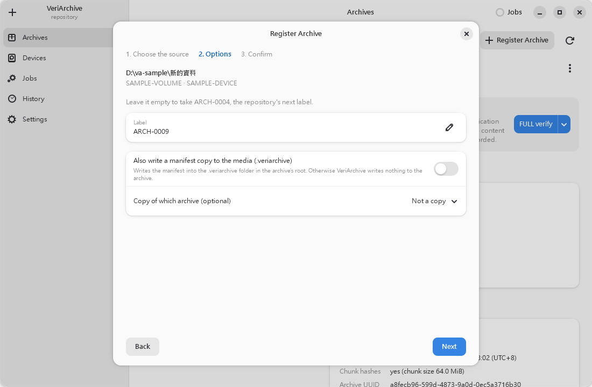
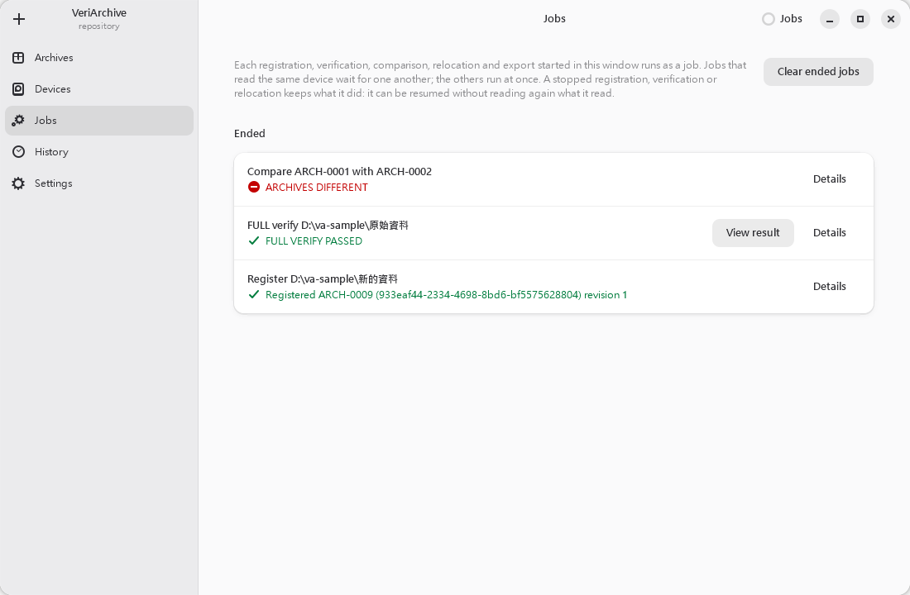
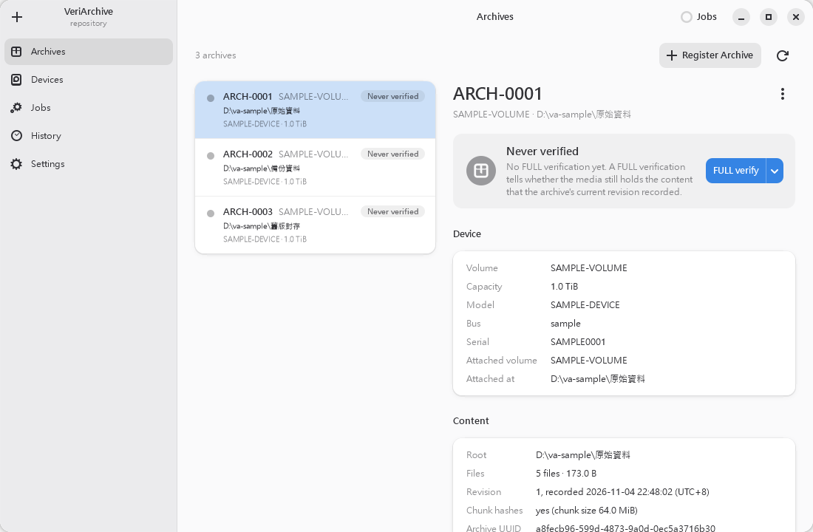
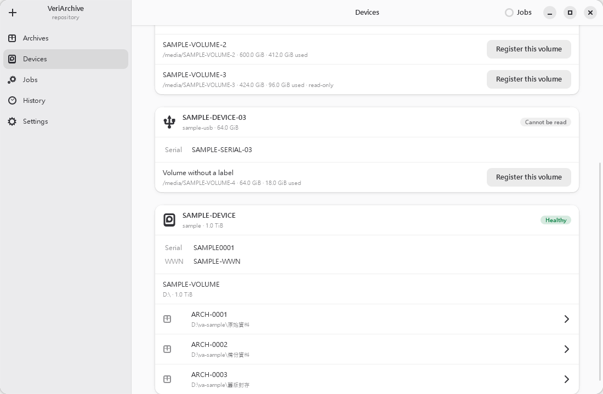
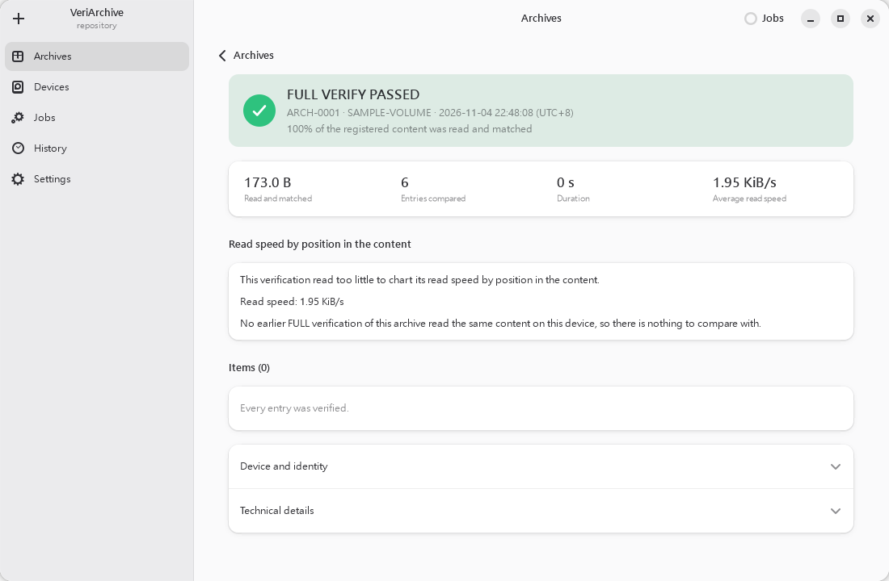
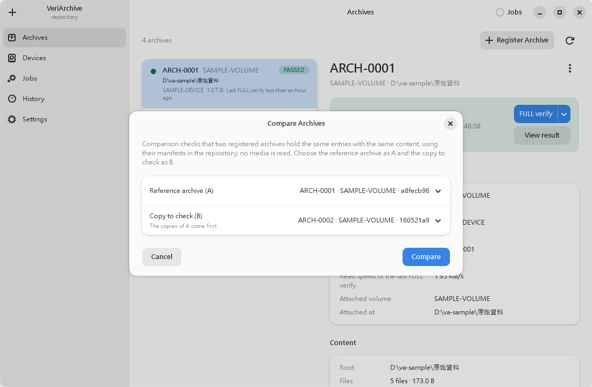

# VeriArchive user guide

VeriArchive records integrity evidence for archive disks and later proves whether the archived files were modified, corrupted, deleted, or added to. It only **detects**: it never repairs, restores, or makes backups.

The whole workflow is two steps:

1. **Register**: read every file of a folder or volume once and store its fingerprints (BLAKE3 and SHA-256) as the **baseline**.
2. **Verify**: later, re-read every registered byte from the disk, compare it with the baseline, and report what changed.

With pictures of the graphical interface (`veriarchive-gui.exe`) as it really looks, this guide takes you step by step through creating the repository, registering an archive, verifying it, reading its result and history, relocating it, and **confirming that a copy and the original are exactly the same**. Most sections explain the window first, then the command line (`veriarchive-cli.exe`).

All data in the screenshots is sample data. This guide is public, so its screenshots cannot show what a real device holds. The archives are folders of sample files on one volume, under `D:\va-sample`: `原始資料` (`ARCH-0001`, the original) and `備份資料` (`ARCH-0002`, its copy); `舊版封存` (`ARCH-0003`) stands for an archive that an earlier version registered, still without chunk hashes (see "Adding chunk hashes to an archive registered earlier"); and the picture of Register Archive registers a fourth sample folder, `新的資料`, as `ARCH-0009`. While the screenshots are made, VeriArchive replaces the identity of that volume and its device (volume label, device model, serial and capacity) with fixed sample values (`SAMPLE-VOLUME`, `SAMPLE-DEVICE`, `SAMPLE0001`, 1.0 TiB), lists a fixed set of sample devices and volumes (`SAMPLE-DEVICE-01`, `/media/SAMPLE-VOLUME-1`, ...) on the Devices page and in the dialogs in place of this computer's, and names the computer `SAMPLE-HOST`, so no real device ever shows. The times, durations and read speeds are those of the run that made the pictures. In real use you usually register a whole volume of a device, such as `H:\`, chosen among the attached volumes (see "Registering an archive"), and Archives shows its real volume label, model and capacity; everything else works as in the screenshots.

[繁體中文版](user-guide.zh-TW.md)

## Installing (Windows)

VeriArchive is a portable program that needs no installation:

1. Make a folder for the program, for example `D:\VeriArchive`, and unzip `VeriArchive-<version>-windows-x86_64.zip` into it; nothing else (such as MSYS2) is needed.
2. Run `bin\veriarchive-gui.exe` in that folder (`D:\VeriArchive\bin\veriarchive-gui.exe` in the example).

The zip holds no folder of its own: its `bin`, `lib` and `share` go straight into the folder it is unzipped into.

- `bin/veriarchive-gui.exe`: the graphical interface
- `bin/veriarchive-cli.exe`: the command line
- `lib/` and `share/`: image loaders, icons, settings and translations GTK needs; `share/doc/VeriArchive/`: this guide and a short README; `share/licenses/`: licenses of the libraries the program uses

To update the program, close VeriArchive, then unzip the new version's zip **into the same folder** (`D:\VeriArchive` in the example) and let it replace the files there. In Windows Explorer: right-click the zip, choose "Extract All...", type the program folder as the destination, and when asked, choose to replace the files in the destination. Explorer proposes a new folder named after the zip instead; a program unzipped there finds none of your records. The zip holds no `bin\data` and no `bin\config.json`, so the existing records are not overwritten. Do not delete the old folder first. To see which version runs, look at "Program version" under About at the end of the Settings page, or run `veriarchive-cli --version` or `veriarchive-cli repo info`.

### Moving the program folder

On first use, the repository (`data`) and the config file that remembers it (`config.json`) are created in the program's folder (`bin` in the zip), and the config file records the repository relative to that folder: `"repository": "data"`. Program, configuration and repository are therefore one folder. You can move or copy the whole unzipped folder, to another drive, to another computer, or onto a USB disk that gets another drive letter, and it keeps using its own repository. Backing up that folder also backs up the repository.

> **Back up the whole program folder regularly, especially `bin\data`.** Losing the repository loses the verification history with it.

- Copying the folder copies the repository; from then on each copy records its own verification history. Keep one of them as the folder you work with.
- A repository outside the program folder (`VeriArchive` in your home folder, or a place chosen with `--repository`) is remembered by its full path and does not move with the folder.
- A folder set up with an earlier version remembers the full path. To make it movable, open `bin\config.json` in a text editor and change the value of `"repository"` to `"data"`.

### After updating VeriArchive

A new version may need to upgrade the repository's database, which earlier versions then cannot open. The first time it opens the repository, it keeps a copy of the database as it is beside it, in the repository folder, named for the database's old schema version and the day, for example `veriarchive-schema-1-before-upgrade-2026-10-17.db`, and says where the copy is: the command line in its error output (`note: the repository database was upgraded from schema version 1 to 3, ...`), the GUI on the Settings page, which it then shows first. Afterwards Settings and `repo info` go on showing where each such copy is, and what it is for (`Copy of the database from before an upgrade: ... (an earlier version of VeriArchive can open only this copy; you can delete it once you no longer need that version)`; `repo info --json`: `database_copies_before_upgrade`), for as long as it is in the repository folder, also after the error when the repository cannot be opened, for example when a later version of VeriArchive has upgraded its database: then the copy is your way back. Copying a large database takes a while: meanwhile the GUI's window shows "Upgrading the repository database..." with a moving progress bar in place of its pages, also in a second start that waits for the first one's upgrade, and if the upgrade fails, it says why there. The verification history lives only in the database, so keep the copy until you are sure you will stay with the new version: an earlier version can open only the copy. If the copy cannot be made, for example because the disk is full, nothing is upgraded and the program stops with an error (exit code 11): make room and open the repository again.

## The window

The window has a sidebar on the left and, beside it, the page you choose there:

- **Archives**: your archives, the operations that have not finished, and the details of the archive you choose. Here you verify, compare, relocate, export and retire an archive.
- **Devices**: the devices attached to this computer now, the health each reports, their volumes and the archives on them.
- **Jobs**: the registrations, verifications, comparisons, relocations and exports started in this window.
- **History**: every recorded verification of every archive.
- **Settings**: the repository, the interface language, the verification policy and the program's version.

Above the sidebar, **+** opens Register Archive, as the Register Archive button in Archives does; beside it is the name of the repository's folder. At the top right of every page, the **Jobs** button shows how many jobs run or wait and how far they are; it opens a list of them. A short message at the foot of the window says when an operation started or ended, often with a button such as View result or Details. Questions come in a small dialog over the window, with Cancel as the default answer. In a narrow window the sidebar and the page show one at a time, and Archives shows either its list or an archive's details.

## Interface language


The interface is available in English and Traditional Chinese. The first setting found wins:

1. `--lang en` or `--lang zh-TW` on the command line
2. the `VERIARCHIVE_LANG` environment variable
3. `"language"` in the config file
4. the Windows display language
5. English

In the GUI, the Settings page has the row "Language / 語言" under Interface (English / 繁體中文). The choice is saved in the config file and the window is rebuilt in the new language at once; the page shown, the window size, the result pages that are open and the jobs with their reports are kept, and the reports are shown in the new language. It cannot be changed while a job waits or works: the row says so.

`--json` output, exit codes and the codes inside JSON (`PASSED`, `Modified`, ...) are **always English**, so scripts behave the same in every language.

## First use: create the repository


The **repository** holds every manifest (baseline) and the verification history.

The first time you open the program, it shows the Settings page with "No repository is open." and the button **Initialise repository**. Press it, and VeriArchive creates the repository in the program folder. Once it is created, the page shows, in groups:

| Group | Item | Meaning |
|---|---|---|
| Repository | RepositoryRoot | the folder the repository is in |
| | Selected by | how the repository in use was chosen, for example "pinned" |
| | repository_uuid | this repository's identifier |
| | Config file | the config file in use |
| | Copy of the database from before an upgrade | shown only when the repository's database was upgraded and the copy kept before the upgrade is still there: where the copy is and what it is for, namely that an earlier version of VeriArchive can open only this copy, and that you can delete it once you no longer need that version (see the upgrade described above). Once the copy is deleted, it is no longer shown |
| Interface | Language / 語言 | see "Interface language" |
| Verification policy | Overdue after | after how many days without a FULL verify, or without any verification, an archive is marked OVERDUE |
| | Strict metadata | when on, a different modification time or attributes also fail a verification |
| | Trusted signing keys | signed manifests are not part of this version |
| About | Program version | the version of VeriArchive that runs, with what it detects |

A warning, such as that the program runs elevated, shows in the Repository group. The reminder under that group is important:

> **Back up RepositoryRoot.** Losing it loses all verification history; manifests can be recovered only from media copies, if they were written.

CLI: `veriarchive-cli repo init`

By default the repository is created in `data` next to the program, or in `VeriArchive` in your home folder when the program folder is not writable. Its location is remembered in the config file and used from then on. To choose it yourself: `veriarchive-cli --repository D:\VeriArchiveRepo repo init`.

If a configured repository is unavailable later (for example an external disk is not attached), VeriArchive stops with an error that names the repository's folder and the config file that names it; it never falls back to another location.

## Registering an archive



Registration reads every file of a volume once and records their fingerprints (BLAKE3 and SHA-256) as the **baseline** for later verifications and comparisons. To register only part of a volume, you can register a single folder.

On the screen, "folder or volume" means these two. "Volume" is the program's word for a place such as `H:\`: a data device usually holds a single volume, so registering `H:\` registers the whole device; a device divided into several volumes is registered once per volume.

Press **+** above the sidebar, or **Register Archive** in Archives. The dialog Register Archive has three steps:

1. **Choose the source.** The attached volumes are listed, each with its label, where it is attached (`H:\`, or a GUID path for a volume that has no drive letter), its device, bus, capacity and the space in use. Choose a volume to register it as a whole. A volume that already holds the roots of archives cannot be registered as a whole, as the roots of archives on one volume may not contain each other: its button "Choose a folder in H:\..." chooses a folder in it. To register a folder, press "Choose a folder...", or type or paste its path, for example `H:\Photos`, also a volume's GUID path. Press **Next**: VeriArchive reads what is there, and a folder or volume that cannot be registered (see below) is refused on this page, saying why.
2. **Options.** Only the options that apply to the source chosen are shown (the table below): the label, and, where it applies, a new revision or a separate archive, the resume of an interrupted registration, the media copy, and which archive this is a copy of. The label is optional: `ARCH-` followed by four or more digits, for example `ARCH-0004`; left empty, the archive takes the repository's next label, which the page names, skipping the numbers that labels in the repository already have. Press **Next**.
3. **Confirm** says what the registration will read, the label, whether a media copy is written and what the archive is a copy of. Press **Start registration**.

The dialog closes and the registration runs as a job (see "Jobs"): a message at the foot of the window says that it started, with Details; Jobs and the Jobs button show it, with its share done, speed and time left (see "Reading the progress" below), and on a volume that holds no archive Devices shows "Being registered: <root>" in place of Register this volume; "Stop" stops it at any time. When it ends, the message says "Registered as ARCH-0009", with View archive, which shows the archive in Archives; its report is in the job's Details.

The screenshot shows the Options page for the sample folder `D:\va-sample\新的資料`, which no archive holds yet, with the label `ARCH-0009` typed in (the introduction says why it is a folder).

| Option | When to use it |
|---|---|
| Create a new revision | Shown where an archive is registered at this folder or volume already. You changed its content on purpose: make a new baseline. In Archives, "Create a new revision..." in the menu of the archive's details opens Register Archive with this chosen |
| Register as a separate archive even though this folder or volume is registered | Shown where an archive is registered there already, and you want another archive of it, as for a sector-by-sector clone of a device (see "Comparing an archive with its copy") |
| Resume the interrupted registration | Shown where a registration of this folder or volume was stopped halfway; it is then the only way on: it continues where it stopped, without reading again the files already hashed ("Resume" on its row under Unfinished operations in Archives does the same). If the program that ran it still runs on this computer, it stops and says which one. A registration that an older version of VeriArchive left cannot be checked so: VeriArchive first asks the same question as Archives, saying what happens if that version still runs it; make sure that the older version's window or command has been closed, then press "Resume" in the question (see "Archives and OVERDUE" below). A registration that can never be finished can be given up with "Abandon..." under Unfinished operations in Archives |
| Also write a manifest copy to the media (.veriarchive) | Off by default. Leaves one more copy of the manifest on the registered volume (the `.veriarchive` folder). **Off, registration writes nothing at all to the archive** |
| Copy of which archive (optional) | This folder or volume is a copy of another archive: records it, for display only (see "Comparing an archive with its copy"). "Not a copy" by default |

On the Devices page, "Register this volume" opens Register Archive with that volume chosen.

Keep in mind:

- **Do not modify the folder or volume while it is being registered**; otherwise the baseline records content that is changing.
- An HDD reads about 150 to 250 MB per second. Registering a volume of several TB can take more than ten hours.
- Several registrations can run at once: each is a job, and jobs that read the same device wait for one another (see "Jobs").

CLI:

```text
veriarchive-cli register K:\ --label ARCH-0012
```

Options:

| Option | Purpose |
|---|---|
| `--write-media-copy` | Also write the manifest onto the disk (`.veriarchive` folder) as a media copy. By default nothing is written to the archive. |
| `--new-revision` | The folder or volume is already registered and its content changed on purpose: create a new revision (a new baseline). |
| `--force-new-archive` | The folder or volume is already registered, but register it as a separate archive. |
| `--resume` | Continue an interrupted registration without re-reading hashed files. While the program that ran it still runs on this computer, it stops and says which one. A registration that an older version of VeriArchive left cannot be checked so: the command says what happens if that version still runs it and stops (exit code 12) without changing anything; make sure that no window or command of that version still runs it, then add `--confirm` (see "Archives and OVERDUE" below). Scripts that resume registrations of this version are not affected. |
| `--io hdd` or `--io ssd` | Reading strategy: `hdd` reads sequentially, `ssd` in parallel. Usually detected automatically. A device whose type is reported wrongly, as by some USB enclosures, can be set once in the config file by its serial, which `veriarchive-cli media list` shows, and that applies on the command line and in the window alike: `"io": {"rotational_override": {"<serial>": "hdd"}}` (or `"ssd"`). `--io` wins over it. |
| `--lost-manifest <uuid>` | The last resort for an archive whose latest manifest is lost: register its next revision from what the folder or volume holds now (see "Archives and OVERDUE" below). It first only says what it would do; add `--confirm` to do it. |

Registering an already registered folder or volume again stops with exit code 12 and asks you to choose `--new-revision` or `--force-new-archive`.

A drive letter made with `subst` (such as `S:` for the folder `D:\Data`) is not a volume. A folder reached through one is registered by its real path: registering `S:\Photos` records `D:\Data\Photos` on the volume that holds it, and the reports show that path. It can be verified through the letter or by its real path.

VeriArchive registers and verifies folders on volumes attached to this computer. A folder on a network share is refused: a network path (`\\server\share\Photos`), a folder on a drive letter mapped to a share, and on Linux a folder on a network filesystem (NFS, SMB, sshfs) or on a share that GNOME or KDE opened (choosing such a share in their file dialogs, "Choose..." included, gives a folder below `/run/user/<uid>/gvfs` or `/run/user/<uid>/kio-fuse-...`). A phone or camera that GNOME shows there is refused as well. On Windows, a root written with `\\?\` in front (`\\?\D:\Photos`) is refused too: write it as `D:\Photos`. A volume that has no drive letter is the exception: Windows names it only by its GUID path, which `mountvol` lists, such as `\\?\Volume{...}\`. Type that path exactly as `mountvol` lists it, for the whole volume (`\\?\Volume{...}\`) or a folder on it (`\\?\Volume{...}\Photos`): it is registered, verified and relocated to like any other root, and is the same archive as through a drive letter the volume gets later. `verify --full <uuid>`, or FULL verify in the archive's details, finds an archive on such a volume too. For each refused root, `register`, `verify --full <root>` and `archive relocate` stop with exit code 10 before anything is read.

A folder or volume that holds VeriArchive's repository (by default `bin\data` in the program folder), or a folder inside the repository, is refused as well (exit code 10): the repository changes while the folder is read, so its verifications could never pass. Keep the program folder, with its repository, outside the folders and volumes you register.

Files that cannot be read at registration (permission, media errors) are recorded without hashes and are never reported as verified.

### Reading the progress

While files are hashed (registering, verifying, relocating), the job's bar in the window (on Jobs, in the Jobs button's list, and on the job's card in an archive's details) and the CLI show one line, for example:

```text
hashing: 2.16 TiB of 9.44 TiB (23%) · 240 MiB/s · about 8-9 hours left
```

The CLI writes it to stderr, and not at all with `--json`.

On the command line, Ctrl+C or Ctrl+Break stops a registration, verification or relocation safely, and closing its window, signing out or shutting down the computer does the same: what it has done is kept, and it can be resumed (see the unfinished operations under "Archives and OVERDUE"). After Ctrl+C its message gives the command that continues it, with the folder or volume written as you can type it.

- **The share done is exact**: it counts bytes, so a folder of large videos and a folder of small photos move it alike. It shows 100% only once the last file is done. Scanning comes first and shows only the entries found, as the total is not known yet.
- **The speed** is the average of the last three minutes.
- **The time left is an estimate**, shown as a range. The low end of the range picks the unit: minutes while it is under an hour, hours while it is under two days, then days ("about 55-175 minutes left", "about 47-96 hours left"). It counts each file's fixed cost (opening it; on an HDD, moving the head) as well as its bytes, so a stretch of small files does not make it jump. It reads "estimating time left" during the first minute and after minutes without progress, and the range widens when the speed varies or keeps dropping (an HDD reads its inner tracks more slowly). A pause, such as the computer sleeping, does not count as slow reading. Once every file is hashed, the line shows no time left while the results are written.

### While an operation runs

While the window runs an operation (a registration, verification, comparison, relocation or export, abandoning an unfinished operation, retiring an archive, or upgrading the repository database), the computer does not go to sleep on its own: VeriArchive asks the system to stay awake until the operation ends. The system lists the request as "A long operation is running" (on Windows `powercfg /requests`, run as administrator; on Linux `systemd-inhibit --list`). The display may still turn off and the screen may lock; neither stops the operation. A sleep you ask for still happens: choosing Sleep, pressing the power button, or closing a laptop's lid. On Linux this needs logind (systemd); without it the computer sleeps as its settings say.

When an operation of the window ends while another window is in front, VeriArchive says so in a notification of the system with the first lines of its report, for example "FULL VERIFY PASSED" and the archive's label and revision. While the VeriArchive window is in front there is no notification: the report is in front of you.

The command line does neither. It often runs in scripts, in scheduled tasks and on servers, whose power settings decide. On a computer that sleeps when idle, set its power settings not to sleep (sleep after: Never) before a long command; on Linux, run the command under `systemd-inhibit`, for example `systemd-inhibit veriarchive-cli verify --full /media/archive`.

### Device alerts

VeriArchive watches for signs that a device may be failing. Such a sign, a **device alert**, is shown in red and led by ⚠, beside the result, which it never changes: a FULL VERIFY PASSED stays PASSED, with the same exit code.

- **The device's own health.** When a registration, a verification or a relocation starts, VeriArchive asks each device of the volume what it reports of its own health, without administrator rights: on Windows, the health that Windows keeps of the disk (what `Get-PhysicalDisk` shows); on Linux, what udisks2 read of its SMART data. A device that reports a warning or a failure, such as "predicting failure" or "bad sectors", gives a device alert at once: in the window on the job's card and its row in Jobs, above the progress, on the command line before the progress. The operation goes on; stop it if you would rather copy the archives off that device first. Many USB enclosures pass no health on: the report then says "cannot be read", which is no alert. The Devices page and `veriarchive-cli media list` show each device's health at any time.
- **Reading slower.** A FULL verification times how fast it reads each hundredth of the archive's content, and compares that with the last FULL verification of the same archive on the same device whose speed was usual. The whole read 30% slower or more, or a part of the content 50% slower or more, is a device alert, which says where ("from 0% to 12% of the content, 55% slower"). Another program reading the same device, or another device read through the same port or hub at the same time, also makes reading slower: to tell, verify the device again with nothing else reading. Every FULL verification's report gives its read speed ("Read speed: 182 MiB/s; the last FULL verification of this archive on this device, which finished 2026-11-01 14:03:00 (UTC+8), read 180 MiB/s"). A verification is compared only with one of the same content on the same device: the first FULL verification with this version of VeriArchive, after moving the disk to another enclosure, after a relocation, or after a new revision with other content, is compared with nothing.

Archives then marks the archive's row with "⚠ device reports a problem" or "⚠ reading slower", and its details and the run's result page show the alert, until a later verification gives none; History marks the run in its row. What to do: copy the archives on that device to another device soon, and verify the copies.

### Jobs



Every registration, verification, comparison, relocation and export started in the window runs as a **job** in the background, so you can start the next one at once: register a second device while the first is verified, or compare two archives meanwhile.

- **Jobs that read the same device wait for one another**, in the order you started them, and say which one they wait for ("Waiting: Register H:\ reads the same device"). A device read in two places at once reads both slower than one after the other. Jobs of different devices run at once; a comparison and an export read no archive and never wait.
- The **Jobs** page lists every job of the window in three groups, Running, Waiting and Ended, newest first: what it does, how far it is (share done, speed, time left), its device alert if any, and **Stop**. **Details** opens a dialog with the same and, once the job has ended, its report; an ended verification has **View result** too, which opens its result page. **Clear ended jobs** removes the ended ones from the page.
- The **Jobs** button at the top right of every page shows how many jobs run or wait, and opens a list of them and of the last three that ended, with "See all jobs".
- A verification or a relocation of an archive also shows as a card in the archive's details in Archives, with its progress, Stop and Details.
- **Stop** asks nothing: the job ends, and what it did is kept. A stopped registration, verification or relocation can be resumed later with "Resume" on its row under Unfinished operations in Archives (a stopped verification or relocation also in the archive's details), without reading again what it read.
- **Closing the window while jobs run asks first.** "Stop them and close" stops every job, each resumable; "Keep the window open" lets them go on.
- While a job works on an unfinished operation, that operation cannot be abandoned or resumed from Archives: stop the job first.
- For two devices at once, connect them to different ports, or to different USB controllers: two devices behind one USB hub share its speed.

The screenshot shows the jobs that were run to make the screenshots, ended: the registration of the sample folder `新的資料`, the FULL verification of `原始資料` and the comparison of the two sample archives.

## Archives and OVERDUE



The Archives page, or `veriarchive-cli archive list`, shows for each archive:

- **Last FULL verify**: result and date of the last complete read
- **Last verify**: result and date of the last verification of any mode
- **OVERDUE**: no FULL verify for 365 days or no verification for 180 days (adjust under `policy` in the config file)

Archives lists the archives, and beside the list shows the details of the archive you choose. Each row of the list is an archive:

| In the row | Meaning |
|---|---|
| The dot | the state in its colour: a failure, a device alert or a manifest that cannot be used; warnings or OVERDUE; never verified; or passed |
| Label, volume label | the archive's label, and the volume label that its current revision records |
| The line below | where the archive is attached now: its folder or volume (in the screenshot `D:\va-sample\原始資料`), "Not attached", or "The device differs from the one recorded" (see "Devices") |
| Model · capacity · Last FULL verify ... ago | the device model and capacity that the archive's current revision records, those of the carrier it was read from (after a relocation, the new carrier), and how long ago the last FULL verify ended |
| The result | the result of the last FULL verify, PASSED, PASSED_WITH_WARNINGS or FAILED, or "Never verified"; beside it OVERDUE, "⚠ device reports a problem", "⚠ reading slower", RETIRED and REGISTRATION_INCOMPLETE (its first registration has not finished), where they hold |

The details of the archive show:

- its label, volume and root, and the menu **⋯**: Compare with another archive..., Create a new revision..., Copy archive UUID, Export manifest..., Relocate to a new carrier... and Retire archive... (see the sections below); each item says under it what it does, or why it does not apply to this archive;
- a banner with the result of the last FULL verify with its mode, for example "FULL VERIFY PASSED", when it ended and how long ago, the last verification of another mode where that is later, and OVERDUE with the limit that was passed; beside it **FULL verify** and **View result** (see "Verifying an archive");
- the device alerts of its last verification, the card of a verification or relocation of it while one waits or works, and a notice with **Resume** where a verification or relocation of it stopped;
- **Device**: the volume, capacity, model, bus and serial that its current revision records, the health and the read speed of its last verification, and where it is attached now ("Attached volume", "Attached at");
- **Content**: its root, files and size, its revision and when that was recorded, whether it has chunk hashes, and its archive UUID;
- **Copies**: the archive it is a copy of and those recorded as its copies, each with Compare...;
- **Recent verifications**, each leading to its result page, and a link to all of them in History.

A result always comes with its mode and its time, because it shows the state only **at that time**. The screenshot shows the sample archive `ARCH-0001` chosen, never verified yet.

An archive whose manifest in the repository cannot be used (missing, unreadable or changed) is listed too, with a line that says what is wrong and how to fix it (in Archives, in red under its row), and `archive list` then exits with code 2 (not for a retired archive whose manifest is lost, see below). Verifying that archive (by its uuid, or with FULL verify in its details) records the failure in its history. A manifest that is missing, unreadable or changed is put back with `veriarchive-cli import <folder>/r0002.vam` (the file of that revision), from a backup of the repository, from an export of that revision, or from its media copy (in the `.veriarchive` folder on the archive's media, where registration wrote one): the import checks that the file is the one the repository recorded, and puts it back.

If none of these holds the manifest of the archive's latest revision, the manifest is lost. Where its first line cannot be used (the manifest is missing, its first line cannot be read, or its first line has changed), registering a new folder or volume and relocating stop on it until it is back, or until the archive is retired (below), as finding which archive a folder or volume holds reads the first line of every archive's latest manifest; a new revision of another archive's folder (`register --new-revision`, or Create a new revision in Register Archive) is still registered where the folder is plainly that archive's, on the volume and the device its manifest records. A manifest changed only in its body stops neither, though verifying its archive fails on it. The last resort is to register the archive's next revision from what its folder or volume holds now: `veriarchive-cli register <root> --lost-manifest <uuid>`. Without `--confirm` it only says what it would do (exit code 12); run it again with `--confirm` to do it. What the folder or volume holds then becomes the new baseline without being compared with the lost revision, so damage since that revision was recorded would not be found. The archive keeps its verification history and never goes back to an earlier revision. Where the lost manifest's first line cannot be used, the lost revision leaves its list of revisions; a manifest changed only in its body stays listed, as an earlier revision. It refuses a manifest that is not lost (one that can be used, or one where only the index differs: rebuild the index), a root that belongs to another archive (a folder containing another archive's folder or inside it, on the volume and the device that archive's manifest records), and a root whose `.veriarchive` folder still holds the lost manifest as a media copy (import that file instead). It takes another archive's very folder, on the volume and the device that archive's manifest records, or on a volume that may be that archive's or a sector-by-sector clone of it (the same filesystem on another device, or no device serial to compare), but names that archive before you confirm: VeriArchive cannot tell whether that folder was registered on purpose as both archives (`--force-new-archive`), so confirm only where it was, or, on a volume that may be a clone, where the volume is not that archive's. Where the folder contains another archive's folder or lies in it, on a volume that may be a sector-by-sector clone of that archive's volume, or that volume itself, it names that archive as possibly a clone before you confirm: confirm only where the folder is not that archive's. Archives names this command in the problem line; it runs on the command line only.

If the device that held the archive is gone as well (broken, lost or wiped), no folder or volume is left to register its next revision from. Retire the archive then: "Retire archive..." in its details (see "Relocating and retiring an archive"), or `veriarchive-cli archive retire <uuid>`; the problem line names the command too, after the last resort, as `archive retire <uuid> --confirm`. Where its lost manifest stops registering and relocating (above), the window says what retiring means and asks you to confirm that the manifest is lost for good and the device is gone, and the command first only says it (exit code 12); run it again with `--confirm` to do it. The archive keeps its verification history and its hash chain, but can no longer be verified or take a new revision, and it no longer stops registering a new folder or volume or relocating: retired, it is no longer taken as a possible owner of a folder or volume, as VeriArchive cannot tell from its lost manifest where it is. Should its device turn up again, nothing recognises it, and registering it makes a new archive. An archive whose manifest changed only in its body stops nothing: it is retired at once, as any archive, and is still recognised when its media is attached. `archive list`, `archive show` and Archives show the archive as retired, with a line "manifest lost: ..." in place of the problem (in Archives, not in red: it needs nothing more of you), and `archive list` no longer exits with code 2 for it. While a registration, a relocation or a verification that adds chunk hashes of the archive is unfinished, retiring it is refused, for every archive: finish or abandon that operation first. An archive retired earlier whose manifest is lost later is treated the same way, and a retired archive takes no registration over its lost manifest. Should the manifest turn up after all, `import` puts it back, and the archive is recognised again as a retired archive.

The manifest of an earlier revision can be lost too: `archive show` marks that revision, and registering a new folder or volume, or verifying a folder, may stop on it where VeriArchive looks among the archive's previous carriers. Put it back with `import` as above; if nothing holds it, `veriarchive-cli repo rebuild-index` leaves that revision out of the index, after which a volume that held only that revision is no longer recognised as a previous carrier of the archive. Its verifications stay in the history.

Above the list of archives, "Unfinished operations" appears while there are any: the registrations, verifications and relocations that have not finished (also those started from the command line; a retired archive can still be verified, and its verifications are listed too, except for a retired archive whose manifest is lost: its interrupted verifications can never be resumed, so they are not listed), each with its label, root, operation, progress and state. Pointing at the label shows the archive's UUID, and pointing at the state shows the run's id. Where the state is "stopped; it can be resumed", the operation can continue from where it stopped, without reading again the files already read:

- Press **Resume** on the row: for a verification, a registration and a relocation alike. This works wherever the operation was started, in this window, in another window or on the command line, and whether or not the program was closed after the interruption (for example by a restart). The operation runs as a job, shown in Jobs (a verification or relocation also on its card in the archive's details); "Stop" stops it if needed. The archive's details show a stopped verification or relocation of it too, with **Resume**. A verification finds the archive on the attached volumes by its UUID, so a volume that got another drive letter is no problem; but if more than one attached volume holds the archive (for example a device and a sector-by-sector clone of it), it cannot tell which one the run read, so it stops and names their roots: detach the other volumes and press "Resume" again, or continue at the root that the run read with `veriarchive-cli verify --full <root> --resume <RUN_ID>` on the command line. A registration reads its own folder or volume again, and a relocation its new root, the path the row shows; where the new carrier is attached at another drive letter or mount point now, "Relocate to a new carrier..." in the archive's details resumes the relocation at the root you give (see "Relocating and retiring an archive"). "Resume" is exactly the command-line resume (`verify --full <uuid> --resume <RUN_ID>`, `register <root> --resume` or `archive relocate <uuid> <root> --resume`) and takes no option: it writes no media copy, and uses strict metadata only where Settings shows "On" in the row "Strict metadata" (`strict_metadata` set under `policy` in the config file). To write a media copy when you resume a registration, choose that folder or volume in Register Archive: its options then offer "Resume the interrupted registration" beside the media copy.

A stopped registration that can never be finished, for example because its media failed, can be given up there with "Abandon..." (CLI: `veriarchive-cli archive abandon-registration <uuid> --confirm`): its saved progress is lost and it can never be resumed, while recorded revisions and history stay. A stopped relocation can be given up there the same way, for example when its new carrier failed (CLI: `veriarchive-cli archive abandon-relocation <uuid> --confirm`): its saved progress is lost and it can never be resumed, while the archive, its revisions and history stay. So can a stopped verification that adds chunk hashes (see "Adding chunk hashes to an archive registered earlier" below). Some states ask you to abandon the operation, such as "new carrier differs; abandon it": the relocation found that what the new carrier holds differs from the archive, so it can never finish; abandon it, copy again, then relocate again. A registration or relocation of an archive that was retired since reads "archive is retired; abandon it": a retired archive takes no new revision, so it can only be abandoned.

Operations that still run, or may still run, have no "Resume", except a registration that an older version of VeriArchive left: that version never records when it last worked, so once it has made no progress for 3 minutes its row reads "no progress seen for N minutes; it may have stopped", and then has "Resume" and "Abandon..." as well. VeriArchive cannot tell whether that older version still runs it: the older version also makes no progress for minutes while it reads a large file or scans the folder or volume. So before you press either, make sure that no window or command of the older version still runs that registration. If one does, and it finishes after "Resume" has recorded the revision, it replaces the manifest that the resume recorded with its own: from then on every verification of the archive fails on that manifest, registering a new folder or volume and relocating stop on it until the archive gets a new revision, and unless a backup of the repository holds the manifest that the resume recorded, it is lost (see above). That is why "Resume" on such a row asks first, "Resume the unfinished registration of ...?": it says all this and asks you to make sure that the older version's window or command has been closed, and resumes only if you press "Resume" there; "Cancel" changes nothing. Register Archive asks the same when its options resume such a registration, and so does `register <root> --resume` on the command line, which says it and stops until you run it again with `--confirm`. A stopped registration's "Resume" does not ask: the registration has said that it stopped, or it has recorded when it last worked or which program runs it, and its version cannot record its own manifest over the one that the resume records. "Abandon..." does not stop the older version either: it may still record the revision. While a job of the window works on the operation, "Resume" and "Abandon..." ask you to stop that job first, or to wait for it to end.

`archive list` and `archive show` print an archive's unfinished registration, its unfinished relocation and its unfinished verification that adds chunk hashes as one more line each under the archive: the revision, the folder or volume it reads, what it has done so far and its state, in the words of Archives (for example "stopped; it can be resumed" or "new carrier differs; abandon it"). As in Archives, the unfinished verification of a retired archive whose manifest is lost is left out.

Times are shown in this computer's local time with the offset from UTC, for example `2026-10-14 08:13:53 (UTC+8)`. `--json` output and the history database always use UTC, for example `2026-10-14T00:13:53Z`.

More archive commands:

```text
veriarchive-cli archive show <uuid>               # details and every revision
veriarchive-cli archive retire <uuid>             # no longer expected to be verified; history is kept
                                                  # (--confirm where its manifest is lost, see above)
veriarchive-cli archive relocate <uuid> <root>    # after copying an archive to a new carrier: read it in full and accept it
veriarchive-cli archive compare <uuid> <uuid>     # do two archives hold the same content? (see below)
```

Relocating and retiring in the window, and how a relocation is resumed or abandoned: see "Relocating and retiring an archive" below.

`archive show`, `retire`, `relocate`, `compare`, `history`, `export`, `export-sha256sums`, `verify --full` and `register --copy-of` accept the first 8 or more characters of a uuid, as long as no other archive starts with them.

## Devices



The Devices page lists the devices attached to this computer now: each with its model, bus, capacity, serial (or WWN) and the health it reports (see "Device alerts"); the volumes on it, with their label, where they are attached, capacity and space in use; and the archives whose roots lie on each volume, each leading to the archive in Archives. A volume that holds no archive has "Register this volume", which opens Register Archive with that volume chosen. The page reads all this again every 30 seconds while it or Archives is shown, and at once with Refresh; reading needs no administrator rights, and nothing is written to the devices.

From the same read, Archives tells where each archive is attached:

- its folder or volume, where the volume and its device are those that its current revision records (MATCH), or the device has no serial to compare (MATCH_WEAK);
- "Not attached", where no attached volume holds it; its details say that it can be verified once it is attached;
- "The device differs from the one recorded", where the archive's filesystem is attached on another device (MIGRATED): the archive's device in another enclosure, or a sector-by-sector clone of it. FULL verify does not read it there. If it is the archive's device in another enclosure, or you moved the archive to that device on purpose, relocate the archive to it with "Relocate to this carrier..." in its details (see "Relocating and retiring an archive"); a clone is registered as an archive of its own in Register Archive;
- "Several volumes look like this archive", as a device and a clone of it would: verify the one you mean with "Verify a folder or volume..." (see "Verifying an archive").

Attached is what this computer sees now, not part of an archive's identity: nothing of it is recorded, and an archive that is not attached keeps its identity and history.

The screenshot shows the end of the page: the last of the fixed sample devices and volumes that the screenshots list (`SAMPLE-DEVICE-03`, with the volumes `/media/SAMPLE-VOLUME-*`), and below them the volume of the sample folders, shown with the sample identity, holding the three sample archives.

## Verifying an archive


A FULL verification reads every registered byte from the device again and compares it with the baseline.

In Archives, choose the archive and press **FULL verify** in its details. VeriArchive finds the archive on the attached volumes by its UUID, so a volume that got another drive letter is no problem, and the verification runs as a job: its card in the details shows its progress, with Stop and Details. When it ends, a message at the foot of the window says its result, with View result, and the details' banner shows it.

The arrow beside FULL verify opens other ways to verify:

| Menu item | What it does |
|---|---|
| FULL verify, and add chunk hashes | Only for an archive that has no chunk hashes: see "Adding chunk hashes to an archive registered earlier" below |
| FULL verify with strict metadata | A FULL verify in which a different modification time or attributes fail the run, whatever Settings says |
| Verify a folder or volume... | Verifies the archive at the folder or volume you choose, typed, pasted or chosen, with strict metadata if you turn it on. Use it where more than one attached volume holds the archive, as a device and a sector-by-sector clone of it do: FULL verify then does not choose one, but stops and names their folders. Or detach the other volumes and verify it again |

While a job of the archive waits or works, FULL verify is not offered for it: a second verification would read its whole device once more. Where Archives shows the archive as not attached, FULL verify still looks for it, as that may have been read up to 30 seconds ago.

The screenshot shows Archives after a FULL verification of the sample archive `ARCH-0001` (its message at the foot of the window), with the details of the sample archive `ARCH-0003` and the menu beside FULL verify open: as that archive has no chunk hashes, the menu offers to add them.

CLI, by path or by archive uuid:

```text
veriarchive-cli verify --full K:\
veriarchive-cli verify --full 46d4c696-4999-4c7d-80eb-b626da614e77
```

With a uuid, or its first 8 or more characters, VeriArchive finds the archive on the attached disks. If more than one attached volume holds it, as a device and a sector-by-sector clone of it do, it does not choose one: it stops (exit code 12) and names their folders. Verify one of them by its folder, or detach the other volumes and verify it again. A folder or volume that is not there, and that is no archive's uuid either, is reported as not found (exit code 10); where no volume is attached as its drive letter, the message asks you to check that the device that holds it is attached. A uuid that names no registered archive, and an archive whose disk is not attached, are reported as not found as well (exit code 10); where the archive's disk is attached but its folder is not there (moved or renamed), the message names that folder. An empty folder that is no registered archive, such as a folder on Linux where a disk is mounted when it is attached, is reported the same way (exit code 10): the message asks you to check that the device is attached.

### Reading the result



**View result**, in an archive's details, on a row of Recent verifications or History, on an ended verification in Jobs, or in the message that a verification ended, opens the run's **result page**:

- **The banner**: the result with its mode, for example "FULL VERIFY PASSED", the archive, and when the run ended; a PASSED run adds "100% of the registered content was read and matched".
- The run's device alerts, in red.
- For a FAILED or PASSED_WITH_WARNINGS run, its items come first: every entry with a problem, with its status and detail.
- **The figures**: read and matched, entries compared, duration and average read speed.
- **Read speed by position in the content**: a chart of how fast each hundredth of the content was read, beside the FULL verification it was compared with (dashed), where the run timed at least one second of reading; below it, the read speed and how it compares. A run that read less says "This verification read too little to chart its read speed by position in the content", as in the screenshot, whose sample archive is read in a moment; a run of a version of VeriArchive that did not record its read speed says so.
- **Items**: the entries that were not verified as recorded, 200 at a time ("Show N more items").
- **Device and identity** and **Technical details**, opened with their arrow: the media identity and each device's health; the run's id, mode and revision, the run it resumed, when it started and finished, the computer and program version that ran it, and what VeriArchive detects.

An INCOMPLETE run says how far it came, and has **Resume** where it can still be resumed. The back button at the top left, named for the page it came from, returns to Archives or History. While the verification's job is listed in Jobs, its Details hold the run's whole report, read as the command line's below.

The command line's report:

```text
FULL VERIFY FAILED  ARCH-0001 (46d4c696-...) revision 1
  root: K:\
  identity: MATCH
  coverage: 7 of 13 registered bytes read and matched
  items:  Modified 1  New 1  Verified 1
  New  new.txt
  Modified  readme.txt  (content differs)
```

How to read the report:

- **The first line** is the result, for example "FULL VERIFY PASSED".
- **Identity**: whether VeriArchive recognised the disk, for example "MATCH".
- **Coverage**: how many bytes were read and matched.
- **Items**: how many items have each status; every entry with a problem is listed below.
- **Note** (Linux only): "driver: ntfs-3g" when the volume was read through ntfs-3g rather than the kernel's ntfs3 driver; it changes nothing in the result.

A result always carries its mode and date: only FULL VERIFY PASSED means 100% of the registered content was read and matched.

| Result | Meaning | Exit code |
|---|---|---|
| PASSED | every registered byte was read and matched | 0 |
| PASSED_WITH_WARNINGS | content matched, but something needs attention (no hardware serial to compare, an unreadable filesystem id, metadata differences, names in one folder that differ only in upper and lower case or in Unicode normalisation, which a volume or system that does not tell them apart cannot keep all, or a hash recorded for a file that cannot be relied on: the file is fine, and a new revision fixes the hash) | 2 |
| FAILED | files were modified, missing or unreadable, or the media identity is wrong, or the archive's manifest in the repository cannot be used (missing, unreadable or changed: then the media is not read at all, and the result says how to fix the manifest) | 3 |
| INCOMPLETE | the verification was interrupted (cancelled, or the device went away or stopped answering); it can be resumed | 4 |

Item statuses:

| Status | Meaning |
|---|---|
| Verified | content matches the baseline |
| Modified | content differs from the baseline |
| Missing | in the baseline, not found now |
| New | a file the baseline does not have |
| Unreadable | could not be read (permission, media error, ...) |
| MetadataMismatch | same content, different modification time (a warning by default); with strict metadata ("Strict metadata" turned on, "FULL verify with strict metadata" in the menu, or `--strict-metadata`), the permission mode and attributes are compared too, and a difference fails the run |
| TypeChanged | for example a file became a folder, or a folder became a file or a link; what such a folder holds is listed beside it, as New where the folder is new, as Missing where it went |
| Unbaselined | unreadable at registration, so there is no hash to compare. When everything else matched and the archive is not retired, the report suggests registering a new revision, which takes a baseline for it (`register <root> --new-revision`, or "Create a new revision..." in the menu of the archive's details) |
| Unrepresentable | the name cannot exist on this operating system, and the revision verified was recorded on another one (for example a name with `?`, registered on Linux and verified on Windows): a warning. Verified on the system that recorded the revision, such an entry that is gone is Missing |
| SkippedMountPoint | another volume is mounted at this folder: it is not part of the archive and is not read. Where the archive recorded nothing there (the volume was mounted there at registration already), it changes no result; where it covers recorded files or folders, those are listed with this status and the run fails |

### Resuming an interrupted run

An interrupted verification ends INCOMPLETE and can be continued; files already verified are not read again:

- GUI: press **Resume** in the archive's details, where its stopped verification shows, on the verification's row under Unfinished operations in Archives (see "Archives and OVERDUE"), or on the INCOMPLETE run's result page. This works also after the window that ran it was closed.
- CLI: `veriarchive-cli verify --full <archive_uuid> --resume <RUN_ID>`, for any interrupted verification, also one started in the GUI. Under Unfinished operations in Archives, pointing at the label of its row shows the archive's uuid, and pointing at its state shows the run's id.

If more than one attached volume holds the archive, as a device and a sector-by-sector clone of it do, a resume by the archive's uuid cannot tell which one the run read: it stops (exit code 12) and names them, with the root the run read. Resume it at the root on the volume it read with `veriarchive-cli verify --full <root> --resume <RUN_ID>`, or detach the other volumes and resume it again.

A device that is unplugged or switched off during a verification ends it INCOMPLETE, not FAILED: before VeriArchive reports a file as unreadable, it checks that the volume is still attached, so a device that went away is not taken for damage, and the result says what happened. A device that stops answering while the computer still lists it (a USB enclosure that hangs) fails every read with an input/output error, as damage does: when 10 entries (files or folders) in a row cannot be read because of such errors, with no entry read between them, the verification ends INCOMPLETE as well, lists none of them, and says that the device stopped answering; fewer in a row are reported unreadable, as damage. Attach the device again (unplug it first if it is still connected) and resume the run as above; what was verified is not read again. If it stops again at the same place, the device may be damaged: damage that spans 10 entries in a row stops the run in the same way instead of failing it. A registration and a relocation stop the same way and are resumed the same way: with "Resume" under Unfinished operations in Archives, or with `register <root> --resume` and `archive relocate <uuid> <root> --resume`.

### Adding chunk hashes to an archive registered earlier

Registering records, besides the BLAKE3 and SHA-256 of each whole file, the hash of each 64 MiB chunk of every larger file, so that a FULL verify can say where a large file differs ("content differs: chunk 1 of 3 differs, from byte 67,108,864"). An archive that an earlier version of VeriArchive registered has no chunk hashes. They are added to it once, by a FULL verify that adds them:

- GUI: in Archives, choose the archive, open the menu beside **FULL verify** in its details, and choose **FULL verify, and add chunk hashes**. The menu has it only for an archive without chunk hashes, and it can be chosen only where they can be added (not for a retired archive); otherwise the line under it says why. To add them with strict metadata, turn strict metadata on in the policy (`strict_metadata` under `policy` in the config file), which every verification then uses.
- CLI: `veriarchive-cli verify --full <archive_uuid> --add-chunk-hashes`, or the folder or volume in place of the uuid.

The screenshot at the start of "Verifying an archive" shows this item offered for the sample archive `ARCH-0003`, not chosen yet. That sample archive was registered the way earlier versions registered archives, without chunk hashes; an archive you registered with an earlier version shows the same.

It is a FULL verify in every respect: it reads the whole archive once, taking as long as any FULL verify, and its result is the verification's. The chunk hashes come from that same read. Only when every file matched does it record a new revision of the archive, holding the same entries with their chunk hashes, and the result says so: "chunk hashes added: revision 2 records them (chunk size 64 MiB, ...)". When anything differs, such as a modified, missing or new file or another modification time, it records the verification alone, and the result says why: "chunk hashes not added: ...". Such an archive gets chunk hashes from its next registration ("Create a new revision..." in the menu of its details; on the command line, `register --new-revision`), which takes it as it is now. Once an archive has chunk hashes, every FULL verify compares them, and the menu no longer offers to add them.

An interrupted one keeps what it has read, and Archives shows it under Unfinished operations as "Verification adding chunk hashes". To continue it, press "Resume" on its row or in the archive's details, also after the window that ran it was closed, or run `veriarchive-cli verify --full <archive_uuid> --resume <RUN_ID>`; files already read are not read again. Where the window shows the archive's uuid and the run's id: see "Resuming an interrupted run" above. To give it up, for example when its device failed, press "Abandon..." on its row, or run `veriarchive-cli archive abandon-verification <archive_uuid> --confirm`: its saved progress is lost, while the archive, its revisions and the history stay. Until it is finished or abandoned, a new registration of the archive (`--new-revision`), a relocation of it, a second verification that adds chunk hashes to it and its retirement are refused (exit code 12), each saying how to finish or abandon it. In the window, the refusal names the window's own buttons: first "Resume" and "Abandon..." on that operation's row under Unfinished operations in Archives, then "Resume" in the archive's details, or, for a registration, choosing its root in Register Archive, whose options then resume it; a relocation is resumed the same way, with "Resume" on its row. While that operation still runs, it says so and to wait for it.

### When VeriArchive needs your decision (exit code 12)

| Message | Situation | What to do |
|---|---|---|
| UNKNOWN | not a registered archive | check that the right disk is attached, or register it |
| MIGRATED | the filesystem matches but the device changed (the archive's device in another enclosure, or a clone on a new device) | if it is the archive's device in another enclosure, or you moved the archive on purpose: "Relocate to this carrier..." or "Relocate to a new carrier..." in its details, or `archive relocate <uuid> <new root>` (see "Relocating and retiring an archive"); a clone: register it as an archive of its own |
| AMBIGUOUS | several archives match (cloned disks) | choose one with `verify --full <archive_uuid>`, or FULL verify in its details; where the volumes of those archives are attached together, detach all but the volume of the one to verify, then verify it |
| AMBIGUOUS: archive ... is on more than one attached volume | a verification by the archive's uuid finds it on several attached volumes (a device and a clone of it) | verify one of them by its folder: "Verify a folder or volume..." in the menu beside FULL verify, or `verify --full <root>`; or detach the other volumes and verify again |
| AMBIGUOUS: archive ... is on more than one attached volume ...; run ... | a resume by the archive's uuid finds it on several attached volumes | resume at the root on the volume the run read: `verify --full <root> --resume <RUN_ID>`, or detach the other volumes and resume again |
| PREVIOUS_CARRIER | this is the old disk of a relocated archive | the old disk is no longer verified; verify the new carrier |
| run the command again with --confirm to resume it | `register <root> --resume` of a registration that an older version of VeriArchive left, which may still run it | make sure that no window or command of that version still runs it, then run the command again with `--confirm` |

## History


The History page, or `veriarchive-cli history <uuid>`, lists the recorded verifications.

History lists the runs of every archive, newest first; choose an archive in "Archive" to list its runs alone, or "All archives" to list them all again. Each row gives the result with its mode, the archive and when the run ended, what it read and matched, how long it took and how fast it read, and its notes: what else the run is (see below) and its device alerts. A row opens the run's result page (see "Reading the result"), which gives its revision, failures and run id. A long history is listed 200 runs at a time ("Show N more runs"). An archive's details in Archives show its recent verifications, with a link to all of them here.

An interrupted `archive relocate` is listed there too, as an INCOMPLETE FULL verification of the revision it compared the new carrier with, marked "interrupted relocation attempt": it read the new carrier, not the archive's carrier. While the relocation is unfinished, continue it with "Resume" under Unfinished operations in Archives or `archive relocate <uuid> <root> --resume`; `verify --resume` does not continue it, and says so. The FULL verification with which a relocation recorded the archive's next revision is marked "relocation from r1", r1 being the revision it compared the new carrier with. The window shows these marks among the notes of the run's row; `history --json` gives each run `relocation`: null, or the relocation's `run_id`, `from_revision` and `interrupted_attempt`.

The history is a hash chain. Checking it detects a recorded run that was changed or removed, but not the removal of the newest runs, nor runs changed with the chain computed again; history signatures, which would detect those, are not part of this version. To check it:

- GUI: press "Check history chain" on the History page: the page then says what it found, for the history of every archive whatever the filter lists, and what the check cannot detect. The screenshot shows the sample repository's history after the FULL verification of `ARCH-0001`, with the chain checked.
- CLI: `veriarchive-cli repo verify-history`

## Comparing an archive with its copy



Say you copied volume H to volume J with your own tools (VeriArchive never makes backups) and want proof that J holds exactly what H holds. Verifying J alone does not show that: it compares J with J's own baseline. Instead, register each volume as an archive of its own and **compare** the two archives. The comparison takes every entry (file, folder, link) of both manifests and confirms that it is in both, with the same type and the same content (BLAKE3 and SHA-256). It reads no media, only the manifests in the repository, so it takes seconds. Modification times and attributes are not compared, because copy tools do not always keep them.

### 1. Register both volumes

Register them once the copy is complete; each registration reads its whole disk.

GUI: in Register Archive, register `H:\` first, then `J:\`; on the Options page of `J:\`, choose H's archive in "Copy of which archive (optional)".

CLI:

```text
veriarchive-cli register H:\
veriarchive-cli register J:\ --copy-of <uuid of H's archive>
```

- `--copy-of`, or "Copy of which archive", is optional: it records that J is a copy of H, for display only; Archives shows it under Copies in the details of both archives. On the command line it takes the uuid of H's archive, or its first 8 or more characters, as `archive list` shows them.
- Register the folder that corresponds to H's root, so the paths line up: if the copy of H sits in `J:\Backup\H`, register `J:\Backup\H`. Anything else in the folder registered on J shows up as New.
- A sector-by-sector clone of H has H's filesystem id, so registering it stops with exit code 12 (MIGRATED). Add `--force-new-archive` to register it as an archive of its own. Register Archive offers "Register as a separate archive even though this folder or volume is registered" for it, with H's archive chosen as the one it is a copy of.

### 2. Compare

GUI: in Archives, choose H's archive and "Compare with another archive..." in the menu of its details, or press "Compare..." beside J's archive under Copies. In the dialog Compare Archives:

1. "Reference archive (A)" is H's archive, the original.
2. In "Copy to check (B)" choose J's archive; the copies of A are listed first, and the first is chosen.
3. Press "Compare". The dialog closes and the comparison runs as a job: a message at the foot of the window says that it started, and the report is in the job's Details in Jobs; "Stop" stops it at any time.

How to read the report:

- **The first line**: "ARCHIVES IDENTICAL", "ARCHIVES IDENTICAL_WITH_WARNINGS" or "ARCHIVES DIFFERENT".
- **The lines A and B**: which archive each is, which of its revisions is compared, and when that revision was recorded: by a registration, by a relocation or by adding chunk hashes.
- **Entries** and **Differences**: how many entries each side has, how many of them are the same, and how many differences there are of each kind.
- Below them, every entry that differs is listed (see "Reading the comparison" below).

Choosing the same archive twice is refused, in the dialog.

The screenshot shows the dialog with the sample archive `ARCH-0001` (`原始資料`) as A and its copy `ARCH-0002` (`備份資料`) as B, as "Compare..." beside the copy opens it. The sample copy lacks one file, has one file more, and holds one file with other content, so the result is DIFFERENT.

CLI, archive A (the reference) first, then archive B (the copy). The first 8 or more characters of each uuid are enough:

```text
veriarchive-cli archive compare 0d0ce48d a82ebd4e
```

```text
COMPARE DIFFERENT  ARCH-0001 (0d0ce48d-9445-4e7a-ae49-8fb42ef05201) r1  vs  ARCH-0002 (a82ebd4e-7766-4291-9795-d1a8d29efadd) r1
  A: ARCH-0001, revision 1 recorded 2026-10-15 10:18:09 (UTC+8), 6 entries
  B: ARCH-0002, revision 1 recorded 2026-10-15 10:18:09 (UTC+8), 6 entries
  same: 4  Missing 1  Modified 1  New 1
  Modified  專案/budget 預算.csv  (size 26 -> 41)
  New  新增的檔案.txt
  Missing  會議紀錄.txt
  This compares what each registration read. A FULL verify of each archive proves that its carrier still holds that content.
```

### Reading the comparison

| Result | Meaning | Exit code |
|---|---|---|
| IDENTICAL | every entry of A is in B with the same type and content, and B has no other entries | 0 |
| IDENTICAL_WITH_WARNINGS | nothing differs, but the entries listed could not be compared (see Unbaselined and MetadataMismatch below) | 2 |
| DIFFERENT | at least one entry is missing, new, modified or of another type | 3 |

Each listed entry is B seen from A:

| Status | Meaning |
|---|---|
| Missing | in A, not in B: the copy lacks it |
| New | in B, not in A: the copy has it in addition |
| Modified | different content; `size 26 -> 41` gives the size in A and in B (bytes) |
| TypeChanged | for example a file in A is a folder in B |
| Unbaselined | no hash to compare: it was unreadable when A or B was registered (the detail says which and why), or it lies in a folder one of them could not read |
| MetadataMismatch | a link whose absolute target differs where one compared revision was recorded on Windows and the other on Linux; a warning only |

If the comparison cannot run, for example because a manifest in the repository was changed or damaged or an archive's first registration never finished, it reports the reason and exits 3; a cancelled comparison exits 4. `--json` gives the result and every difference, always in English.

### What the comparison proves

It compares what each registration read, not what their media hold today. For proof that J holds H's content now:

1. The comparison says IDENTICAL: the two baselines hold the same entries with the same content.
2. A FULL verify of each archive (`verify --full H:\`, `verify --full J:\`) says PASSED: the media of each still hold its baseline.

Devices can still fail later. To prove that both volumes **still** hold that content now, run a FULL verification of each archive regularly (see "Verifying an archive" above).

If H changed between its registration and the copy, the comparison shows the change. Register H again with `--new-revision` ("Create a new revision..." in its details) and compare again. A comparison writes nothing: it is not part of the verification history and does not change "Last FULL verify" or OVERDUE, so you can run it as often as you like.

## Relocating and retiring an archive


**Relocation** takes an archive to a new carrier and keeps its UUID and its history: after you copied its files to another device with your own tools, or put its device in another enclosure. VeriArchive copies nothing. It reads the new carrier in full and accepts it only when every entry matches the archive's latest revision; it then records the next revision with the new carrier, and the old carrier is no longer verified (it is recognised as PREVIOUS_CARRIER).

In the window:

1. Copy the archive's files to the new carrier, keeping their paths below the archive's root.
2. In Archives, choose the archive and "Relocate to a new carrier..." in the menu of its details. Where Archives found the archive's filesystem on another device than the one recorded (see "Devices"), its details offer "Relocate to this carrier..." with that root chosen.
3. The dialog lists the attached volumes: choose the one that holds the copy, or under "New root" choose, type or paste the folder that holds it. A volume that holds other archives' roots cannot be the new root as a whole. "What the relocation does" says what it will read and record.
4. Press **Start relocation**. VeriArchive first checks the new root, as the relocation will, and a refusal stays in the dialog. The relocation then runs as a job, which waits for the jobs of the new carrier's devices and of the archive, and shows as a card in the archive's details. A message says how it ended; its report, with every entry that differs if the new carrier does not hold the recorded content, is in the job's Details.

A stopped relocation shows under Unfinished operations and in the archive's details, with "Resume". Where the new carrier is attached at another drive letter or mount point now, "Relocate to a new carrier..." opens the dialog to resume it at the root you give there. "Abandon..." on its row gives it up.

The screenshot shows the relocation dialog of the sample archive `ARCH-0002`, with the sample volumes `/media/SAMPLE-VOLUME-*` listed and the sample folder `/media/SAMPLE-VOLUME-1/備份資料` typed in as the new root, before Start relocation.

An interrupted `archive relocate` keeps what it has matched and is listed with the unfinished operations: continue it with "Resume" or `archive relocate <uuid> <root> --resume`, or give it up with "Abandon..." or `archive abandon-relocation <uuid> --confirm`. A relocation that finds an entry on the new carrier that differs from the archive, such as a modified or missing file, ends instead, also when it is interrupted after that, and its saved progress is removed: copy again, and the next relocation reads the whole new carrier. It lists every entry that differs, and names the 64 MiB chunks of a large file that differ, as a FULL verify does. A relocation accepts what a FULL verify accepts: a file whose recorded hash cannot be relied on while the file itself is fine (see PASSED_WITH_WARNINGS above) does not end it, and the relocation finishes with the same warning (exit code 2); the revision it records keeps that hash as it was recorded, until `register --new-revision` records the file again. An entry that cannot be read ends it only once everything else has been read; if the new carrier is unplugged before that, the relocation is interrupted, and its resume reads that entry again. If the saved progress of a relocation that ended cannot be removed, the relocation stays listed as "new carrier differs; abandon it": abandon it, then relocate again.

**Retiring** an archive says that you no longer expect to verify it: it is never OVERDUE, keeps its verification history and is still recognised when attached, but takes no new revision, and it cannot be made active again. In Archives, choose the archive and "Retire archive..." in the menu of its details: VeriArchive first reads what retiring will do, then asks, with Cancel as the default. For an archive whose latest manifest is lost (see "Archives and OVERDUE"), it explains what retiring it means, and offers "Retire" only once you turn on "I confirm that this manifest is lost for good and the device is gone". Retiring is refused while a registration, a relocation or a verification that adds chunk hashes of the archive is unfinished: finish or abandon it first. A retired archive can still be verified.

CLI:

```text
veriarchive-cli archive relocate <uuid> <root>             # read the new carrier in full and accept it
veriarchive-cli archive relocate <uuid> <root> --resume    # continue a stopped relocation
veriarchive-cli archive abandon-relocation <uuid> --confirm
veriarchive-cli archive retire <uuid>                      # --confirm where its manifest is lost
```

## Export and import

In the window, "Export manifest..." in the menu of an archive's details writes the manifest of its current revision and its `identity.json` into a folder named for the archive (its label and the start of its UUID) inside the folder you choose, so that exports of several archives into one folder never replace each other. A folder inside the root of an attached archive is refused: its next FULL verification would report the files as new. The export runs as a job; Stop cancels it and writes nothing. Importing, and the list for `sha256sum`, are on the command line:

```text
veriarchive-cli export-sha256sums <uuid> --out sums.txt   # sha256sum-format list
veriarchive-cli export <uuid> --out D:\export             # the current revision's manifest
veriarchive-cli --repository D:\OtherRepository import D:\export\r0001.vam   # into another repository
```

`export` writes the manifest of the archive's current revision (`r0001.vam` is revision 1) and its `identity.json`, not those of earlier revisions: to keep an export of every revision, export the archive again after each new one. `import` imports into the repository in use; to import into another repository, name it with `--repository`, and create it first if it does not exist yet (`veriarchive-cli --repository D:\OtherRepository repo init`). A repository named with `--repository` is used for that command only: without it, VeriArchive uses the repository that the config file remembers, and says nothing about the other one.

`sums.txt` lists every file by its path inside the archive, so `sha256sum -c sums.txt` checks the archive without VeriArchive when it runs in the archive's root folder. Windows itself has no `sha256sum`; Git Bash (part of Git for Windows), WSL and Linux have it. In Git Bash, for an archive at `H:\` and the list at `D:\sums.txt`: `cd /h && sha256sum -c /d/sums.txt`.

## More

- If the repository's database (`veriarchive.db`) is lost or damaged, the commands say so (a damaged part of it, by the first command that reads that part), and `veriarchive-cli repo rebuild-index` makes it again from the manifests: it renames the damaged file `veriarchive.db.damaged-<date and time>` and leaves it beside the new one. The verification history was kept only in the database and cannot be made again: afterwards every archive is listed as never verified until it is verified again, retired archives are listed as registered, and unfinished registrations and relocations are gone. If a backup of the repository holds `veriarchive.db`, put that file back instead. If the rebuild stops before it has finished (Ctrl+C, an error), the new database is left unfilled: every command says so, and running `repo rebuild-index` again finishes it and names the file put aside once more. Manifests are the truth; the database is an index.
- Every command accepts `--json` for machine-readable output.
- Exit codes: 0 passed, 2 passed with warnings, 3 failed, 4 incomplete, 10 usage, 11 repository, 12 needs your decision.
- VeriArchive detects accidental corruption and unintended change; tamper evidence (signed manifests) is not part of this version. Nor are QUICK and DEEP verification, which would read only a sample of the content: every verification of this version reads everything (FULL).
- VeriArchive needs no administrator rights and should not be run elevated.
- In PowerShell, run `[Console]::OutputEncoding = [Text.UTF8Encoding]::new()` before capturing, redirecting (`>`) or piping CLI output; otherwise Chinese text is garbled. Output shown directly in the window is not affected.
- If the GUI closes unexpectedly, the reason is written to `veriarchive-gui.log` in the user config folder (`%APPDATA%\VeriArchive` on Windows, `~/.config/veriarchive` on Linux). Include it when reporting a problem.
- The screenshots are made automatically from sample data by the tool in `tools/screenshots/`. When the interface changes, they can be made again; see `tools/screenshots/README.md` in the source code.
