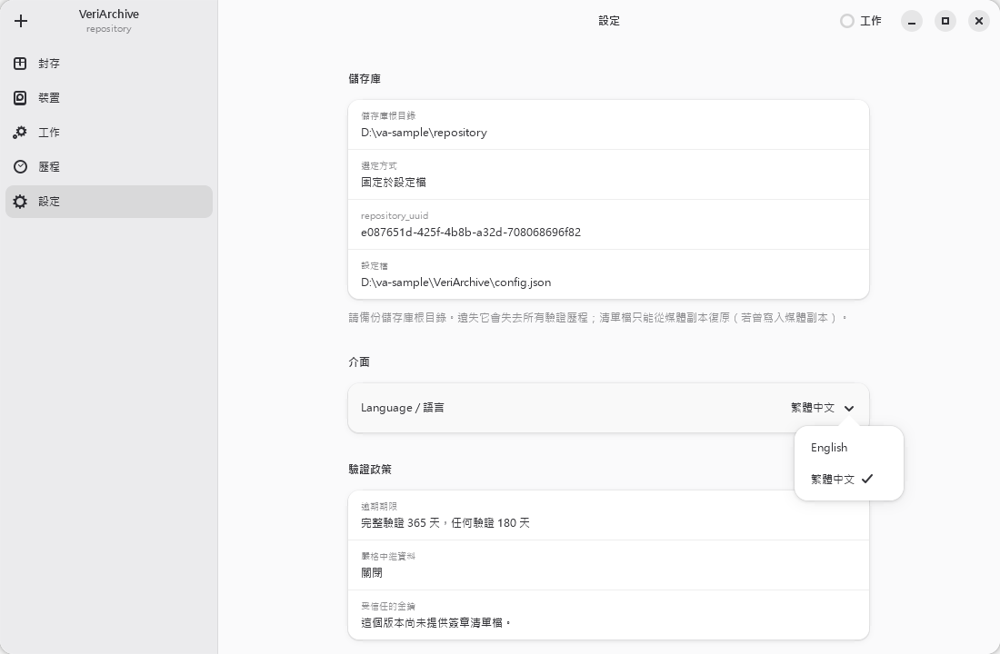
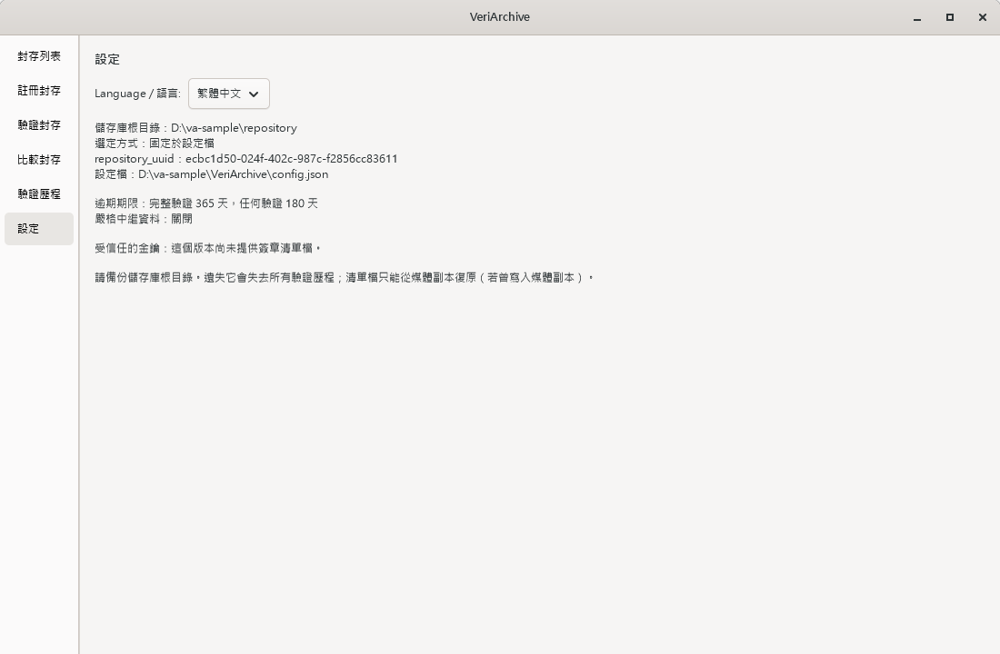
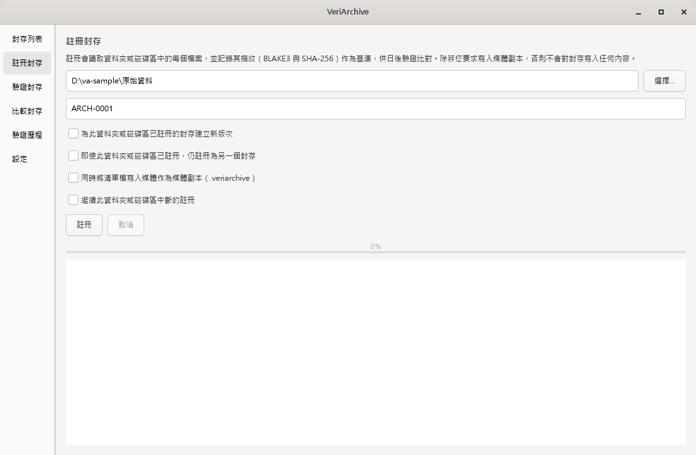
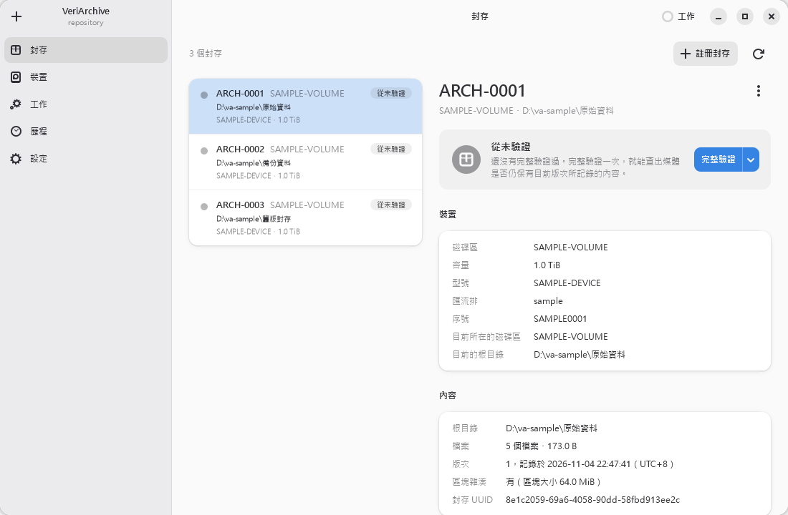
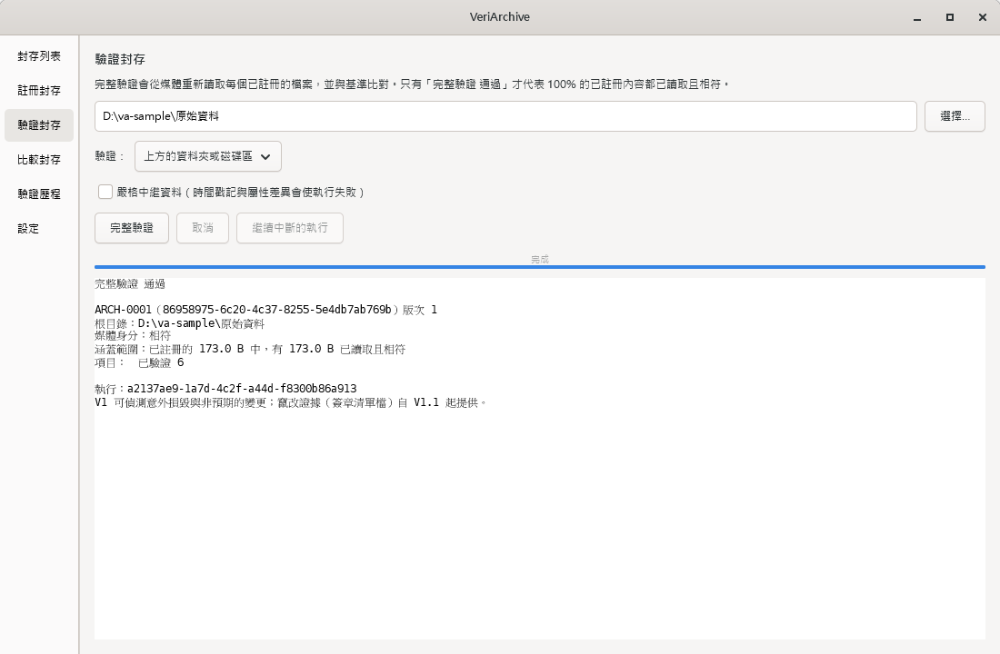
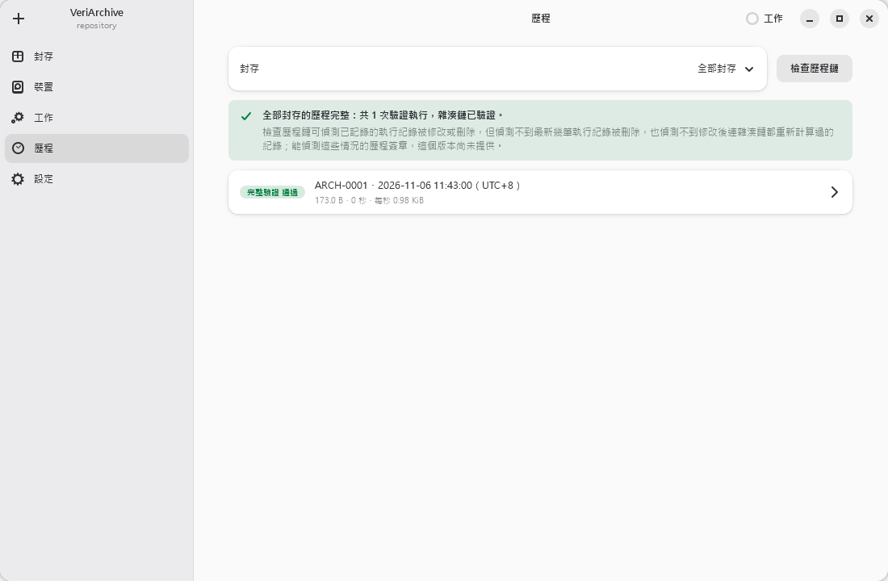

# VeriArchive 使用說明

VeriArchive 為封存用的資料碟留下「完整性證據」，日後可以證明裡面的檔案有沒有被修改、損毀、刪除或多出檔案。它只負責**偵測**：不會修復、不會還原，也不會幫你備份。

整個流程只有兩步：

1. **註冊**：把資料夾或整顆磁碟區的每個檔案讀一次，把指紋（BLAKE3 與 SHA-256）記下來，當作日後比對的**基準**。
2. **驗證**：日後再從磁碟重新讀取每一個已註冊的位元組，和基準比對，回報哪些檔案變了。

這份說明用圖形介面（`veriarchive-gui.exe`）的實際畫面，一步一步帶你完成：建立儲存庫、註冊封存、驗證封存、查看歷程，以及**確認副本和原始資料完全相同**。大部分章節先說明圖形介面，再說明命令列（`veriarchive-cli.exe`）的用法。

截圖裡的資料全都是範例資料，包括封存列表的磁碟區、型號和容量（`SAMPLE-VOLUME`、`SAMPLE-DEVICE`、1.0 TiB）。這份說明是公開的，截圖不能拿真實硬碟上的資料來示範，所以兩個封存是一顆硬碟上的兩個資料夾（`原始資料`、`備份資料`），裡面放的是範例檔案；產生截圖時，程式也會把磁碟區標籤、硬碟型號、序號和容量這些身分資料換成固定的範例值，不會顯示這顆硬碟真正的資料。實際使用時，一般是註冊整顆硬碟：輸入 `F:\` 這樣的磁碟區根目錄（見「註冊封存」），封存列表會顯示那顆硬碟實際的磁碟區標籤、型號和容量；其他操作都和截圖相同。

[English version](user-guide.md)

## 安裝（Windows）

VeriArchive 是免安裝的攜帶式程式：

1. 先建立放程式的資料夾，例如 `D:\VeriArchive`，再把 `VeriArchive-<版本>-windows-x86_64.zip` 解壓縮到這個資料夾裡。不需要安裝 MSYS2 或其他程式。
2. 執行這個資料夾裡的 `bin\veriarchive-gui.exe`（以上例來說是 `D:\VeriArchive\bin\veriarchive-gui.exe`）。

zip 裡沒有再包一層資料夾：它的 `bin`、`lib` 和 `share` 會直接放進解壓縮的目的資料夾。

- `bin/veriarchive-gui.exe`：圖形介面
- `bin/veriarchive-cli.exe`：命令列
- `lib/` 與 `share/`：GTK 需要的圖片載入程式、圖示、設定與中文翻譯；`share/doc/VeriArchive/`：這份說明與簡短的 README；`share/licenses/`：程式所用函式庫的授權

更新程式時，先關閉 VeriArchive，再把新版 zip **解壓縮到同一個資料夾**（上例的 `D:\VeriArchive`），取代裡面原有的檔案。在檔案總管中：對 zip 按右鍵，選「解壓縮全部...」，目的地輸入程式資料夾，遇到詢問時選擇取代目的地中的檔案。檔案總管預設會另外建立一個以 zip 命名的新資料夾；解壓縮到那裡的程式找不到你的任何紀錄。zip 裡沒有 `bin\data` 和 `bin\config.json`，所以既有的紀錄不會被蓋掉。請不要先刪除舊的資料夾。

### 搬移程式資料夾

第一次使用時，儲存庫（`data`）和記住它的設定檔（`config.json`）都建立在程式所在的資料夾（zip 裡的 `bin`），設定檔以相對於這個資料夾的方式記錄儲存庫：`"repository": "data"`。所以程式、設定和儲存庫都在同一個資料夾裡。整個解壓縮後的資料夾可以搬到別的磁碟、別台電腦，或放到接上後磁碟機代號不同的 USB 碟，仍然會使用它自己的儲存庫。備份這個資料夾，也就備份了儲存庫。

> **請定期備份整個程式資料夾，尤其是 `bin\data`。** 儲存庫遺失了，驗證歷程也就跟著遺失。

- 複製這個資料夾會連儲存庫一起複製，之後兩份會各自記錄自己的驗證歷程。請只把其中一份當作平常使用的資料夾。
- 儲存庫如果不在程式資料夾裡（個人資料夾中的 `VeriArchive`，或用 `--repository` 指定的位置），設定檔記的是完整路徑，不會跟著資料夾移動。
- 用較早版本建立的資料夾，設定檔記的是完整路徑。要讓它可以搬移，用文字編輯器打開 `bin\config.json`，把 `"repository"` 的值改成 `"data"`。

## 介面語言



介面有英文與繁體中文兩種。程式依下列順序決定語言，先找到的為準：

1. 命令列參數 `--lang zh-TW` 或 `--lang en`
2. 環境變數 `VERIARCHIVE_LANG`
3. 設定檔中的 `"language"`
4. Windows 的顯示語言
5. 英文

在圖形介面的「設定」頁，可以在「Language / 語言」選單直接切換語言（English / 繁體中文）。選擇會存進設定檔，視窗會立即以新語言重建；已輸入的資料夾、勾選的選項、視窗大小和畫面上的報告都會保留，報告會改用新語言顯示。正在執行註冊、驗證或比較時無法切換，請等作業結束。

`--json` 輸出、結束代碼，以及 JSON 裡的狀態代碼（`PASSED`、`Modified` 等）**永遠是英文**，所以自動化腳本在任何語言下的行為都一樣。

## 第一次使用：建立儲存庫



**儲存庫**存放所有清單檔（基準）與驗證歷程。

第一次開啟程式時，畫面會停在「設定」頁，並顯示「初始化儲存庫」按鈕。按下它，程式會在程式資料夾裡建立儲存庫。建立之後，這一頁會顯示：

| 項目 | 意義 |
|---|---|
| 儲存庫根目錄 | 儲存庫實際所在的資料夾 |
| 選定方式 | 這次用的儲存庫是怎麼決定的，例如「固定於設定檔」 |
| repository_uuid | 這個儲存庫的識別碼 |
| 設定檔 | 目前使用的設定檔 |
| 逾期期限 | 超過幾天沒有完整驗證或任何驗證，就標示「逾期」 |
| 嚴格中繼資料 | 開啟時，修改時間或屬性不同也會讓驗證失敗 |

最下面的提醒很重要：

> **請備份儲存庫根目錄。** 遺失它會失去所有驗證歷程；清單檔只能從媒體副本復原（若曾寫入媒體副本）。

命令列：`veriarchive-cli repo init`

儲存庫預設建立在程式所在資料夾的 `data`；若該處無法寫入，則建在個人資料夾的 `VeriArchive`。位置會記在設定檔中，之後每次都用同一個。也可以自己指定：`veriarchive-cli --repository D:\VeriArchiveRepo repo init`。

指定過的儲存庫如果之後找不到（例如外接碟沒接上），程式會直接報錯，**不會**悄悄改用別的位置。

## 註冊封存



註冊會把一整顆硬碟裡的每個檔案讀一次，記下它們的指紋（BLAKE3 與 SHA-256），當作日後驗證和比較的**基準**。只想註冊其中一部分時，也可以只註冊一個資料夾。

畫面上的「資料夾或磁碟區」就是指這兩種對象。「磁碟區」是程式對 `F:\` 這種位置的正式說法：一顆資料硬碟通常只有一個磁碟區，所以註冊 `F:\` 就是註冊整顆硬碟；硬碟分成幾個磁碟區時，每個磁碟區各註冊一次。

註冊整顆硬碟的步驟：

1. 在上方的欄位輸入硬碟的磁碟區根目錄，例如 `F:\`（也可以按「選擇…」挑選）。
2. 標籤可以不填。要填的話，格式是 `ARCH-` 加上四位以上數字，例如 `ARCH-0001`；不填時，程式會自動編號。
3. 按「註冊」。進度列會顯示完成比例、速度與剩餘時間（見下方「看懂進度」），可隨時按「取消」。

只註冊一個資料夾時，第 1 步改成按「選擇…」挑選那個資料夾，或直接輸入它的路徑，例如 `F:\照片`；其他步驟都一樣。截圖裡註冊的 `D:\va-sample\原始資料` 就是一個資料夾（原因見開頭的說明）。

下面四個選項平常都不用勾：

| 選項 | 什麼時候用 |
|---|---|
| 為此資料夾或磁碟區已註冊的封存建立新版次 | 已經註冊過，而且內容是你刻意更新的，要重新建立基準 |
| 即使此資料夾或磁碟區已註冊，仍註冊為另一個封存 | 已經註冊過，但要另外建立一個封存 |
| 同時將清單檔寫入媒體作為媒體副本（.veriarchive） | 在被註冊的磁碟上多留一份清單檔（`.veriarchive` 資料夾）。**不勾的話，註冊完全不會寫入被註冊的磁碟** |
| 繼續此資料夾或磁碟區中斷的註冊 | 上次註冊中途被取消，從中斷處接著做，已計算過的檔案不必重讀（也可以直接在「封存列表」的未完成作業按該列的「繼續」）。上次的程式若仍在這台電腦上執行，會停下來告訴你是哪一個。舊版 VeriArchive 留下的註冊無法這樣檢查，程式會先跳出和「封存列表」相同的詢問，說明舊版若仍在執行它會發生什麼事；請先確認舊版的視窗或命令都已關閉，再在詢問中按「繼續」（見下方「封存列表與逾期」）。再也無法完成的註冊，可以在「封存列表」的未完成作業按「放棄…」 |

注意事項：

- **註冊期間請不要修改那顆磁碟**，否則基準會記到正在變動的內容。
- 傳統硬碟每秒大約讀 150 到 250 MB。幾 TB 的磁碟，註冊可能要十幾個小時。
- 圖形介面一次只執行一項長時間作業。要兩顆磁碟同時註冊，請用命令列：開兩個視窗，各執行一次 `veriarchive-cli register`。

命令列：

```text
veriarchive-cli register E:\ --label ARCH-0012
```

選項：

| 選項 | 用途 |
|---|---|
| `--write-media-copy` | 同時把清單檔寫到該磁碟上（`.veriarchive` 資料夾），當作媒體副本。預設**不**寫入任何東西到封存。 |
| `--new-revision` | 這個資料夾或磁碟區已經註冊過，內容是刻意更新的：建立新的版次（新基準）。 |
| `--force-new-archive` | 這個資料夾或磁碟區已經註冊過，但要註冊成另一個獨立的封存。 |
| `--resume` | 繼續被中斷的註冊，已計算過的檔案不必重讀。若執行該註冊的程式仍在這台電腦上執行，會停下來並告訴你是哪一個。舊版 VeriArchive 留下的註冊無法這樣檢查：命令會說明舊版若仍在執行它會發生什麼事，然後停下來（結束代碼 12），不做任何變更；請先確認舊版的視窗或命令都已不再執行它，再加上 `--confirm`（見下方「封存列表與逾期」）。繼續本版本留下的註冊的自動化腳本不受影響。 |
| `--io hdd` 或 `--io ssd` | 指定讀取方式；傳統硬碟用 `hdd`（循序讀取），固態硬碟用 `ssd`（平行讀取）。通常會自動判斷。 |
| `--lost-manifest <uuid>` | 封存最新版次的清單檔已無法取回時的最後手段：用資料夾或磁碟區目前的內容註冊它的下一個版次（見下方「封存列表與逾期」）。第一次只會說明將會做什麼；加上 `--confirm` 才會真的執行。 |

同一個資料夾或磁碟區再註冊一次時，程式會停下來（結束代碼 12），請你決定要用 `--new-revision` 還是 `--force-new-archive`。

用 `subst` 建立的磁碟機代號（例如代表資料夾 `D:\Data` 的 `S:`）不是磁碟區。經由這種代號指定的資料夾，會以它的實際路徑註冊：註冊 `S:\Photos` 時，記錄的是 `D:\Data\Photos` 及它所在的磁碟區，報告也顯示這個路徑。之後經由代號或實際路徑都能驗證。

VeriArchive 只註冊和驗證這台電腦所連接的磁碟區上的資料夾。網路共用資料夾會被拒絕：網路路徑（`\\server\share\Photos`）、對應到網路共用的磁碟機代號上的資料夾，以及 Linux 上網路檔案系統（NFS、SMB、sshfs）裡的資料夾，或 GNOME、KDE 開啟的共用資料夾（在它們的檔案對話方塊中選擇這種共用資料夾時，包括按「選擇…」，得到的是 `/run/user/<uid>/gvfs` 或 `/run/user/<uid>/kio-fuse-…` 底下的資料夾）。GNOME 在那裡顯示的手機和相機也會被拒絕。在 Windows 上，前面加上 `\\?\` 的根目錄（`\\?\D:\Photos`）也會被拒絕：請寫成 `D:\Photos`。沒有磁碟機代號的磁碟區例外：Windows 只用 GUID 路徑稱呼它，可以用 `mountvol` 列出，例如 `\\?\Volume{...}\`。請完全照 `mountvol` 列出的樣子輸入，整個磁碟區寫成 `\\?\Volume{...}\`，其中的資料夾寫成 `\\?\Volume{...}\Photos`：它和其他根目錄一樣可以註冊、驗證和搬移，日後這個磁碟區有了磁碟機代號，經由代號看到的也是同一個封存。用 `verify --full <uuid>`，或在「驗證：」選單挑選這個封存，也找得到這種磁碟區上的封存。遇到被拒絕的根目錄時，`register`、`verify --full <根目錄>` 和 `archive relocate` 都會在讀取任何內容之前停止，結束代碼是 10。

註冊時讀不到的檔案（權限不足、媒體錯誤等）會被記錄下來，但不含雜湊，日後絕不會回報為「已驗證」。

### 看懂進度

計算雜湊時（註冊、驗證、搬移），圖形介面的進度列和命令列都會顯示一行進度，例如：

```text
計算雜湊中：2.16 TiB / 9.44 TiB（23%）・每秒 240 MiB・約剩 8～9 小時
```

命令列把它寫到 stderr；加上 `--json` 時不顯示。

- **完成比例是精確的**：它依位元組計算，所以一個大型影片的資料夾和一個小照片的資料夾，都按實際讀取量前進；要到最後一個檔案完成才會顯示 100%。一開始的掃描還不知道總量，只顯示已找到的項目數。
- **速度**是最近三分鐘的平均。
- **剩餘時間是估計值**，以範圍表示，單位由範圍的下限決定：下限不到一小時以分鐘表示，不到兩天以小時表示，再多則以天表示（例如「約剩 55～175 分鐘」、「約剩 47～96 小時」）。估算時同時考慮每個檔案的固定成本（開檔；傳統硬碟還要移動磁頭）和它的位元組，所以遇到一段小檔案時不會忽然暴增。剛開始的一分鐘內，以及好幾分鐘沒有進展時，會顯示「剩餘時間估算中」；速度起伏大或持續變慢時（傳統硬碟讀到內圈會變慢），範圍會變寬。電腦睡眠等暫停的時間，不會被當成讀得慢。所有檔案都計算完雜湊後，寫入結果的期間不再顯示剩餘時間。

## 封存列表與逾期



圖形介面「封存列表」頁，或命令列 `veriarchive-cli archive list`，會顯示每個封存：

- **上次完整驗證**：最近一次完整讀取的結果與日期
- **上次驗證**：最近一次任何驗證的結果與日期
- **逾期**：完整驗證超過 365 天，或任何驗證超過 180 天，就會標示逾期（期限可在設定檔的 `policy` 調整）

在「封存列表」頁，每一列是一個封存：

| 欄位 | 意義 |
|---|---|
| 標籤、UUID | 封存的標籤和識別碼（UUID 只顯示前 8 碼） |
| 磁碟區、型號、容量 | 註冊時記錄的磁碟區標籤、硬碟型號和容量 |
| 上次完整驗證、上次驗證、逾期 | 見上方；還沒驗證過時，前兩欄顯示「從未」 |
| 版次、狀態 | 目前的版次；「已註冊」或「已停用」 |

結果一定附上時間，因為結果只代表**那個時間**的狀態。

儲存庫裡的清單檔無法使用（遺失、無法讀取或已被變更）的封存也會列出，並多一行說明問題和修復方法（「封存列表」頁以紅字顯示在該列下方），這時 `archive list` 的結束代碼是 2（已停用、而且清單檔已無法取回的封存除外，見下文）。驗證這個封存（用它的 uuid，或在「驗證封存」頁選它），會在它的歷程記錄這次失敗。遺失、無法讀取或已被變更的清單檔，請用 `veriarchive-cli import <資料夾>/r0002.vam`（該版次的檔案）放回：檔案可以來自儲存庫的備份、該版次的匯出檔，或媒體副本（封存所在媒體上 `.veriarchive` 資料夾裡的檔案，註冊時有寫入才有）。匯入時會確認這個檔案就是儲存庫所記錄的那一份，再把它放回原位。

如果這些地方都沒有封存最新版次的清單檔，這份清單檔就無法取回了。如果無法使用的是它的第一行（清單檔遺失、第一行無法讀取，或第一行已被變更），在它放回或封存停用之前（見下文），註冊新的資料夾或磁碟區和搬移都會因它而停下來，因為判斷一個資料夾或磁碟區存放的是哪個封存，需要讀取每個封存最新清單檔的第一行；不過為其他封存的資料夾建立新版次（`register --new-revision`，或「註冊封存」頁的新版次選項）仍然可以，只要那個資料夾明顯屬於該封存：位於它的清單檔所記錄的磁碟區與裝置上。只有主體被變更的清單檔不會讓這些作業停下來，但驗證該封存時會失敗。最後的手段是用該封存的資料夾或磁碟區目前的內容，註冊它的下一個版次：`veriarchive-cli register <根目錄> --lost-manifest <uuid>`。不加 `--confirm` 時只會說明將會做什麼（結束代碼 12）；加上 `--confirm` 再執行一次才會真的執行。這時資料夾或磁碟區目前的內容會成為新的基準，而不與無法取回的版次比對，所以自那個版次註冊以來發生的損壞將不會被發現。封存會保留它的驗證歷程，也絕不會回到較早的版次。無法取回的清單檔如果是第一行無法使用，那個版次會從版次清單中移除；只有主體被變更的清單檔則會留在清單中，成為較早的版次。清單檔並未無法取回時（仍可使用，或只是索引不符：請重建索引）、根目錄屬於其他封存時（位於該封存的清單檔所記錄的磁碟區與裝置上，包含該封存的資料夾或位於其中），以及根目錄的 `.veriarchive` 資料夾裡仍有那份清單檔的媒體副本時（請改為匯入該檔案），它都會拒絕執行。其他封存自己的資料夾也可以使用，不論它位於該封存的清單檔所記錄的磁碟區與裝置上，或位於可能就是該封存的磁碟區、也可能是它逐磁區複製出來的複本的磁碟區上（檔案系統相同但裝置不同，或沒有裝置序號可比對），但在你確認之前，它會先指出這是哪個封存的資料夾：程式無法判斷這個資料夾當初是否刻意同時註冊成這兩個封存（`--force-new-archive`），所以請只在確實如此時才確認；在可能是複本的磁碟區上，也可以在這個磁碟區不是那個封存的磁碟區時確認。如果該資料夾包含其他封存的資料夾或位於其中，而所在的磁碟區可能是那個封存的磁碟區逐磁區複製出來的複本，或就是那個磁碟區本身，它會在你確認之前指出那個封存「可能是複本」：只有在這個資料夾不是那個封存的資料夾時才確認。「封存列表」頁的問題說明會提到這個命令；它只能在命令列執行。

如果存放這個封存的裝置也已不在（損壞、遺失或已清除），就沒有資料夾或磁碟區可以用來註冊它的下一個版次。這時請停用這個封存：`veriarchive-cli archive retire <uuid>`；問題說明在最後的手段之後也會提到它：`archive retire <uuid> --confirm`。如果這份無法取回的清單檔會讓註冊和搬移停下來（見上文），命令第一次只會說明停用代表什麼（結束代碼 12）；加上 `--confirm` 再執行一次才會真的停用。封存會保留它的驗證歷程及其雜湊鏈，但再也無法驗證，也不再接受新的版次；它也不再讓註冊新的資料夾或磁碟區、或搬移停下來：停用之後，因為程式無法從這份無法取回的清單檔得知它在哪裡，它不再被視為可能擁有某個資料夾或磁碟區的封存。如果那個裝置之後又找到了，程式不會認出它，註冊它會成為一個新的封存。只有主體被變更的清單檔不會讓任何作業停下來：這樣的封存會像其他封存一樣立即停用，接上時仍會被辨識。`archive list`、`archive show` 與「封存列表」頁會把這個封存顯示為已停用，並以「清單檔無法取回：…」一行取代問題說明（「封存列表」頁不使用紅字：它不再需要你處理），`archive list` 也不再因它而以結束代碼 2 結束。這個封存還有未完成的註冊時，停用會被拒絕：請先放棄（或完成）那個註冊。先停用、之後清單檔才無法取回的封存也一樣處理；已停用的封存不能以 `--lost-manifest` 註冊它的下一個版次。如果清單檔後來又找到了，用 `import` 放回之後，程式又會認出這個已停用的封存。

較早版次的清單檔也可能無法取回：`archive show` 會標示那個版次；在程式比對這個封存先前的載體時，註冊新的資料夾或磁碟區、或依資料夾驗證，都可能因它而停下來。請照上面的方法用 `import` 放回；如果都沒有，`veriarchive-cli repo rebuild-index` 會把那個版次從索引移除，之後只存放過那個版次的磁碟區就不再被認出是這個封存先前的載體。它的驗證紀錄仍保留在歷程中。

封存表格上方有時會多出「未完成的作業」，列出還沒完成的註冊、驗證和搬移（從命令列啟動的也算；已停用的封存仍然可以驗證，它的驗證也會列出，只有已停用、而且清單檔已無法取回的封存例外：它中斷的驗證永遠無法繼續，所以不會列出），以及各自的進度和狀態。狀態是「已停止；可以繼續」時，可以從中斷的地方接著做，已讀過的檔案不必重讀：

- 驗證和註冊：按該列的「繼續」。不論是在這個視窗、另一個視窗還是命令列啟動的，也不論中斷之後程式是否關閉過（例如重新開機），都可以這樣繼續。程式會切換到「驗證封存」或「註冊封存」頁，在那裡顯示進度和結果，需要時可以按「取消」。驗證會在已接上的磁碟中，依封存的 UUID 找到它，所以磁碟換了磁碟機代號也沒關係；但如果有不只一個已連接的磁碟區存放這個封存（例如一個裝置和它逐磁區複製出來的複本），就無法分辨當初讀的是哪一個，它會停下來並列出這些根目錄：請讓其他磁碟區中斷連線後再按一次「繼續」，或用命令列 `veriarchive-cli verify --full <根目錄> --resume <RUN_ID>` 從當初讀取的根目錄繼續。註冊則讀取原本那個資料夾或磁碟區（該列「根目錄」欄的路徑）。「繼續」和命令列的繼續（`verify --full <uuid> --resume <RUN_ID>` 或 `register <根目錄> --resume`）完全相同，不採用「驗證封存」頁的「嚴格中繼資料」和「註冊封存」頁的「同時將清單檔寫入媒體作為媒體副本（.veriarchive）」勾選：它不會寫入媒體副本，也只在「設定」頁顯示「嚴格中繼資料：開啟」（設定檔的 `policy` 設定了 `strict_metadata`）時才使用嚴格中繼資料。若要在繼續註冊時寫入媒體副本，請到「註冊封存」頁輸入那個資料夾或磁碟區，勾選「繼續此資料夾或磁碟區中斷的註冊」和媒體副本選項後按「註冊」。
- 搬移：用命令列 `veriarchive-cli archive relocate <uuid> <新根目錄> --resume`。把滑鼠移到該列的標籤上，會顯示封存的 UUID；新根目錄就是該列「根目錄」欄的路徑。

已停止、而且再也無法完成的註冊（例如硬碟壞了），可以在這裡按「放棄…」放棄它（命令列：`veriarchive-cli archive abandon-registration <uuid> --confirm`）：已儲存的進度會遺失，之後不能再繼續，已記錄的版次與歷程不受影響。已停止的搬移也可以在這裡用同樣的方式放棄，例如新載體壞了（命令列：`veriarchive-cli archive abandon-relocation <uuid> --confirm`）：已儲存的進度會遺失，之後不能再繼續，封存、它的版次與歷程不受影響。有些狀態會直接請你放棄，例如「新載體上的內容不符；請放棄它」：搬移發現新載體上的資料和封存不一樣，這次搬移永遠無法完成，請放棄它，重新複製後再搬移一次。

還在執行、或可能還在執行的作業，沒有「繼續」，只有舊版程式留下的註冊例外：舊版不會記錄最後一次運作的時間，所以 3 分鐘沒有進度時會顯示「已 N 分鐘未見進度，可能已停止」，這時該列也有「繼續」和「放棄…」。程式無法判斷舊版是否仍在執行這個註冊：舊版讀取一個大檔案、或掃描整個資料夾或磁碟區時，也會好幾分鐘沒有進度。所以按這兩個按鈕之前，請先確認舊版的視窗或命令都已不再執行這個註冊。如果舊版仍在執行，而且在按「繼續」記錄了這個版次之後才完成，它會用自己的清單檔蓋掉這次繼續所記錄的清單檔：從此這個封存的每次驗證都會因這份清單檔而失敗，註冊新的資料夾或磁碟區和搬移也會因它而停下來，直到這個封存有了新的版次為止；除非儲存庫的備份中有這次繼續所記錄的那一份，否則它就無法取回了（見上文）。所以在這種列上按「繼續」時，程式會先跳出詢問「要繼續…未完成的註冊嗎？」，說明上面這些情況，並請你確認舊版的視窗或命令都已關閉；要在詢問中按「繼續」才會接著做，按「取消」則什麼都不會改變。在「註冊封存」頁勾選繼續選項繼續這種註冊時也會同樣詢問；命令列的 `register <根目錄> --resume` 則會說明同樣的事並停下來，要加上 `--confirm` 再執行一次才會接著做。已停止的註冊按「繼續」不會詢問：這種註冊已表明它停止了，或記錄了它最後一次運作的時間或執行它的程式，而留下它的版本不會用自己的清單檔蓋掉這次繼續所記錄的清單檔。按「放棄…」也不會讓舊版停下來，它仍可能記錄這個版次。這個視窗正在執行另一項作業時，按「繼續」會請你等它結束。

`archive list` 與 `archive show` 會在封存下方，為它未完成的註冊與未完成的搬移各多列一行：版次、正在讀取的資料夾或磁碟區、目前的進度和狀態，用語和「封存列表」頁相同（例如「已停止；可以繼續」或「新載體上的內容不符；請放棄它」）。

畫面上的時間是這台電腦的本地時間，括號內是和 UTC 的時差，例如 `2026-10-14 08:13:53（UTC+8）`。`--json` 輸出和歷程資料庫一律記錄 UTC，例如 `2026-10-14T00:13:53Z`。

其他封存相關指令：

```text
veriarchive-cli archive show <uuid>              # 詳細資料與所有版次
veriarchive-cli archive retire <uuid>            # 停用：不再需要定期驗證，但保留歷程
                                                 # （清單檔已無法取回時要加 --confirm，見上文）
veriarchive-cli archive relocate <uuid> <根目錄> # 封存搬到新磁碟後，確認並驗證新載體
veriarchive-cli archive compare <uuid> <uuid>    # 兩個封存的內容是否相同（見下文）
```

中斷的 `archive relocate` 會保留已比對相符的進度，並列在未完成的作業中：以 `archive relocate <uuid> <根目錄> --resume` 繼續，或以 `archive abandon-relocation <uuid> --confirm` 放棄。如果搬移發現新載體上有項目和封存不符，例如檔案被修改或遺失，搬移就會結束（即使之後才被中斷也一樣），已儲存的進度也會刪除：請重新複製，下一次搬移會重讀整個新載體。讀不到的項目，要等其他項目都讀完才會結束搬移；如果新載體在那之前被拔除，搬移只是中斷，繼續時會重讀那個項目。結束的搬移若無法刪除已儲存的進度，會以「新載體上的內容不符；請放棄它」留在未完成的作業中：請先放棄它，再重新搬移。

`archive show`、`retire`、`relocate`、`compare`、`history`、`export` 與 `export-sha256sums` 的 uuid 可以只打前 8 個以上的字元，只要不會和其他封存混淆。

## 驗證封存



完整驗證會把每一個已註冊的位元組從磁碟重新讀出來，和基準比對。

操作步驟：

1. 在上方輸入或選擇磁碟區根目錄（例如 `F:\`）或資料夾，「驗證：」選單保持「上方的資料夾或磁碟區」。也可以在「驗證：」選單直接挑選已註冊的封存，程式會在已接上的磁碟中找到它。如果有不只一個已連接的磁碟區存放這個封存（例如一個裝置和它逐磁區複製出來的複本），程式不會自己挑選，會停下來並列出這些資料夾：請在上方輸入或選擇要驗證的那一個資料夾，在「驗證：」選「上方的資料夾或磁碟區」，再按「完整驗證」；或讓其他磁碟區中斷連線後再驗證一次。
2. 按「完整驗證」。

命令列（用路徑或封存的 uuid 都可以）：

```text
veriarchive-cli verify --full E:\
veriarchive-cli verify --full 46d4c696-4999-4c7d-80eb-b626da614e77
```

用 uuid 時，程式會在目前接上的磁碟中找出這個封存。如果有不只一個已連接的磁碟區存放它（例如一個裝置和它逐磁區複製出來的複本），程式不會自己挑選：它會停下來（結束代碼 12）並列出這些資料夾。請依資料夾驗證其中一個，或讓其他磁碟區中斷連線後再驗證一次。

### 讀懂結果

```text
完整驗證 失敗  ARCH-0001（46d4c696-…）版次 1
  根目錄：E:\
  媒體身分：相符
  涵蓋範圍：已註冊的 13 位元組中，有 7 位元組已讀取且相符
  項目：  已修改 1  新增 1  已驗證 1
  新增  new.txt
  已修改  readme.txt  （內容不同）
```

報告怎麼看：

- **第一行**是結果，例如「完整驗證 通過」。
- **媒體身分**：程式是否認出這顆磁碟，例如「相符」。
- **涵蓋範圍**：讀取並且相符的位元組數。
- **項目**：各種狀態的數量；有問題的項目會逐一列在下面。

結果一定帶著模式（完整驗證）與日期：只有「完整驗證 通過」才代表 100% 的已註冊內容都已讀取且相符。

| 結果 | 意義 | 結束代碼 |
|---|---|---|
| 通過 | 每個已註冊的位元組都讀到了，而且相符 | 0 |
| 通過（有警告） | 內容相符，但有需要注意的地方（例如磁碟沒有硬體序號可比對、讀不到檔案系統 UUID、中繼資料有差異、同一資料夾中有名稱只差在大小寫或 Unicode 正規化，不區分這些差異的磁碟區或作業系統無法同時保存它們） | 2 |
| 失敗 | 有檔案被修改、遺失、無法讀取，或媒體身分不符，或儲存庫裡這個封存的清單檔無法使用（遺失、無法讀取或已被變更：這時完全不會讀取媒體，結果會說明如何修復清單檔） | 3 |
| 未完成 | 驗證被中斷（取消、拔碟），可以繼續 | 4 |

項目狀態：

| 狀態 | 意義 |
|---|---|
| 已驗證 | 內容與基準相符 |
| 已修改 | 內容與基準不同 |
| 遺失 | 基準中有，現在找不到 |
| 新增 | 基準中沒有的新檔案 |
| 無法讀取 | 讀取失敗（權限不足、媒體錯誤等） |
| 中繼資料不符 | 內容相同，但修改時間不同（預設只是警告）；勾選「嚴格中繼資料」或用 `--strict-metadata` 時，也比對權限模式與檔案屬性，而且算失敗 |
| 類型改變 | 例如原本是檔案，現在是資料夾，或原本是資料夾，現在是檔案或連結；這種資料夾裡的項目也會一併列出：資料夾是新的就列為新增，資料夾不在了就列為遺失 |
| 無基準 | 註冊時就讀不到，所以沒有可比對的雜湊。其他內容都相符時，報告會建議註冊新版次，為它建立基準（`register <root> --new-revision`，或「註冊封存」頁的「為此資料夾或磁碟區已註冊的封存建立新版次」） |
| 無法表示的名稱 | 這個名稱無法存在於目前的作業系統，而封存是在另一個作業系統上註冊的（例如在 Linux 註冊、名稱含 `?` 的檔案，在 Windows 上驗證）：只是警告。在註冊這個封存的作業系統上驗證時，這種項目不見了就是「遺失」 |

### 中斷後繼續

驗證被中斷時，結果是「未完成」，之後可以接著做，已驗證過的檔案不必重讀：

- 圖形介面：在「封存列表」頁的未完成的作業中，按該驗證那一列的「繼續」（見「封存列表與逾期」）。在中斷驗證的那個視窗，也可以按「驗證封存」頁的「繼續中斷的執行」；之後又執行過其他驗證、或程式關閉過時，請用「封存列表」的「繼續」。
- 命令列：`veriarchive-cli verify --full <archive_uuid> --resume <RUN_ID>`，任何中斷的驗證都可以，包括在圖形介面啟動的。在「封存列表」的未完成的作業中，把滑鼠移到該列的標籤上會顯示封存的 UUID，移到狀態上會顯示執行編號。

如果有不只一個已連接的磁碟區存放這個封存（例如一個裝置和它逐磁區複製出來的複本），依封存的 UUID 繼續時無法分辨該次執行讀取的是哪一個：它會停下來（結束代碼 12），列出這些磁碟區上的根目錄和該次執行讀取的根目錄。請以 `veriarchive-cli verify --full <根目錄> --resume <RUN_ID>` 從它讀取的那個磁碟區上的根目錄繼續，或讓其他磁碟區中斷連線後再繼續一次。

驗證期間如果裝置被拔除、關閉電源或不再回應，驗證會以「未完成」結束，而不是「失敗」：VeriArchive 把檔案回報為無法讀取之前，會先確認磁碟區仍然連接著，所以不會把離開的裝置當成損壞，結果也會說明發生了什麼事。重新連接裝置後，依上述方式繼續該次執行即可；已驗證的部分不會再讀一次。註冊和搬移也會以同樣的方式停止、以同樣的方式繼續：註冊用 `register <root> --resume` 或「封存列表」的「繼續」，搬移用 `archive relocate <uuid> <root> --resume`。

### 程式要你做決定時（結束代碼 12）

| 訊息 | 情況 | 該怎麼做 |
|---|---|---|
| 未知 | 這不是已註冊的封存 | 確認接的是正確的磁碟，或先註冊 |
| 已遷移 | 檔案系統相符，但磁碟裝置換了（例如整顆複製到新硬碟） | 確認是你搬的：`archive relocate <uuid> <新根目錄>` |
| 無法確定 | 有好幾個封存都符合（複製出來的磁碟） | 用 `verify --full <archive_uuid>` 指定要驗證哪一個；若這些封存的磁碟區同時連接著，請讓要驗證的那個封存以外的磁碟區都中斷連線，再驗證它 |
| 無法確定：封存 … 位於多個已連接的磁碟區上 | 依封存的 UUID 驗證時，在多個已連接的磁碟區上找到它（一個裝置和它的複本） | 依資料夾驗證其中一個：`verify --full <根目錄>`，或讓其他磁碟區中斷連線後再驗證一次 |
| 無法確定：封存 … 位於多個已連接的磁碟區上……；執行 … | 依封存的 UUID 繼續驗證時，在多個已連接的磁碟區上找到它 | 從該次執行讀取的磁碟區上的根目錄繼續：`verify --full <根目錄> --resume <RUN_ID>`，或讓其他磁碟區中斷連線後再繼續一次 |
| 先前的載體 | 這是封存搬移前的舊磁碟 | 舊磁碟不再驗證；請驗證新載體 |
| 若要繼續，請加上 --confirm 再執行一次 | 以 `register <根目錄> --resume` 繼續舊版 VeriArchive 留下、而且舊版可能仍在執行的註冊 | 確認舊版的視窗或命令都已不再執行它，再加上 `--confirm` 執行一次 |

## 驗證歷程



圖形介面「驗證歷程」頁，或 `veriarchive-cli history <uuid>`，列出某個封存的每次驗證。

在「封存：」選單選一個封存，按「顯示執行紀錄」，就會列出每一次驗證的時間、模式、結果、版次、相符位元組和執行編號。

中斷的 `archive relocate` 也會列在這裡，是一次「未完成」的完整驗證，版次是它拿來和新載體比對的版次，並標示「中斷的搬移嘗試」：它讀取的是新載體，不是封存原本的載體。搬移尚未完成時，請以 `archive relocate <uuid> <根目錄> --resume` 繼續；`verify --resume` 不會繼續它，並會這樣告訴你。搬移完成、記錄封存下一個版次的那次完整驗證，會標示「從 r1 搬移」，r1 是它拿來和新載體比對的版次。圖形介面把這些標示放在表格最後的「備註」欄，只有含這類執行紀錄的封存才會出現這一欄；`history --json` 則為每次執行提供 `relocation`：null，或搬移的 `run_id`、`from_revision` 與 `interrupted_attempt`。

歷程是用雜湊串成的鏈。檢查歷程鏈可以發現已記錄的執行紀錄被修改或刪除，但發現不了最新幾筆執行紀錄被刪除，也發現不了修改後連雜湊鏈都重新計算過的紀錄；能發現這些情況的歷程簽章，這個版本尚未提供。檢查方式：

- 圖形介面：按「檢查歷程鏈」
- 命令列：`veriarchive-cli repo verify-history`

## 比較封存：確認副本和原始資料相同


假設你用自己的工具把 F 碟備份（複製）到 G 碟（VeriArchive 本身不做備份），想證明 G 碟的內容和 F 碟完全相同。只驗證 G 碟做不到這件事：驗證是拿 G 碟和 G 自己的基準比對。正確的做法是把兩顆磁碟各自註冊成一個封存，再**比較**這兩個封存。比較會取出兩份清單檔中的每個項目（檔案、資料夾、連結），確認它在兩邊都存在、類型相同、內容（BLAKE3 與 SHA-256）相同。比較不讀取任何磁碟，只讀儲存庫裡的清單檔，所以幾秒鐘就完成。修改時間和檔案屬性不比較，因為複製工具不一定會保留它們。

### 1. 註冊兩顆磁碟

等複製完成後再註冊；每次註冊都會把整顆磁碟讀一遍。

圖形介面：在「註冊封存」頁先註冊 `F:\`，再註冊 `G:\`。

命令列：

```text
veriarchive-cli register F:\
veriarchive-cli register G:\ --copy-of <F 的封存 uuid>
```

- `--copy-of` 可以不加：它只是記錄「G 是 F 的副本」，供顯示用。這裡要填完整的 uuid，可用 `archive list` 查看。
- 要註冊和 F 根目錄相對應的資料夾，兩邊的路徑才對得上：如果 F 的副本放在 `G:\Backup\F`，就註冊 `G:\Backup\F`。G 這邊註冊的資料夾裡如果還有其他東西，都會被列為「新增」。
- 如果 G 是用逐磁區方式複製（克隆）出來的，它的檔案系統 UUID 和 F 相同，註冊時會停下來（結束代碼 12，已遷移）。加上 `--force-new-archive`（圖形介面：勾選「即使此資料夾或磁碟區已註冊，仍註冊為另一個封存」），就能把它註冊成另一個封存。

### 2. 比較

圖形介面「比較封存」頁：

1. 在「參考封存（A）：」選 F 的封存，也就是原始資料。
2. 在「要檢查的副本（B）：」選 G 的封存。
3. 按「比較」。進度列會顯示已比較的項目數，可隨時按「取消」。

報告怎麼看：

- **第一行**：「比較結果：相同」、「比較結果：相同（有警告）」或「比較結果：不同」。
- **A、B 兩行**：各是哪個封存，以及註冊時間。
- **項目**和**差異**：兩邊各有多少項目、多少個相同，以及各種差異的數量。
- 下面逐一列出每一個不同的項目（見下方「讀懂比較結果」）。

A 和 B 選了同一個封存時，程式會請你重新選擇。

截圖的範例裡，副本少了一個檔案、多了一個檔案，還有一個檔案的內容不同，所以結果是「不同」。

命令列：先寫封存 A（參考），再寫封存 B（副本）。uuid 只要打前 8 個以上的字元：

```text
veriarchive-cli archive compare 0d0ce48d a82ebd4e
```

```text
比較結果：不同  ARCH-0001（0d0ce48d-9445-4e7a-ae49-8fb42ef05201）r1  與  ARCH-0002（a82ebd4e-7766-4291-9795-d1a8d29efadd）r1
  A：ARCH-0001，註冊於 2026-10-15 10:18:09（UTC+8），共 6 個項目
  B：ARCH-0002，註冊於 2026-10-15 10:18:09（UTC+8），共 6 個項目
  相同：4  遺失 1  已修改 1  新增 1
  已修改  專案/budget 預算.csv  （大小 26 → 41）
  新增  新增的檔案.txt
  遺失  會議紀錄.txt
  此比較依據各封存註冊時讀取的內容。對各封存進行完整驗證，才能證明其載體仍保有這些內容。
```

### 讀懂比較結果

| 結果 | 意義 | 結束代碼 |
|---|---|---|
| 相同 | A 的每個項目都以相同的類型與內容存在於 B，且 B 沒有其他項目 | 0 |
| 相同（有警告） | 沒有項目不同，但列出的項目無法比較（見下表的「無基準」與「中繼資料不符」） | 2 |
| 不同 | 至少有一個項目遺失、新增、已修改或類型改變 | 3 |

每個列出的項目，都是「以 A 為準來看 B」：

| 狀態 | 意義 |
|---|---|
| 遺失 | A 有、B 沒有：副本少了它 |
| 新增 | B 有、A 沒有：副本多了它 |
| 已修改 | 內容不同；「大小 26 → 41」是它在 A 和 B 中的大小（位元組） |
| 類型改變 | 例如在 A 是檔案，在 B 是資料夾 |
| 無基準 | 沒有雜湊可以比較：註冊 A 或 B 時讀不到（說明會寫出是哪一邊、什麼原因），或位於其中一個封存無法讀取的資料夾內 |
| 中繼資料不符 | 一個在 Windows、一個在 Linux 上註冊的封存中，連結的絕對目標不同；只是警告 |

如果比較無法進行，例如儲存庫裡的清單檔被修改或損壞、某個封存第一次註冊沒有完成，程式會說明原因，結束代碼 3；比較被取消時結束代碼 4。加上 `--json` 可以取得結果和每一個差異，一律是英文。

### 比較能證明什麼

比較的是**每次註冊時讀到的內容**，不是磁碟現在的內容。要證明 G 碟現在保存著 F 碟的內容：

1. 比較結果是「相同」：兩個基準有相同的項目和內容。
2. 對兩個封存各做一次完整驗證（`verify --full F:\`、`verify --full G:\`），結果都是「通過」：兩顆磁碟都仍保存著自己的基準。

磁碟之後還是可能壞掉。要證明兩顆磁碟**現在**仍然保有這些內容，請定期對兩個封存各做一次完整驗證（見上方「驗證封存」）。

如果 F 在註冊之後、複製之前又有變動，比較會把變動列出來。這時用 `--new-revision` 重新註冊 F，再比較一次。比較不會寫入任何東西：它不算驗證歷程，也不會改變「上次完整驗證」或逾期，想比較幾次都可以。

## 匯出與匯入

```text
veriarchive-cli export-sha256sums <uuid> --out sums.txt   # 產生 sha256sum 格式的清單
veriarchive-cli export <uuid> --out D:\export             # 匯出目前版次的清單檔
veriarchive-cli --repository D:\OtherRepository import D:\export\r0001.vam   # 匯入到另一個儲存庫
```

`export` 匯出的是封存目前版次的清單檔和它的 `identity.json`，不包括較早版次的：要保留每個版次的匯出檔，請在每次建立新版次之後再匯出一次。`import` 會匯入到目前使用的儲存庫；要匯入到另一個儲存庫，請用 `--repository` 指定它，如果它還不存在，要先建立（`veriarchive-cli --repository D:\OtherRepository repo init`）。VeriArchive 會記住上一次開啟的儲存庫，每次開啟另一個儲存庫時都會發出警告，所以執行上面的指令之後，下一次開啟平常那個儲存庫時就會出現這個警告：指令會顯示 `警告：repository_uuid 已從 … 變更為 …；已記錄新的 uuid`，圖形介面則在「設定」頁顯示同樣的警告。這只是記下換了儲存庫，兩個儲存庫都沒有被更動。

`sums.txt` 以封存內的路徑列出每個檔案，所以要在封存的根目錄執行 `sha256sum -c sums.txt`，才能在沒有 VeriArchive 的情況下檢查封存。Windows 本身沒有 `sha256sum`；Git Bash（Git for Windows 的一部分）、WSL 和 Linux 都有。在 Git Bash 中，封存在 `F:\`、清單在 `D:\sums.txt` 時：`cd /f && sha256sum -c /d/sums.txt`。

## 其他

- 資料庫損壞時，可以從清單檔重建索引：`veriarchive-cli repo rebuild-index`。清單檔才是真正的依據，資料庫只是索引。
- 每個指令都可以加 `--json`，輸出機器可讀的結果。
- 結束代碼：0 通過、2 通過（有警告）、3 失敗、4 未完成、10 用法錯誤、11 儲存庫錯誤、12 需要你做決定。
- VeriArchive 能偵測意外損毀與非預期的變更；這個版本尚未提供竄改證據（簽章清單檔），也尚未提供只讀取部分內容的快速驗證與深度驗證：這個版本的每次驗證都會讀取全部內容（完整驗證）。
- 程式不需要系統管理員權限，也不應以系統管理員身分執行。
- 在 PowerShell 擷取、重新導向（`>`）或用管線傳遞 CLI 輸出之前，先執行 `[Console]::OutputEncoding = [Text.UTF8Encoding]::new()`，否則中文會變成亂碼。直接顯示在視窗裡的輸出不受影響。
- 圖形介面如果意外關閉，原因會記錄在使用者設定資料夾的 `veriarchive-gui.log`（Windows 是 `%APPDATA%\VeriArchive`，Linux 是 `~/.config/veriarchive`）。回報問題時請附上這個檔案。
- 這些截圖由 `tools/screenshots/` 的工具用範例資料自動產生。介面改版後可以重新產生，說明見原始碼中的 `tools/screenshots/README.md`。
