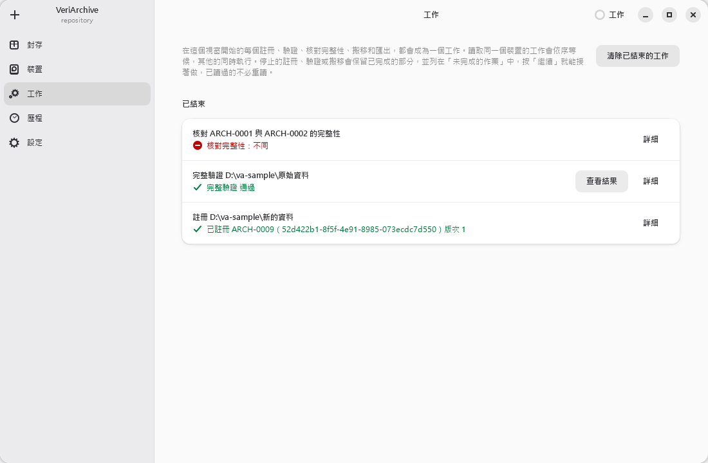
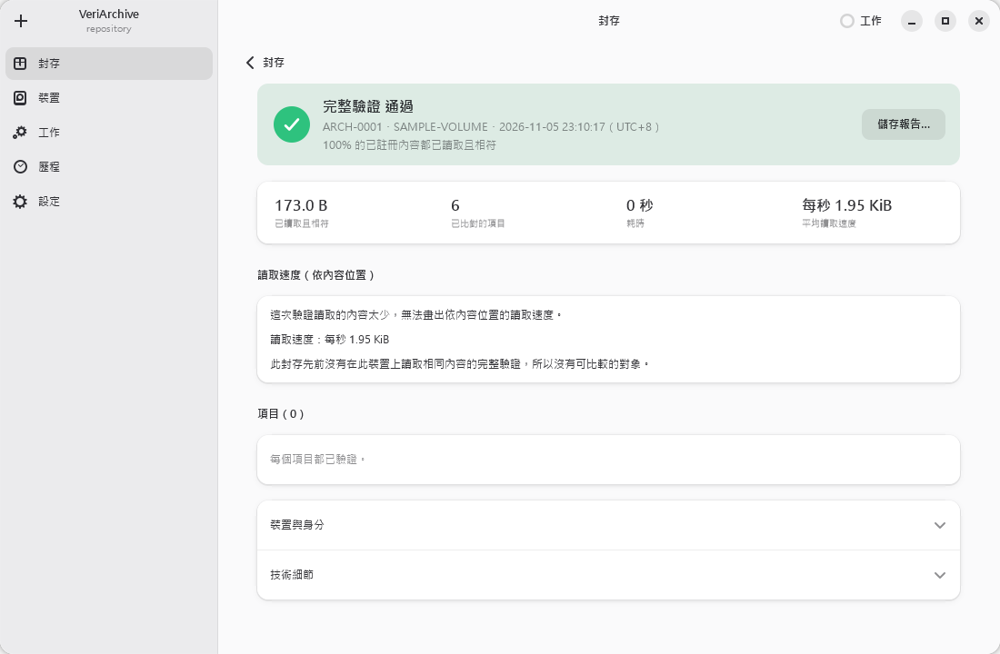
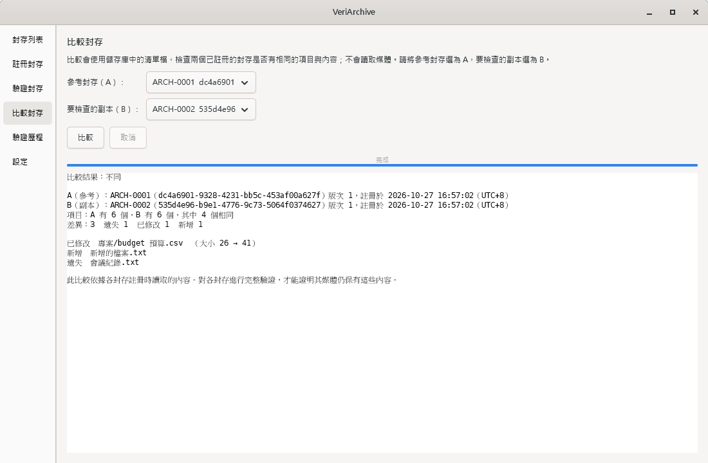
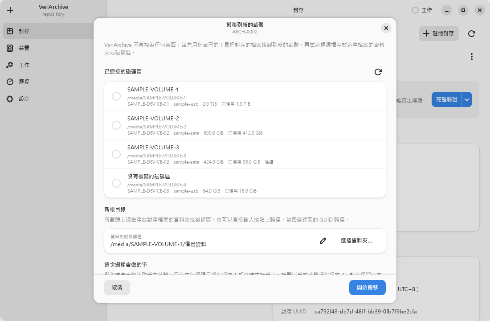

# VeriArchive 使用說明

VeriArchive 為封存用的資料碟留下「完整性證據」，日後可以證明裡面的檔案有沒有被修改、損毀、刪除或多出檔案。它只負責**偵測**：不會修復、不會還原，也不會幫您備份。

整個流程只有兩步：

1. **註冊**：把資料夾或整顆磁碟區的每個檔案讀一次，把指紋（BLAKE3 與 SHA-256）記下來，當作日後比對的**基準**。
2. **驗證**：日後再從磁碟重新讀取每一個已註冊的位元組，和基準比對，回報哪些檔案變了。

這份說明用圖形介面（`veriarchive-gui.exe`）的實際畫面，一步一步帶您完成：建立儲存庫、註冊封存、驗證封存、查看結果與歷程、儲存驗證報告、搬移封存，以及**確認副本和原始資料完全相同**。大部分章節先說明圖形介面，再說明命令列（`veriarchive-cli.exe`）的用法。

截圖裡的資料全都是範例資料。這份說明是公開的，截圖不能拿真實裝置上的資料來示範。截圖中的封存是同一個磁碟區上、`D:\va-sample` 底下放著範例檔案的資料夾：`原始資料`（`ARCH-0001`，原始資料）和 `備份資料`（`ARCH-0002`，它的副本）；`舊版封存`（`ARCH-0003`）代表由較早版本註冊、還沒有區塊雜湊的封存（見「為較早註冊的封存加入區塊雜湊」）；「註冊封存」的截圖則把第四個範例資料夾 `新的資料` 註冊為 `ARCH-0009`。產生截圖時，程式會把這個磁碟區和它的裝置的身分資料（磁碟區標籤、裝置型號、序號和容量）換成固定的範例值（`SAMPLE-VOLUME`、`SAMPLE-DEVICE`、`SAMPLE0001`、1.0 TiB），在「裝置」頁和各個對話方塊中改列一組固定的範例裝置與磁碟區（`SAMPLE-DEVICE-01`、`/media/SAMPLE-VOLUME-1` 等），不列出這台電腦的；讀取裝置本身的序號時，會以固定的範例身分（`SAMPLE-OWN-SERIAL-01`）回答，不會向 Windows 要求系統管理員權限；電腦名稱也顯示為 `SAMPLE-HOST`，所以不會出現任何真實的裝置。截圖中的時間、耗時和讀取速度，則是產生截圖那次實際執行的結果。實際使用時，一般是註冊裝置上的整個磁碟區，例如在已連接的磁碟區中選擇 `H:\`（見「註冊封存」），「封存」頁會顯示它實際的磁碟區標籤、型號和容量；其他操作都和截圖相同。

[English version](user-guide.md)

## 安裝（Windows）

VeriArchive 是免安裝的攜帶式程式：

1. 先建立放程式的資料夾，例如 `D:\VeriArchive`，再把 `VeriArchive-<版本>-windows-x86_64.zip` 解壓縮到這個資料夾裡。不需要安裝 MSYS2 或其他程式。
2. 執行這個資料夾裡的 `bin\veriarchive-gui.exe`（以上例來說是 `D:\VeriArchive\bin\veriarchive-gui.exe`）。

zip 裡沒有再包一層資料夾：它的 `bin`、`lib` 和 `share` 會直接放進解壓縮的目的資料夾。

- `bin/veriarchive-gui.exe`：圖形介面
- `bin/veriarchive-cli.exe`：命令列
- `bin/veriarchive-device-identity.exe`：裝置身分讀取程式。只有在您要求讀取外接盒內裝置本身的序號時，視窗才會啟動它，Windows 也會先詢問您是否允許它取得系統管理員權限（見「裝置換了外接盒」）；請不要自行開啟它
- `lib/` 與 `share/`：GTK 需要的圖片載入程式、圖示、設定與中文翻譯；`share/doc/VeriArchive/`：這份說明與簡短的 README；`share/licenses/`：程式所用函式庫的授權

更新程式時，先關閉 VeriArchive，再把新版 zip **解壓縮到同一個資料夾**（上例的 `D:\VeriArchive`），取代裡面原有的檔案。在檔案總管中：對 zip 按右鍵，選「解壓縮全部...」，目的地輸入程式資料夾，遇到詢問時選擇取代目的地中的檔案。檔案總管預設會另外建立一個以 zip 命名的新資料夾；解壓縮到那裡的程式找不到您的任何紀錄。zip 裡沒有 `bin\data` 和 `bin\config.json`，所以既有的紀錄不會被蓋掉。請不要先刪除舊的資料夾。想知道目前執行的是哪個版本，可以看「設定」頁最後「關於」中的「程式版本」，或執行 `veriarchive-cli --version` 或 `veriarchive-cli repo info`。

### 移動程式資料夾

第一次使用時，儲存庫（`data`）和記住它的設定檔（`config.json`）都建立在程式所在的資料夾（zip 裡的 `bin`），設定檔以相對於這個資料夾的方式記錄儲存庫：`"repository": "data"`。所以程式、設定和儲存庫都在同一個資料夾裡。整個解壓縮後的資料夾可以搬到別的磁碟、別台電腦，或放到接上後磁碟機代號不同的 USB 碟，仍然會使用它自己的儲存庫。備份這個資料夾，也就備份了儲存庫。

> **請定期備份整個程式資料夾，尤其是 `bin\data`。** 儲存庫遺失了，驗證歷程也就跟著遺失。

- 複製這個資料夾會連儲存庫一起複製，之後兩份會各自記錄自己的驗證歷程。請只把其中一份當作平常使用的資料夾。
- 儲存庫如果不在程式資料夾裡（個人資料夾中的 `VeriArchive`，或用 `--repository` 指定的位置），設定檔記的是完整路徑，不會跟著資料夾移動。
- 用較早版本建立的資料夾，設定檔記的是完整路徑。要讓它可以移到別處，用文字編輯器打開 `bin\config.json`，把 `"repository"` 的值改成 `"data"`。

### 更新程式之後

新版本可能需要升級儲存庫的資料庫，升級後較早的版本就無法再開啟它。新版本第一次開啟儲存庫時，會先在儲存庫資料夾裡、資料庫的旁邊保留一份資料庫目前的副本，檔名標示舊的結構描述版本和日期，例如 `veriarchive-schema-1-before-upgrade-2026-10-17.db`，並告訴您副本的位置：命令列寫在錯誤輸出（`附註：儲存庫資料庫已從結構描述版本 1 升級到 3，……`），圖形介面寫在「設定」頁，而且這次會先顯示「設定」頁。之後只要副本還在儲存庫資料夾裡，「設定」頁和 `repo info` 都會繼續顯示每份這種副本的位置和用途（`升級前的資料庫副本：……（較早版本的 VeriArchive 只能開啟這份副本；不再需要那個版本時，就可以刪除它）`；`repo info --json` 則是 `database_copies_before_upgrade`）；儲存庫無法開啟時也一樣，會顯示在錯誤訊息之後，例如較新版本的 VeriArchive 已經升級它的資料庫時：這時副本就是您的退路。複製較大的資料庫需要一些時間：這段期間，圖形介面的視窗會先顯示「正在升級儲存庫資料庫……」和一條移動的進度列，完成後才顯示各頁面；升級時再啟動一次程式，第二個視窗也會這樣顯示，等第一個升級完成；升級失敗時，視窗會在那裡說明原因。驗證歷程只存在資料庫裡，請保留這份副本，直到確定要繼續使用新版本：較早的版本只能開啟這份副本。如果無法建立副本，例如磁碟已滿，程式不會升級任何東西，並以錯誤停止（結束代碼 11）：騰出空間後再開啟一次儲存庫。

## 視窗

視窗左側是側邊欄，旁邊顯示您在側邊欄選擇的頁面：

- **封存**：您的封存的概覽、封存清單，以及您選擇的封存的詳細資料。驗證、核對完整性、搬移、匯出和停用封存都在這裡進行。
- **裝置**：目前連接到這台電腦的裝置、各裝置回報的健康狀態、裝置上的磁碟區，以及其中的封存。
- **工作**：在這個視窗開始的註冊、驗證、核對完整性、搬移和匯出，以及尚未完成的作業。
- **歷程**：每個封存每一次記錄下來的驗證。
- **設定**：儲存庫、介面語言、驗證政策和程式版本。

側邊欄上方的 **+** 會開啟「註冊封存」，和「封存」頁的「註冊封存」按鈕相同；旁邊是儲存庫資料夾的名稱。每一頁右上角的**「工作」**按鈕會顯示有幾個工作正在執行或等候，以及它們的進度；有已停止的作業時，旁邊會以暫停符號標出有幾個；按下會列出這些工作。作業開始或結束時，視窗下方會出現一則簡短訊息，通常附有「查看結果」或「詳細」之類的按鈕。需要您回答的問題會以小對話方塊顯示在視窗上，預設的答案是「取消」。視窗較窄時，側邊欄和頁面會輪流顯示，「封存」頁也會在清單和某個封存的詳細資料之間切換。

## 介面語言


介面有英文與繁體中文兩種。程式依下列順序決定語言，先找到的為準：

1. 命令列參數 `--lang zh-TW` 或 `--lang en`
2. 環境變數 `VERIARCHIVE_LANG`
3. 設定檔中的 `"language"`
4. Windows 的顯示語言
5. 英文

在圖形介面的「設定」頁，可以在「介面」中的「Language / 語言」直接切換語言（English / 繁體中文）。選擇會存進設定檔，視窗會立即以新語言重建；目前顯示的頁面、視窗大小、開啟中的結果頁，以及各個工作和它們的報告都會保留，報告會改用新語言顯示。有工作正在等候或執行時無法切換，該列會說明原因。

`--json` 輸出、結束代碼，以及 JSON 裡的狀態代碼（`PASSED`、`Modified` 等）**永遠是英文**，所以自動化腳本在任何語言下的行為都一樣。

## 第一次使用：建立儲存庫


**儲存庫**存放所有清單檔（基準）與驗證歷程。

第一次開啟程式時，畫面會停在「設定」頁，顯示「目前沒有開啟的儲存庫。」和**「初始化儲存庫」**按鈕。按下它，程式會在程式資料夾裡建立儲存庫。建立之後，這一頁會分組顯示：

| 群組 | 項目 | 意義 |
|---|---|---|
| 儲存庫 | 儲存庫根目錄 | 儲存庫實際所在的資料夾 |
| | 選定方式 | 這次用的儲存庫是怎麼決定的，例如「固定於設定檔」 |
| | repository_uuid | 這個儲存庫的識別碼 |
| | 設定檔 | 目前使用的設定檔 |
| | 升級前的資料庫副本 | 只在儲存庫的資料庫升級過、而且升級前保留的副本還在時出現：副本的位置和用途，也就是較早版本的 VeriArchive 只能開啟這份副本，不再需要那個版本時，就可以刪除它（見上面的升級說明）。副本刪除後就不再顯示 |
| 介面 | Language / 語言 | 見「介面語言」 |
| 驗證政策 | 逾期期限 | 超過幾天沒有完整驗證或任何驗證，就標示「逾期」 |
| | 嚴格中繼資料 | 開啟時，修改時間或屬性不同也會讓驗證失敗 |
| | 受信任的金鑰 | 這個版本尚未提供簽章清單檔 |
| 關於 | 程式版本 | 目前執行的 VeriArchive 版本，以及它能偵測什麼 |

警告（例如程式正以系統管理員權限執行）會顯示在「儲存庫」群組中。這個群組下方的提醒很重要：

> **請備份儲存庫根目錄。** 遺失它會失去所有驗證歷程；清單檔只能從媒體副本復原（若曾寫入媒體副本）。

命令列：`veriarchive-cli repo init`

儲存庫預設建立在程式所在資料夾的 `data`；若該處無法寫入，則建在個人資料夾的 `VeriArchive`。位置會記在設定檔中，之後每次都用同一個。也可以自己指定：`veriarchive-cli --repository D:\VeriArchiveRepo repo init`。

指定過的儲存庫如果之後找不到（例如外接碟沒接上），程式會直接報錯，並列出儲存庫的資料夾和記錄它的設定檔，**不會**悄悄改用別的位置。

## 註冊封存


註冊會把一個磁碟區裡的每個檔案讀一次，記下它們的指紋（BLAKE3 與 SHA-256），當作日後驗證和核對完整性的**基準**。只想註冊其中一部分時，也可以只註冊一個資料夾。

畫面上的「資料夾或磁碟區」就是指這兩種對象。「磁碟區」是程式對 `H:\` 這種位置的正式說法：存放資料的裝置通常只有一個磁碟區，所以註冊 `H:\` 就是註冊整個裝置；裝置分成幾個磁碟區時，每個磁碟區各註冊一次。

按側邊欄上方的 **+**，或「封存」頁的**「註冊封存」**。「註冊封存」對話方塊有三個步驟：

1. **選擇來源。** 這裡列出已連接的磁碟區，每個都顯示標籤、連接的位置（`H:\`，沒有磁碟機代號的磁碟區則是 GUID 路徑）、所在的裝置、匯流排、容量和已使用的空間。選一個磁碟區，就是把它整個註冊。已經存放封存根目錄的磁碟區不能整個註冊，因為同一磁碟區上的封存根目錄不得互相包含：請按它的「選擇 H:\ 裡的資料夾…」選擇其中的資料夾。要註冊資料夾時，按「選擇資料夾…」，或直接輸入或貼上它的路徑，例如 `H:\照片`，也可以是磁碟區的 GUID 路徑。按**「下一步」**：程式會讀取那裡的內容；無法註冊的資料夾或磁碟區（見下文）會在這一頁被拒絕，並說明原因。
2. **選項。** 只會顯示適用於所選來源的選項（見下表）：標籤，以及視情況出現的建立新版次或另一個封存、繼續中斷的註冊、媒體副本、這是哪個封存的副本，和記錄裝置本身的序號。標籤可以不填；要填的話，格式是 `ARCH-` 加上四位以上數字，例如 `ARCH-0004`；不填時，封存會使用儲存庫的下一個標籤（這一頁會寫出是哪一個），並跳過儲存庫中已有標籤用掉的號碼。按**「下一步」**。
3. **確認**會說明這次註冊要讀取什麼、標籤、是否寫入媒體副本、這是哪個封存的副本，以及（適用時）是否讀取並記錄裝置本身的序號。按**「開始註冊」**。

對話方塊會關閉，註冊成為一個工作執行（見「工作」）：視窗下方的訊息會告訴您它已開始，並附有「詳細」；「工作」頁和「工作」按鈕會顯示它的完成比例、速度與剩餘時間（見下方「看懂進度」），沒有封存的磁碟區在「裝置」頁會以「正在註冊 <根目錄>」取代「註冊這個磁碟區」；隨時可以按「停止」。完成時，訊息會顯示「已註冊為 ARCH-0009」，按「查看封存」就會在「封存」頁顯示它；報告在這個工作的「詳細」中。

截圖是範例資料夾 `D:\va-sample\新的資料` 的「選項」頁，這個資料夾還沒有任何封存，標籤欄位已輸入 `ARCH-0009`；它是一個資料夾，原因見開頭的說明。

| 選項 | 什麼時候用 |
|---|---|
| 建立新版次 | 只在這個資料夾或磁碟區已經註冊過時出現。內容是您刻意更新的，要重新建立基準。在「封存」頁封存詳細資料的選單中按「建立新版次…」，會開啟「註冊封存」並選好這一項 |
| 即使此資料夾或磁碟區已註冊，仍註冊為另一個封存 | 只在那裡已經註冊過時出現，用於要另外建立一個封存時，例如裝置逐磁區複製出來的複本（見「核對完整性：確認副本和原始資料相同」） |
| 繼續中斷的註冊 | 只在這個資料夾或磁碟區有中途停止的註冊時出現，而且這時只能繼續它：從中斷處接著做，已計算過雜湊的檔案不必重讀（在「工作」頁的「未完成的作業」按該列的「繼續」也一樣）。上次的程式若仍在這台電腦上執行，會停下來告訴您是哪一個。舊版 VeriArchive 留下的註冊無法這樣檢查，程式會先跳出和「封存」頁相同的詢問，說明舊版若仍在執行它會發生什麼事；請先確認舊版的視窗或命令都已關閉，再在詢問中按「繼續」（見下方「未完成的作業」）。再也無法完成的註冊，可以在「工作」頁的「未完成的作業」按「放棄…」 |
| 同時將清單檔寫入媒體作為媒體副本（.veriarchive） | 預設關閉。在被註冊的磁碟區上多留一份清單檔（`.veriarchive` 資料夾）。**關閉時，註冊完全不會寫入封存** |
| 這是哪個封存的副本（選填） | 這個資料夾或磁碟區是另一個封存的副本：把它記錄下來，僅供顯示（見「核對完整性：確認副本和原始資料相同」）。預設為「不是副本」 |
| 記錄裝置本身的序號 | 只在 Windows 上、來源所在的裝置接在不會轉送裝置本身序號的 USB 外接盒裡（系統只看得到外接盒的序號），而且不是繼續中斷的註冊時出現。預設關閉。開啟時，按**「開始註冊」**會先用裝置身分讀取程式讀取裝置本身的序號，Windows 會先詢問您是否允許它取得系統管理員權限，讀到的序號會隨這次註冊記下；之後這個裝置換到別的外接盒時，VeriArchive 就能用這個序號認出它（見「裝置換了外接盒」）。如果您回答「否」，或外接盒不轉送這個指令，「確認」會說明原因，按**「不記錄序號，開始註冊」**就會不記錄序號直接註冊。如果視窗還保留著這個裝置本身序號的讀取結果（在「裝置」頁或完整驗證前的詢問中讀到的；裝置拔除或改變、或視窗停止留意裝置之後就不再保留），「選項」頁會以「裝置本身的序號：…（已讀取）」取代這個開關，註冊時直接記下這個序號，不會再請 Windows 詢問一次。這時報告會寫「已記下裝置本身的序號：…（從此是這個封存已確認的裝置）」 |

在「裝置」頁按「註冊這個磁碟區」，會開啟「註冊封存」並選好那個磁碟區。

注意事項：

- **註冊期間請不要修改那個資料夾或磁碟區**，否則基準會記到正在變動的內容。
- 傳統硬碟每秒大約讀 150 到 250 MB。幾 TB 的磁碟區，註冊可能要十幾個小時。
- 可以同時進行好幾個註冊：每個都是一個工作，讀取同一個裝置的工作會依序等候（見「工作」）。

命令列：

```text
veriarchive-cli register K:\ --label ARCH-0012
```

選項：

| 選項 | 用途 |
|---|---|
| `--write-media-copy` | 同時把清單檔寫到該磁碟上（`.veriarchive` 資料夾），當作媒體副本。預設**不**寫入任何東西到封存。 |
| `--new-revision` | 這個資料夾或磁碟區已經註冊過，內容是刻意更新的：建立新的版次（新基準）。 |
| `--force-new-archive` | 這個資料夾或磁碟區已經註冊過，但要註冊成另一個獨立的封存。 |
| `--resume` | 繼續被中斷的註冊，已計算過的檔案不必重讀。若執行該註冊的程式仍在這台電腦上執行，會停下來並告訴您是哪一個。舊版 VeriArchive 留下的註冊無法這樣檢查：命令會說明舊版若仍在執行它會發生什麼事，然後停下來（結束代碼 12），不做任何變更；請先確認舊版的視窗或命令都已不再執行它，再加上 `--confirm`（見下方「未完成的作業」）。繼續本版本留下的註冊的自動化腳本不受影響。 |
| `--io hdd` 或 `--io ssd` | 指定讀取方式；傳統硬碟用 `hdd`（循序讀取），固態硬碟用 `ssd`（平行讀取）。通常會自動判斷。類型被回報錯誤的裝置（例如某些 USB 外接盒），可以在設定檔中依它的序號（`veriarchive-cli media list` 會列出）設定一次，命令列和視窗都適用：`"io": {"rotational_override": {"<序號>": "hdd"}}`（或 `"ssd"`）。`--io` 優先於這個設定。 |
| `--lost-manifest <uuid>` | 封存最新版次的清單檔已無法取回時的最後手段：用資料夾或磁碟區目前的內容註冊它的下一個版次（見下方「封存與逾期」）。第一次只會說明將會做什麼；加上 `--confirm` 才會真的執行。 |

同一個資料夾或磁碟區再註冊一次時，程式會停下來（結束代碼 12），請您決定要用 `--new-revision` 還是 `--force-new-archive`。

用 `subst` 建立的磁碟機代號（例如代表資料夾 `D:\Data` 的 `S:`）不是磁碟區。經由這種代號指定的資料夾，會以它的實際路徑註冊：註冊 `S:\Photos` 時，記錄的是 `D:\Data\Photos` 及它所在的磁碟區，報告也顯示這個路徑。之後經由代號或實際路徑都能驗證。

VeriArchive 只註冊和驗證這台電腦所連接的磁碟區上的資料夾。網路共用資料夾會被拒絕：網路路徑（`\\server\share\Photos`）、對應到網路共用的磁碟機代號上的資料夾，以及 Linux 上網路檔案系統（NFS、SMB、sshfs）裡的資料夾，或 GNOME、KDE 開啟的共用資料夾（在它們的檔案對話方塊中選擇這種共用資料夾時，包括按「選擇…」，得到的是 `/run/user/<uid>/gvfs` 或 `/run/user/<uid>/kio-fuse-…` 底下的資料夾）。GNOME 在那裡顯示的手機和相機也會被拒絕。在 Windows 上，前面加上 `\\?\` 的根目錄（`\\?\D:\Photos`）也會被拒絕：請寫成 `D:\Photos`。沒有磁碟機代號的磁碟區例外：Windows 只用 GUID 路徑稱呼它，可以用 `mountvol` 列出，例如 `\\?\Volume{...}\`。請完全照 `mountvol` 列出的樣子輸入，整個磁碟區寫成 `\\?\Volume{...}\`，其中的資料夾寫成 `\\?\Volume{...}\Photos`：它和其他根目錄一樣可以註冊、驗證和搬移，日後這個磁碟區有了磁碟機代號，經由代號看到的也是同一個封存。用 `verify --full <uuid>`，或在這個封存的詳細資料中按「完整驗證」，也找得到這種磁碟區上的封存。遇到被拒絕的根目錄時，`register`、`verify --full <根目錄>` 和 `archive relocate` 都會在讀取任何內容之前停止，結束代碼是 10。

內含 VeriArchive 儲存庫的資料夾或磁碟區（預設是程式資料夾中的 `bin\data`），以及儲存庫裡面的資料夾，也會被拒絕（結束代碼 10）：讀取這個資料夾時儲存庫會跟著變動，所以它的驗證永遠無法通過。請把程式資料夾連同儲存庫，放在要註冊的資料夾和磁碟區以外。

註冊時讀不到的檔案（權限不足、媒體錯誤等）會被記錄下來，但不含雜湊，日後絕不會回報為「已驗證」。

### 看懂進度

計算雜湊時（註冊、驗證、搬移），視窗中工作的進度列（在「工作」頁、「工作」按鈕的清單，以及封存詳細資料中的工作卡片）和命令列都會顯示一行進度，例如：

```text
計算雜湊中：2.16 TiB / 9.44 TiB（23%）・每秒 240 MiB・約剩 8～9 小時
```

命令列把它寫到 stderr；加上 `--json` 時不顯示。

在命令列上，按 Ctrl+C 或 Ctrl+Break 可以安全地停止註冊、驗證或搬移；關閉命令列視窗、登出或關機也一樣：已完成的部分都會保留，之後可以繼續（見「工作」一節中的「未完成的作業」）。按 Ctrl+C 後，訊息會列出繼續用的指令，其中的資料夾或磁碟區寫成可以直接輸入的樣子。

- **完成比例是精確的**：它依位元組計算，所以一個大型影片的資料夾和一個小照片的資料夾，都按實際讀取量前進；要到最後一個檔案完成才會顯示 100%。一開始的掃描還不知道總量，只顯示已找到的項目數。
- **速度**是最近三分鐘的平均。
- **剩餘時間是估計值**，以範圍表示，單位由範圍的下限決定：下限不到一小時以分鐘表示，不到兩天以小時表示，再多則以天表示（例如「約剩 55～175 分鐘」、「約剩 47～96 小時」）。估算時同時考慮每個檔案的固定成本（開檔；傳統硬碟還要移動磁頭）和它的位元組，所以遇到一段小檔案時不會忽然暴增。剛開始的一分鐘內，以及好幾分鐘沒有進展時，會顯示「剩餘時間估算中」；速度起伏大或持續變慢時（傳統硬碟讀到內圈會變慢），範圍會變寬。電腦睡眠等暫停的時間，不會被當成讀得慢。所有檔案都計算完雜湊後，寫入結果的期間不再顯示剩餘時間。

### 作業執行期間

視窗版執行作業（註冊、驗證、核對完整性、搬移、匯出、放棄未完成的作業、停用封存，或升級儲存庫資料庫）期間，電腦不會自己進入睡眠：VeriArchive 會要求系統保持清醒，直到作業結束。系統把這個要求列為「長時間作業執行中」（Windows 以系統管理員身分執行 `powercfg /requests`；Linux 用 `systemd-inhibit --list`）。螢幕仍可能關閉、畫面仍可能鎖定，兩者都不會中斷作業。您自己要求的睡眠照樣會發生：選擇「睡眠」、按電源鍵，或闔上筆電。Linux 需要 logind（systemd）；沒有的話，電腦會照它的設定睡眠。

視窗版的作業結束時，如果前景是其他視窗，VeriArchive 會跳出系統通知，內容是報告的前幾行，例如「完整驗證 通過」和封存的標籤與版次。VeriArchive 視窗在前景時不會通知：報告就在眼前。

命令列兩者都不做。命令列常由指令碼、排程或伺服器執行，交給它們的電源設定決定。在閒置會睡眠的電腦上執行長時間指令前，請把電源設定的睡眠時間設為「永不」；Linux 可以用 `systemd-inhibit` 執行指令，例如 `systemd-inhibit veriarchive-cli verify --full /media/archive`。

### 裝置警訊

VeriArchive 會留意裝置可能即將故障的跡象。這種跡象稱為**裝置警訊**，以紅字顯示、前面加上 ⚠，放在結果旁邊，但絕不改變結果：「完整驗證 通過」仍是通過，結束代碼也不變。

- **裝置自己回報的健康狀態。** 註冊、驗證或搬移開始時，VeriArchive 會詢問磁碟區的每個裝置回報的健康狀態，不需要系統管理員權限：Windows 上是 Windows 記錄的磁碟健康狀態（即 `Get-PhysicalDisk` 顯示的內容）；Linux 上是 udisks2 讀到的 SMART 資料。裝置回報警告或故障，例如「預測即將故障」或「有損壞的磁區」時，會立刻顯示裝置警訊：視窗版在工作卡片和「工作」頁該列的進度上方，命令列在進度之前。作業會繼續進行；如果想先把封存從那個裝置複製出來，可以按「停止」。許多 USB 外接盒不會轉送健康狀態，報告就會寫「無法讀取」，這不算警訊。「裝置」頁和 `veriarchive-cli media list` 隨時可以查看每個裝置的健康狀態。
- **讀取變慢。** 完整驗證會記錄讀取封存內容每 1/100 的速度，並和同一個封存在同一個裝置上、上一次速度正常的完整驗證比較。整體慢 30% 以上，或某部分內容慢 50% 以上，就是裝置警訊，並會指出位置（「內容的 0% 至 12% 處慢了 55%」）。同時有其他程式在讀取同一個裝置，或接在同一個連接埠或集線器上的另一個裝置也在被讀取，也會讓讀取變慢；要分辨的話，請在沒有其他讀取的情況下再驗證一次。每次完整驗證的報告都會寫出讀取速度（「讀取速度：每秒 182 MiB；此封存上次在此裝置上、於 2026-11-01 14:03:00（UTC+8）完成的完整驗證為每秒 180 MiB」）。只有同一個裝置上、內容相同的驗證才會互相比較：用這一版 VeriArchive 的第一次完整驗證、把裝置換到另一個外接盒之後、搬移之後，或內容不同的新版次之後，都沒有可比較的對象。

之後，「封存」頁會在該封存的列上標示「⚠ 裝置回報異常」或「⚠ 讀取變慢」，它的詳細資料和那次執行的結果頁也會顯示這個警訊，直到之後的驗證沒有警訊為止；「歷程」頁也會在那一次的列上標出。該怎麼做：請盡快把那個裝置上的封存複製到另一個裝置，並驗證這些副本。

### 工作



在視窗開始的每個註冊、驗證、核對完整性、搬移和匯出，都會成為一個在背景執行的**工作**，所以可以馬上開始下一個：例如第一個裝置在驗證時，註冊第二個，或同時核對兩個封存的完整性。

- **讀取同一個裝置的工作會依序等候**，順序就是您開始的順序，並會寫出在等哪一個（「等候中：註冊 H:\ 正在讀取同一個裝置」）。同一個裝置同時讀兩個地方，兩邊都會比一個接一個做還慢。不同裝置的工作會同時執行；核對完整性和匯出不讀取封存，從不等候。
- **「工作」**頁把這個視窗的所有工作分成「執行中」、「等候中」和「已結束」三組，最新的在最上面，下方是「未完成的作業」（見下文）：在做什麼、進度（百分比、速度、剩餘時間）、裝置警訊（如果有），以及**「停止」**。**「詳細」**會開一個對話方塊顯示同樣的內容，工作結束後也會顯示它的報告；已結束的驗證還有**「查看結果」**，可開啟它的結果頁。**「清除已結束的工作」**會把已結束的從頁面移除。
- 每一頁右上角的**「工作」**按鈕會顯示有幾個工作正在執行或等候，有已停止的作業時，旁邊以暫停符號標出有幾個（側邊欄的「工作」也會標出）；按下會列出執行中與等候中的工作和最近結束的三個，並有「查看全部工作」。
- 封存的驗證或搬移，也會以卡片顯示在「封存」頁該封存的詳細資料中，附有進度、「停止」和「詳細」。
- **按「停止」不會先詢問**：工作會結束，已完成的部分會保留。停止的註冊、驗證或搬移會列在同一頁的「未完成的作業」中，按該列的「繼續」就會接著做（已停止的驗證或搬移，也可以在封存的詳細資料中按「繼續」），已讀過的不必重讀，所以「停止」用起來就像暫停；只有停止時正在讀的那個檔案，繼續時要從頭再讀。
- **還有工作在執行時關閉視窗，會先詢問。**選「停止並關閉」會停止所有工作，每個之後都可以繼續；選「不要關閉」則讓它們繼續執行。
- 有工作正在處理某個未完成的作業時，不能放棄或繼續那個作業：請先停止那個工作。
- 要同時處理兩個裝置時，請接在不同的連接埠或不同的 USB 控制器上：接在同一個 USB 集線器上的兩個裝置會分用它的速度。

截圖中是產生截圖時執行、都已結束的工作：註冊範例資料夾 `新的資料`、完整驗證 `原始資料`，以及核對兩個範例封存的完整性。這時沒有未完成的作業，所以頁面上沒有那一組。

### 未完成的作業

「工作」頁在工作下方列出「未完成的作業」（沒有時就不顯示這一組），列出還沒完成的註冊、驗證和搬移（從命令列啟動的也算；已停用的封存仍然可以驗證，它的驗證也會列出，只有已停用、而且清單檔已無法取回的封存例外：它中斷的驗證永遠無法繼續，所以不會列出），每一列有標籤、根目錄、作業、進度和狀態。把滑鼠移到標籤上會顯示封存的 UUID，移到狀態上會顯示執行編號。狀態是「已停止；可以繼續」時，可以從中斷的地方接著做，已讀過的檔案不必重讀：

- 按該列的**「繼續」**：驗證、註冊和搬移都一樣。不論是在這個視窗、另一個視窗還是命令列啟動的，也不論中斷之後程式是否關閉過（例如重新開機），都可以這樣繼續。作業會成為一個工作執行，顯示在同一頁的工作中（驗證和搬移也會顯示在該封存詳細資料的工作卡片上），需要時可以按「停止」。封存的詳細資料中，也會顯示它已停止的驗證或搬移，並附有**「繼續」**。驗證會在已連接的磁碟區中，依封存的 UUID 找到它，所以磁碟區換了磁碟機代號也沒關係；但如果有不只一個已連接的磁碟區存放這個封存（例如一個裝置和它逐磁區複製出來的複本），就無法分辨當初讀的是哪一個，它會停下來並列出這些根目錄：請讓其他磁碟區中斷連線後再按一次「繼續」，或用命令列 `veriarchive-cli verify --full <根目錄> --resume <RUN_ID>` 從當初讀取的根目錄繼續。註冊會重新讀取原本那個資料夾或磁碟區，搬移則讀取它的新根目錄，也就是該列顯示的路徑；新的載體如果現在接在另一個磁碟機代號或掛載點，請在封存詳細資料中按「搬移到新的載體…」，在您指定的根目錄繼續搬移（見「搬移與停用封存」）。「繼續」和命令列的繼續（`verify --full <uuid> --resume <RUN_ID>`、`register <根目錄> --resume` 或 `archive relocate <uuid> <根目錄> --resume`）完全相同，不帶任何選項：它不會寫入媒體副本，也只在「設定」頁的「嚴格中繼資料」為「開啟」（設定檔的 `policy` 設定了 `strict_metadata`）時才使用嚴格中繼資料。若要在繼續註冊時寫入媒體副本，請在「註冊封存」選擇那個資料夾或磁碟區：它的選項會在「繼續中斷的註冊」旁提供媒體副本。

已停止、而且再也無法完成的註冊（例如它的媒體壞了），可以在這裡按「放棄…」放棄它（命令列：`veriarchive-cli archive abandon-registration <uuid> --confirm`）：已儲存的進度會遺失，之後不能再繼續，已記錄的版次與歷程不受影響。已停止的搬移也可以在這裡用同樣的方式放棄，例如新載體壞了（命令列：`veriarchive-cli archive abandon-relocation <uuid> --confirm`）：已儲存的進度會遺失，之後不能再繼續，封存、它的版次與歷程不受影響。已停止的加入區塊雜湊的驗證也一樣（見下文「為較早註冊的封存加入區塊雜湊」）。已停止的一般完整驗證也可以按「放棄…」，例如您不打算再驗證那個封存、或它的裝置壞了：程式會先詢問，放棄後已儲存的進度會刪除，之後不能再繼續，它也不再列在這裡，封存、它的版次和歷程（包括那次「未完成」的紀錄）都不受影響。不放棄的話，下一次對這個封存開始的完整驗證也會取代它，讓它從這裡消失。有些狀態會直接請您放棄，例如「新載體上的內容不符；請放棄它」：搬移發現新載體上的資料和封存不一樣，這次搬移永遠無法完成，請放棄它，重新複製後再搬移一次。封存在之後被停用時，它的註冊或搬移會顯示「封存已停用；請放棄它」：已停用的封存不再接受新的版次，所以只能放棄。

還在執行、或可能還在執行的作業，沒有「繼續」，只有舊版程式留下的註冊例外：舊版不會記錄最後一次運作的時間，所以 3 分鐘沒有進度時會顯示「已 N 分鐘未見進度，可能已停止」，這時該列也有「繼續」和「放棄…」。程式無法判斷舊版是否仍在執行這個註冊：舊版讀取一個大檔案、或掃描整個資料夾或磁碟區時，也會好幾分鐘沒有進度。所以按這兩個按鈕之前，請先確認舊版的視窗或命令都已不再執行這個註冊。如果舊版仍在執行，而且在按「繼續」記錄了這個版次之後才完成，它會用自己的清單檔蓋掉這次繼續所記錄的清單檔：從此這個封存的每次驗證都會因這份清單檔而失敗，註冊新的資料夾或磁碟區和搬移也會因它而停下來，直到這個封存有了新的版次為止；除非儲存庫的備份中有這次繼續所記錄的那一份，否則它就無法取回了（見上文）。所以在這種列上按「繼續」時，程式會先跳出詢問「要繼續…未完成的註冊嗎？」，說明上面這些情況，並請您確認舊版的視窗或命令都已關閉；要在詢問中按「繼續」才會接著做，按「取消」則什麼都不會改變。在「註冊封存」以選項繼續這種註冊時也會同樣詢問；命令列的 `register <根目錄> --resume` 則會說明同樣的事並停下來，要加上 `--confirm` 再執行一次才會接著做。已停止的註冊按「繼續」不會詢問：這種註冊已表明它停止了，或記錄了它最後一次運作的時間或執行它的程式，而留下它的版本不會用自己的清單檔蓋掉這次繼續所記錄的清單檔。按「放棄…」也不會讓舊版停下來，它仍可能記錄這個版次。這個視窗有工作正在處理該作業時，按「繼續」或「放棄…」會請您先停止那個工作，或等它結束。

`archive list` 與 `archive show` 會在封存下方，為它未完成的註冊、未完成的搬移與未完成的加入區塊雜湊的驗證各多列一行：版次、正在讀取的資料夾或磁碟區、目前的進度和狀態，用語和「工作」頁相同（例如「已停止；可以繼續」或「新載體上的內容不符；請放棄它」）。和「工作」頁一樣，已停用、而且清單檔已無法取回的封存，不會列出它未完成的驗證。

已停止的作業有幾個，會以暫停符號標在每一頁右上角的「工作」按鈕和側邊欄的「工作」旁；「封存」頁的概覽也會寫出這個數目，按下就會前往「工作」頁。

## 封存與逾期


圖形介面「封存」頁，或命令列 `veriarchive-cli archive list`，會顯示每個封存：

- **上次完整驗證**：最近一次完整讀取的結果與日期
- **上次驗證**：最近一次任何驗證的結果與日期
- **逾期**：完整驗證超過 365 天，或任何驗證超過 180 天，就會標示逾期（期限可在設定檔的 `policy` 調整）

「封存」頁上方是**概覽**：

- 第一行寫出有幾個封存、其中幾個需要處理（逾期、從未完整驗證、上次失敗、有裝置警訊，或清單檔無法使用；已停用的不算）。下一行是目前有幾個已連接，以及所有封存中最近一次的完整驗證是哪個封存、多久以前。
- **「驗證需要驗證的已連接封存（N）」**會對每個逾期、從未完整驗證或上次失敗，而且照記錄連接著的封存開始完整驗證；同一個裝置上的會依序進行。把滑鼠移到按鈕上，會列出是哪些封存。換了外接盒的封存（要先確認是同一個裝置，見「裝置換了外接盒」）、已有工作或未完成的作業的封存不包括在內。旁邊是「註冊封存」、「核對完整性…」和「重新整理」。
- 一排數字：「全部」、「通過且未逾期」、「逾期」、「從未完整驗證」、「上次失敗」和「裝置警訊」各有幾個封存。**按一個數字，下面的清單就只列出那一類**，按「全部」再列出所有封存。已停用的封存只算在「全部」裡。最右邊的箭頭可以收起或展開這排數字；收起時清單列出所有封存。
- 有已停止的作業時，會多一行寫出有幾個未完成的作業已停止，按下就會前往「工作」頁。

概覽下方列出封存，並在清單旁顯示您選擇的封存的詳細資料。清單中每一列是一個封存：

| 列上的內容 | 意義 |
|---|---|
| 圓點 | 以顏色表示狀態：失敗、裝置警訊或清單檔無法使用；有警告或逾期；從未驗證；或通過 |
| 標籤、磁碟區標籤 | 封存的標籤，以及目前版次所記錄的磁碟區標籤 |
| 下一行 | 封存目前連接在哪裡：它的資料夾或磁碟區（截圖中是 `D:\va-sample\原始資料`）、「未連接」、「外接盒與記錄中的不同」（見「裝置換了外接盒」），或「裝置與記錄中的不同」（見「裝置」） |
| 型號・容量・上次完整驗證 … 前 | 目前版次所記錄的裝置型號和容量，也就是讀取該版次時的載體（搬移之後就是新的載體），以及上次完整驗證是多久以前完成的 |
| 結果 | 上次完整驗證的結果：「通過」、「通過（有警告）」、「失敗」，或「從未驗證」；旁邊視情況標示「逾期」、「⚠ 裝置回報異常」、「⚠ 讀取變慢」、「已停用」和「註冊未完成」（它的第一次註冊還沒有完成） |

封存的詳細資料包括：

- 最上方的標題列：它的標籤、上次完整驗證的結果、選單 **⋯**，以及磁碟區和根目錄、**「完整驗證」**和**「核對完整性…」**（見「驗證封存」和「核對完整性：確認副本和原始資料相同」）。往下捲動詳細資料時，這一列會固定在上方，所以一直看得到是哪個封存；選單中有「建立新版次…」、「複製封存 UUID」、「匯出清單檔…」、「搬移到新的載體…」和「停用封存…」（見下面各節），每個項目下方會說明它的作用，或為什麼不適用於這個封存；
- 一個橫幅，顯示上次完整驗證的結果和模式（例如「完整驗證 通過」）、多久以前和完成的時間，若有較晚的其他模式驗證也會列出，逾期時還會寫出超過的期限；旁邊是**「查看結果」**；
- 上次驗證的裝置警訊、它等候或執行中的驗證或搬移的工作卡片，以及這個封存的驗證或搬移停止時，附有**「繼續」**的提示；
- **裝置**：目前版次所記錄的磁碟區、容量、型號、匯流排和序號，上次驗證時的健康狀態和讀取速度，以及它目前連接的位置（「目前所在的磁碟區」、「目前的根目錄」）；外接盒與記錄中的不同時，「外接盒的序號」會列出記錄中的序號和這次看到的序號；
- **內容**：根目錄、檔案數與大小、版次和它的記錄時間、是否有區塊雜湊，以及封存 UUID；
- **副本**：它是哪個封存的副本，以及記錄為它的副本的封存，各附有「核對完整性…」；
- **最近的驗證**：每一筆都能開啟它的結果頁，另有連結可到「歷程」頁查看全部。

結果一定附上模式和時間，因為結果只代表**那個時間**的狀態。截圖選的是還沒驗證過的範例封存 `ARCH-0001`。

儲存庫裡的清單檔無法使用（遺失、無法讀取或已被變更）的封存也會列出，並多一行說明問題和修復方法（「封存」頁以紅字顯示在該列下方），這時 `archive list` 的結束代碼是 2（已停用、而且清單檔已無法取回的封存除外，見下文）。驗證這個封存（用它的 uuid，或在它的詳細資料中按「完整驗證」），會在它的歷程記錄這次失敗。遺失、無法讀取或已被變更的清單檔，請用 `veriarchive-cli import <資料夾>/r0002.vam`（該版次的檔案）放回：檔案可以來自儲存庫的備份、該版次的匯出檔，或媒體副本（封存所在媒體上 `.veriarchive` 資料夾裡的檔案，註冊時有寫入才有）。匯入時會確認這個檔案就是儲存庫所記錄的那一份，再把它放回原位。

如果這些地方都沒有封存最新版次的清單檔，這份清單檔就無法取回了。如果無法使用的是它的第一行（清單檔遺失、第一行無法讀取，或第一行已被變更），在它放回或封存停用之前（見下文），註冊新的資料夾或磁碟區和搬移都會因它而停下來，因為判斷一個資料夾或磁碟區存放的是哪個封存，需要讀取每個封存最新清單檔的第一行；不過為其他封存的資料夾建立新版次（`register --new-revision`，或「註冊封存」的「建立新版次」）仍然可以，只要那個資料夾明顯屬於該封存：位於它的清單檔所記錄的磁碟區與裝置上。只有主體被變更的清單檔不會讓這些作業停下來，但驗證該封存時會失敗。最後的手段是用該封存的資料夾或磁碟區目前的內容，註冊它的下一個版次：`veriarchive-cli register <根目錄> --lost-manifest <uuid>`。不加 `--confirm` 時只會說明將會做什麼（結束代碼 12）；加上 `--confirm` 再執行一次才會真的執行。這時資料夾或磁碟區目前的內容會成為新的基準，而不與無法取回的版次比對，所以自那個版次記錄以來發生的損壞將不會被發現。封存會保留它的驗證歷程，也絕不會回到較早的版次。無法取回的清單檔如果是第一行無法使用，那個版次會從版次清單中移除；只有主體被變更的清單檔則會留在清單中，成為較早的版次。清單檔並未無法取回時（仍可使用，或只是索引不符：請重建索引）、根目錄屬於其他封存時（位於該封存的清單檔所記錄的磁碟區與裝置上，包含該封存的資料夾或位於其中），以及根目錄的 `.veriarchive` 資料夾裡仍有那份清單檔的媒體副本時（請改為匯入該檔案），它都會拒絕執行。其他封存自己的資料夾也可以使用，不論它位於該封存的清單檔所記錄的磁碟區與裝置上，或位於可能就是該封存的磁碟區、也可能是它逐磁區複製出來的複本的磁碟區上（檔案系統相同但裝置不同，或沒有裝置序號可比對），但在您確認之前，它會先指出這是哪個封存的資料夾：程式無法判斷這個資料夾當初是否刻意同時註冊成這兩個封存（`--force-new-archive`），所以請只在確實如此時才確認；在可能是複本的磁碟區上，也可以在這個磁碟區不是那個封存的磁碟區時確認。如果該資料夾包含其他封存的資料夾或位於其中，而所在的磁碟區可能是那個封存的磁碟區逐磁區複製出來的複本，或就是那個磁碟區本身，它會在您確認之前指出那個封存「可能是複本」：只有在這個資料夾不是那個封存的資料夾時才確認。「封存」頁的問題說明會提到這個命令；它只能在命令列執行。

如果存放這個封存的裝置也已不在（損壞、遺失或已清除），就沒有資料夾或磁碟區可以用來註冊它的下一個版次。這時請停用這個封存：在它的詳細資料中按「停用封存…」（見「搬移與停用封存」），或執行 `veriarchive-cli archive retire <uuid>`；問題說明在最後的手段之後也會提到這個命令：`archive retire <uuid> --confirm`。如果這份無法取回的清單檔會讓註冊和搬移停下來（見上文），視窗會說明停用代表什麼，並請您確認這個清單檔已無法取回、裝置也已不在；命令第一次則只會說明（結束代碼 12），加上 `--confirm` 再執行一次才會真的停用。封存會保留它的驗證歷程及其雜湊鏈，但再也無法驗證，也不再接受新的版次；它也不再讓註冊新的資料夾或磁碟區、或搬移停下來：停用之後，因為程式無法從這份無法取回的清單檔得知它在哪裡，它不再被視為可能擁有某個資料夾或磁碟區的封存。如果那個裝置之後又找到了，程式不會認出它，註冊它會成為一個新的封存。只有主體被變更的清單檔不會讓任何作業停下來：這樣的封存會像其他封存一樣立即停用，接上時仍會被辨識。`archive list`、`archive show` 與「封存」頁會把這個封存顯示為已停用，並以「清單檔無法取回：…」一行取代問題說明（「封存」頁不使用紅字：它不再需要您處理），`archive list` 也不再因它而以結束代碼 2 結束。不論哪個封存，只要它還有未完成的註冊、搬移或加入區塊雜湊的驗證，停用就會被拒絕：請先完成或放棄那個作業。先停用、之後清單檔才無法取回的封存也一樣處理；已停用的封存不能以 `--lost-manifest` 註冊它的下一個版次。如果清單檔後來又找到了，用 `import` 放回之後，程式又會認出這個已停用的封存。

較早版次的清單檔也可能無法取回：`archive show` 會標示那個版次；在程式比對這個封存先前的載體時，註冊新的資料夾或磁碟區、或依資料夾驗證，都可能因它而停下來。請照上面的方法用 `import` 放回；如果都沒有，`veriarchive-cli repo rebuild-index` 會把那個版次從索引移除，之後只存放過那個版次的磁碟區就不再被認出是這個封存先前的載體。它的驗證紀錄仍保留在歷程中。

畫面上的時間是這台電腦的本地時間，括號內是和 UTC 的時差，例如 `2026-10-14 08:13:53（UTC+8）`。`--json` 輸出和歷程資料庫一律記錄 UTC，例如 `2026-10-14T00:13:53Z`。

其他封存相關指令：

```text
veriarchive-cli archive show <uuid>              # 詳細資料與所有版次
veriarchive-cli archive retire <uuid>            # 停用：不再需要定期驗證，但保留歷程
                                                 # （清單檔已無法取回時要加 --confirm，見上文）
veriarchive-cli archive relocate <uuid> <根目錄> # 把封存複製到新載體後，完整讀取並接受新載體
veriarchive-cli archive compare <uuid> <uuid>    # 兩個封存的內容是否相同（見下文）
```

在視窗中搬移和停用封存，以及如何繼續或放棄搬移，見下文「搬移與停用封存」。

`archive show`、`retire`、`relocate`、`compare`、`history`、`export`、`export-sha256sums`、`verify --full` 與 `register --copy-of` 的 uuid 可以只打前 8 個以上的字元，只要不會和其他封存混淆。

## 裝置


「裝置」頁列出目前連接到這台電腦的裝置：每個裝置的型號、匯流排、容量、序號（或 WWN）和它回報的健康狀態（見「裝置警訊」）；裝置上的磁碟區，以及各磁碟區的標籤、連接的位置、容量和已使用的空間；還有根目錄位於各磁碟區上的封存，點選即可到「封存」頁查看。沒有存放任何封存的磁碟區有「註冊這個磁碟區」，按下會開啟「註冊封存」並選好那個磁碟區。顯示這一頁或「封存」頁時，每 30 秒會重新讀取一次，按「重新整理」會立即讀取；這些讀取不需要系統管理員權限，也不會寫入這些裝置。

許多 USB 外接盒回報的是外接盒自己的序號，而不是裡面裝置的序號。程式看得出這種情況時，該裝置會以**「外接盒的序號」**取代「序號」，並多一列**「裝置本身的序號」**：「這個外接盒不會轉送裝置本身的序號。」在 Windows 上，這一列有**「讀取裝置本身的序號…」**（附盾牌圖示）：它會啟動裝置身分讀取程式，這需要系統管理員權限，所以 Windows 的「使用者帳戶控制」會先詢問您是否允許（見「裝置換了外接盒」）。讀取程式只讀取裝置回報的型號、序號與 WWN，不讀取裝置上的任何資料。讀到之後，這一列會顯示序號並標上「（已讀取）」，再寫出「ARCH-0001 的裝置（已確認）」（它是某個封存已確認的裝置時），或「還沒有封存記錄這個序號」。在這裡讀到的序號只會顯示，本身不會記錄：之後註冊這個裝置時，「註冊封存」會直接採用這次讀取、取代「記錄裝置本身的序號」開關並記下它（見「註冊封存」）；或換了外接盒、確認後的完整驗證（它會重新讀取序號）通過時，才會記下。視窗留意著這個裝置時會保留這次讀取，裝置拔除或改變之後就不再保留。USB 快閃記憶體和讀卡機沒有外接盒，不會這樣顯示（向系統回報媒體為固定式的快閃記憶體可能例外：讀取時什麼也讀不到）；Linux 沒有裝置身分讀取程式，所以那裡的這一列沒有按鈕。

「封存」頁也根據同一次讀取，顯示每個封存目前連接在哪裡：

- 它的資料夾或磁碟區：磁碟區和它的裝置與目前版次所記錄的相同（相符），或裝置沒有序號可比對（弱相符）；
- 「未連接」：沒有任何已連接的磁碟區存放它；它的詳細資料會說明接上之後就能驗證；
- 「外接盒與記錄中的不同」：封存的檔案系統出現在接在另一個 USB 外接盒裡的裝置上，和記錄中的外接盒不同（已遷移），可能是封存的裝置換了外接盒，也可能是逐磁區複製出來的複本。它的詳細資料會提供「確認並完整驗證…」，「完整驗證」會先請您確認是不是同一個裝置（見「裝置換了外接盒」）；
- 「裝置與記錄中的不同」：封存的檔案系統以其他方式出現在另一個裝置上（已遷移），可能是封存裝置逐磁區複製出來的複本，也可能是把封存的裝置從外接盒取出、直接連接。「完整驗證」不會讀取那裡。如果是您有意把封存移到那個裝置（例如用來取代原裝置的複本），或那是取出外接盒的封存裝置，請在它的詳細資料中按「搬移到這個載體…」（見「搬移與停用封存」）；複本則要在「註冊封存」中註冊為另一個封存；
- 「多個磁碟區都像這個封存」：例如一個裝置和它的複本；請用「驗證一個資料夾或磁碟區…」驗證您要的那一個（見「驗證封存」）。

「已連接」是這台電腦目前看到的情況，不是封存身分的一部分：程式不會記錄它，沒有連接的封存也仍保有它的身分和歷程。

截圖是這一頁的最後一段：產生截圖時使用的固定範例裝置和磁碟區（磁碟區為 `/media/SAMPLE-VOLUME-*`）的最後幾個，其中的 `SAMPLE-DEVICE-03` 顯示為接在不轉送裝置本身序號的範例外接盒裡，附有「讀取裝置本身的序號…」（還沒有按）；下方則是範例資料夾所在的磁碟區，以範例身分顯示，上面有三個範例封存。

## 驗證封存


完整驗證會把每一個已註冊的位元組從裝置重新讀出來，和基準比對。

在「封存」頁選擇封存，再按它詳細資料中的**「完整驗證」**。程式會在已連接的磁碟區中依封存的 UUID 找到它，所以磁碟區換了磁碟機代號也沒關係；驗證會成為一個工作執行，詳細資料中的工作卡片會顯示進度，並附有「停止」和「詳細」。完成時，視窗下方的訊息會顯示結果並附有「查看結果」，詳細資料的橫幅也會顯示這次結果。

「完整驗證」旁的箭頭會開啟其他驗證方式：

| 選單項目 | 作用 |
|---|---|
| 完整驗證，並加入區塊雜湊 | 只適用於還沒有區塊雜湊的封存：見下文「為較早註冊的封存加入區塊雜湊」 |
| 以嚴格中繼資料完整驗證 | 修改時間或屬性不同也會讓這次完整驗證失敗，不論「設定」頁怎麼設定 |
| 驗證一個資料夾或磁碟區… | 在您輸入、貼上或選擇的資料夾或磁碟區上驗證這個封存，也可以開啟嚴格中繼資料。用於有不只一個已連接的磁碟區存放這個封存時，例如一個裝置和它逐磁區複製出來的複本：這時「完整驗證」不會自己挑選，而是停下來並列出這些資料夾；也可以讓其他磁碟區中斷連線後再驗證一次 |

封存有工作正在等候或執行時，不能再按它的「完整驗證」：第二次驗證會把整個裝置再讀一遍。「封存」頁顯示封存未連接時，「完整驗證」仍會再找一次，因為那可能是最多 30 秒前讀到的情況。顯示「外接盒與記錄中的不同」時，「完整驗證」和「以嚴格中繼資料完整驗證」會先請您確認是不是同一個裝置（見「裝置換了外接盒」）；用「驗證一個資料夾或磁碟區…」驗證這種封存則不會詢問，而是停下來，請您改用詳細資料中的「完整驗證」。

截圖是範例封存 `ARCH-0001` 完整驗證後的「封存」頁（視窗下方是它的訊息），選的是範例封存 `ARCH-0003`，並打開了「完整驗證」旁的選單：這個封存還沒有區塊雜湊，所以選單提供加入區塊雜湊。

命令列（用路徑或封存的 uuid 都可以）：

```text
veriarchive-cli verify --full K:\
veriarchive-cli verify --full 46d4c696-4999-4c7d-80eb-b626da614e77
```

用 uuid（或它的前 8 個以上的字元）時，程式會在目前接上的磁碟中找出這個封存。如果有不只一個已連接的磁碟區存放它（例如一個裝置和它逐磁區複製出來的複本），程式不會自己挑選：它會停下來（結束代碼 12）並列出這些資料夾。請依資料夾驗證其中一個，或讓其他磁碟區中斷連線後再驗證一次。指定的資料夾或磁碟區不存在、也不是任何封存的 uuid 時，程式會告訴您找不到它（結束代碼 10）；如果它的磁碟機代號上沒有連接任何磁碟區，訊息會請您確認存放它的裝置已連接。uuid 不屬於任何已註冊的封存，或封存所在的磁碟沒有接上時，程式同樣會告訴您找不到（結束代碼 10）；如果封存所在的磁碟已接上、但它的資料夾不在那裡（被移走或改名），訊息會指出那個資料夾。如果封存的檔案系統出現在另一個裝置上、和記錄中的不同，而且它的資料夾在那裡（已遷移：封存的裝置換了外接盒，或它逐磁區複製出來的複本），驗證會在那裡停下來（結束代碼 12），並提到 `archive relocate`；較早的版本則會告訴您找不到這個封存（結束代碼 10）。指定的是一個空的資料夾、而且不是已註冊的封存時（例如 Linux 上某個磁碟接上時才掛載到那裡的資料夾），程式也會這樣告訴您（結束代碼 10）：訊息會請您確認存放它的裝置已連接。

### 讀懂結果



在封存的詳細資料、「最近的驗證」或「歷程」頁的某一列、「工作」頁已結束的驗證，或驗證結束時的訊息中，按**「查看結果」**就會開啟這次執行的**結果頁**：

- **橫幅**：結果和模式（例如「完整驗證 通過」）、封存，以及執行完成的時間；通過時還會寫「100% 的已註冊內容都已讀取且相符」。旁邊的**「儲存報告…」**會儲存這次執行的驗證報告（見下文「儲存驗證報告」）。
- 這次執行的裝置警訊，以紅字顯示。
- 結果是「失敗」或「通過（有警告）」時，項目會排在最前面：每個有問題的項目，以及它的狀態和說明。
- **數據**：已讀取且相符、已比對的項目、耗時和平均讀取速度。
- **讀取速度（依內容位置）**：以圖表顯示內容每 1/100 的讀取速度，並與拿來比較的那次完整驗證（虛線）並列；只有這次執行計時的讀取至少有一秒時才會畫出。圖表下方是讀取速度和比較結果。讀取量更少時會寫「這次驗證讀取的內容太少，無法畫出依內容位置的讀取速度。」，就像截圖一樣，因為範例封存一下子就讀完了；不記錄讀取速度的舊版 VeriArchive 所做的驗證，也會說明這一點。
- **項目**：未依記錄驗證成功的項目，每次列出 200 個（「再顯示 N 個項目」）。
- **裝置與身分**和**技術細節**：按箭頭展開，包括媒體身分和各裝置的健康狀態，以及執行編號、模式、版次、繼續自哪一次執行、開始和完成時間、執行它的電腦和程式版本，還有 VeriArchive 能偵測什麼。

「未完成」的執行會寫出它進行到哪裡，還能繼續時附有**「繼續」**。左上角以來源頁面命名的返回按鈕，會回到「封存」或「歷程」頁。只要這次驗證的工作還列在「工作」頁，它的「詳細」中就有完整的報告，看法和下面的命令列報告相同。

命令列的報告：

```text
完整驗證 失敗  ARCH-0001（46d4c696-…）版次 1
  根目錄：K:\
  媒體身分：相符
  涵蓋範圍：已註冊的 13 位元組中，有 7 位元組已讀取且相符
  項目：  已修改 1  新增 1  已驗證 1
  新增  new.txt
  已修改  readme.txt  （內容不同）
```

報告怎麼看：

- **第一行**是結果，例如「完整驗證 通過」。
- **媒體身分**：程式是否認出這顆磁碟，例如「相符」。
- **涵蓋範圍**：讀取並且相符的位元組數。
- **項目**：各種狀態的數量；有問題的項目會逐一列在下面。
- **附註**（僅限 Linux）：透過 ntfs-3g 而不是核心的 ntfs3 驅動程式讀取磁碟區時，會顯示「驅動程式：ntfs-3g」；這不會改變結果。

結果一定帶著模式（完整驗證）與日期：只有「完整驗證 通過」才代表 100% 的已註冊內容都已讀取且相符。

| 結果 | 意義 | 結束代碼 |
|---|---|---|
| 通過 | 每個已註冊的位元組都讀到了，而且相符 | 0 |
| 通過（有警告） | 內容相符，但有需要注意的地方（例如磁碟沒有硬體序號可比對、讀不到檔案系統 UUID、中繼資料有差異、同一資料夾中有名稱只差在大小寫或 Unicode 正規化，不區分這些差異的磁碟區或作業系統無法同時保存它們，或某個檔案記錄的雜湊不可靠：檔案本身沒有問題，建立新版次即可修正那個雜湊） | 2 |
| 失敗 | 有檔案被修改、遺失、無法讀取，或媒體身分不符，或儲存庫裡這個封存的清單檔無法使用（遺失、無法讀取或已被變更：這時完全不會讀取媒體，結果會說明如何修復清單檔） | 3 |
| 未完成 | 驗證被中斷（取消，或裝置離開或停止回應），可以繼續 | 4 |

項目狀態：

| 狀態 | 意義 |
|---|---|
| 已驗證 | 內容與基準相符 |
| 已修改 | 內容與基準不同 |
| 遺失 | 基準中有，現在找不到 |
| 新增 | 基準中沒有的新檔案 |
| 無法讀取 | 讀取失敗（權限不足、媒體錯誤等） |
| 中繼資料不符 | 內容相同，但修改時間不同（預設只是警告）；使用嚴格中繼資料（開啟「嚴格中繼資料」、選單中的「以嚴格中繼資料完整驗證」，或 `--strict-metadata`）時，也比對權限模式與檔案屬性，而且算失敗 |
| 類型改變 | 例如原本是檔案，現在是資料夾，或原本是資料夾，現在是檔案或連結；這種資料夾裡的項目也會一併列出：資料夾是新的就列為新增，資料夾不在了就列為遺失 |
| 無基準 | 註冊時就讀不到，所以沒有可比對的雜湊。其他內容都相符、而且封存沒有停用時，報告會建議註冊新版次，為它建立基準（`register <根目錄> --new-revision`，或封存詳細資料選單中的「建立新版次…」） |
| 無法表示的名稱 | 這個名稱無法存在於目前的作業系統，而驗證的版次是在另一個作業系統上記錄的（例如在 Linux 註冊、名稱含 `?` 的檔案，在 Windows 上驗證）：只是警告。在記錄這個版次的作業系統上驗證時，這種項目不見了就是「遺失」 |
| 略過掛載點 | 這個資料夾掛載了另一個磁碟區：它不屬於封存，不會被讀取。如果封存在那裡沒有記錄任何內容（註冊時那裡就已經掛載了這個磁碟區），不影響結果；如果它蓋住了已記錄的檔案或資料夾，這些項目會以此狀態列出，結果為失敗 |

### 儲存驗證報告

**驗證報告**是一個檔案，寫出一次驗證發現了什麼：可以和封存的相關文件一起保存，或寄給沒有使用 VeriArchive 的人。它是一個 HTML 檔，任何瀏覽器都能打開，離線也可以。檔案裡沒有指令碼，也不會從別處載入任何東西，所以打開它不會執行任何程式。

在視窗中，於這次執行結果頁的橫幅按**「儲存報告…」**（見上文「讀懂結果」）。只有得出結果的執行（通過、通過（有警告）或失敗）才有報告；「未完成」的執行沒有這個按鈕，結果頁的橫幅會在結果下方寫「未完成的驗證不能儲存報告。」。儲存對話框會建議一個檔名，例如 `ARCH-0001 驗證報告 2026-11-04 通過.html`（封存的標籤、執行完成的日期和結果，使用介面語言），位置是您的「文件」資料夾，或這個視窗開啟以來您上次儲存報告的資料夾；同名的檔案已經存在時，它會先詢問是否取代。接著視窗下方的訊息會寫「已儲存報告：…」，並附有**「開啟」**，用瀏覽器打開這個檔案；無法儲存時，則會寫「無法儲存報告 …：」和原因。

報告的內容：

- 結果頁顯示的內容，用字也相同：結果和模式、封存和執行完成的時間、裝置警訊、數據、讀取速度和它的圖表、每一個項目（不是每次 200 個）、裝置與身分，以及技術細節（含執行編號和 VeriArchive 能偵測什麼）。
- 換了外接盒、讀取裝置本身的序號後才進行的執行（見「裝置換了外接盒」）：讀到的型號、序號和 WWN，列在「裝置本身的身分（透過外接盒讀取）」下。結果頁不顯示這些。
- 「此封存的執行」：這個封存記錄下來的每一次執行，由新到舊，並以「這次執行」標出這一次。
- 「製作此報告時的歷程鏈」：和「歷程」頁「檢查歷程鏈」相同的檢查結果（檢查的是全部封存的歷程），以及「這次執行在歷程鏈中的雜湊（row_hash）」。
- 最後是製作的時間、電腦和 VeriArchive 版本，以及日後如何核對。

在螢幕上，它會依系統的設定顯示淺色或深色。列印時適用 A4 紙張，不需要背景色也能閱讀，很長的項目表會在每一頁重複標題列。

**不能存放的位置。** 報告不能存放在目前已連接封存的根目錄中，也不能存放在這個根目錄底下的任何資料夾：報告會成為那裡多出來的檔案，該封存下一次完整驗證時會把它報告為新增，使驗證失敗。如果封存是整個磁碟區（例如 `H:\`），那個磁碟區的每個資料夾都算在內。程式會拒絕這種資料夾並指出是哪個封存，例如「H:\Reports 位於 ARCH-0001 的根目錄（H:\）中：報告存到那裡會多出一個檔案，下一次完整驗證會把它報告為新增的項目。請選擇不在任何封存中的資料夾。」；經由指向它的符號連結或目錄連接（junction）、用 `subst` 建立的磁碟機代號，或 `PROGRA~1` 這類短檔名指定這個資料夾時，也一樣會被拒絕。請把報告存到其他地方，例如「文件」資料夾。

**日後核對報告。** 這個檔案沒有簽章，本身無法顯示製作之後是否被人修改：儲存庫才是紀錄，報告寫的是製作當時儲存庫所記錄的內容。要核對報告，請從儲存庫再製作一份這次執行的報告（在它的結果頁按「儲存報告…」，或用下面的 `veriarchive-cli report`），比對兩份報告：兩者對這次執行所寫的內容（結果、數據和項目）必須相同，這次執行在歷程鏈中的雜湊（row_hash）也必須相同，而且歷程鏈仍然完整（屆時它也會算入之後記錄的執行）。雜湊相同只表示儲存庫中這次執行的紀錄沒有改變；舊檔案本身有沒有被改過，要比對兩份報告的內容才看得出來。報告的最後也說明了如何核對。

命令列：

```text
veriarchive-cli report <run_id> --out D:\Reports\ARCH-0001.html
```

`<run_id>` 是這次執行完整的執行編號：`veriarchive-cli history <uuid>` 會列出它，`verify --json` 會提供它（`run_id`），結果頁「技術細節」中的「執行」也會顯示它。這個指令製作的檔案和視窗製作的相同，使用 `--lang` 指定的語言（沒有指定時，依上文「介面語言」所列的順序決定）。`report` 不會在儲存庫中記錄任何東西：不會新增執行，也不會改變歷程（和每個指令一樣，新版本第一次執行的指令會升級較舊的資料庫，見「更新程式之後」）。完成時會顯示「已將執行 …（ARCH-0001：完整驗證 通過）的驗證報告寫入 …」；加上 `--json` 時，輸出 `run_id`、`archive_uuid`、`result` 和 `out`（寫入的檔案）。

| 結束代碼 | 情況 |
|---|---|
| 0 | 已寫入報告 |
| 10 | 沒有寫入任何東西：用法錯誤（沒有執行編號、沒有 `--out`）；檔案已經存在（「… 已經存在；報告不會取代既有的檔案，請指定另一個檔名」）；沒有這次執行的紀錄（「找不到執行 …」）；這次執行未完成（「執行 … 未得出結果（未完成）；只有得出結果的執行才能製作驗證報告」）；檔案所在的資料夾位於已連接封存的根目錄中（見上文） |
| 11 | 無法開啟或讀取儲存庫，或無法寫入檔案 |

`report` 不會取代既有的檔案：檔案已經存在時它會拒絕，製作報告期間其他程式以同一個名稱建立的檔案也一樣；`export-sha256sums` 則會不經詢問就取代它的檔案；在視窗中，儲存對話框會先詢問您。只有在 Linux 上既不支援「不取代既有檔案的重新命名」、也不支援硬式連結的檔案系統（例如透過 FUSE 使用的 exFAT）中，報告取得檔名之前那一瞬間才建立的檔案，才可能被取代。

### 中斷後繼續

驗證被中斷時，結果是「未完成」，之後可以接著做，已驗證過的檔案不必重讀：

- 圖形介面：在顯示已停止驗證的封存詳細資料中、「工作」頁「未完成的作業」裡該驗證的那一列（見「未完成的作業」），或那次「未完成」執行的結果頁上，按**「繼續」**。即使執行它的視窗已經關閉也可以。
- 命令列：`veriarchive-cli verify --full <archive_uuid> --resume <RUN_ID>`，任何中斷的驗證都可以，包括在圖形介面啟動的。在「工作」頁的「未完成的作業」中，把滑鼠移到該列的標籤上會顯示封存的 UUID，移到狀態上會顯示執行編號。

如果有不只一個已連接的磁碟區存放這個封存（例如一個裝置和它逐磁區複製出來的複本），依封存的 UUID 繼續時無法分辨該次執行讀取的是哪一個：它會停下來（結束代碼 12），列出這些磁碟區上的根目錄和該次執行讀取的根目錄。請以 `veriarchive-cli verify --full <根目錄> --resume <RUN_ID>` 從它讀取的那個磁碟區上的根目錄繼續，或讓其他磁碟區中斷連線後再繼續一次。

驗證期間如果裝置被拔除或關閉電源，驗證會以「未完成」結束，而不是「失敗」：VeriArchive 把檔案回報為無法讀取之前，會先確認磁碟區仍然連接著，所以不會把離開的裝置當成損壞，結果也會說明發生了什麼事。裝置如果在電腦仍列出它時停止回應（例如 USB 外接盒當住），每次讀取都會出現輸入／輸出錯誤，就像損壞一樣：當連續 10 個項目（檔案或資料夾）因為這種錯誤而無法讀取、中間沒有任何項目讀取成功時，驗證同樣會以「未完成」結束，不列出這些項目，並說明裝置停止回應；連續少於 10 個時，會當成損壞，回報為無法讀取。請重新連接裝置（如果它仍連接著，先拔除），再依上述方式繼續該次執行；已驗證的部分不會再讀一次。如果它又在同一個地方停止，裝置可能已經損壞：連續 10 個項目都損壞時，也會這樣停止，而不是以「失敗」結束。註冊和搬移也會以同樣的方式停止、以同樣的方式繼續：在「工作」頁「未完成的作業」中按「繼續」，或用 `register <根目錄> --resume` 和 `archive relocate <uuid> <根目錄> --resume`。

### 為較早註冊的封存加入區塊雜湊

註冊時，除了每個檔案整體的 BLAKE3 與 SHA-256，程式也會為每個較大的檔案記錄每 64 MiB 一個區塊的雜湊，所以完整驗證可以指出大檔案是哪裡不同（「內容不同：共 3 個區塊，其中區塊 1 不同，從位元組 67,108,864 開始」）。由較早版本的 VeriArchive 註冊的封存沒有區塊雜湊，可以用一次「加入區塊雜湊的完整驗證」補上：

- 圖形介面：在「封存」頁選擇這個封存，打開它詳細資料中**「完整驗證」**旁的選單，選擇**「完整驗證，並加入區塊雜湊」**。只有還沒有區塊雜湊的封存，選單才有這一項，而且只有能加入時（例如封存沒有停用）才能選擇；否則項目下方會說明原因。要同時使用嚴格中繼資料，請在驗證政策中開啟嚴格中繼資料（設定檔 `policy` 中的 `strict_metadata`），之後每次驗證都會使用。
- 命令列：`veriarchive-cli verify --full <archive_uuid> --add-chunk-hashes`，也可以用資料夾或磁碟區代替 uuid。

「驗證封存」一節開頭的截圖中，範例封存 `ARCH-0003` 的選單提供了這一項，但還沒有選擇。這個範例封存是照較早版本的方式註冊的，沒有區塊雜湊；您用較早版本註冊的封存也會這樣顯示。

它在各方面都是一次完整驗證：把整個封存讀一次，所需時間和一般的完整驗證相同，結果也就是這次驗證的結果。區塊雜湊來自同一次讀取。只有每個檔案都相符時，才會為封存記錄一個新版次，內容是相同的項目再加上它們的區塊雜湊，結果會寫「已加入區塊雜湊：由版次 2 記錄（區塊大小 64 MiB，……）」。只要有任何不同，例如檔案被修改、遺失、多出檔案，或修改時間不同，就只記錄這次驗證，並在結果寫出原因：「未加入區塊雜湊：……」。這樣的封存，下一次註冊（封存詳細資料選單中的「建立新版次…」，或 `register --new-revision`，依封存目前的內容建立新版次）時就會取得區塊雜湊。封存有了區塊雜湊之後，每次完整驗證都會比對它們，選單也就不再提供加入區塊雜湊。

中斷的「加入區塊雜湊的完整驗證」會保留已讀取的進度，並以「驗證（加入區塊雜湊）」列在「工作」頁的「未完成的作業」中。要繼續它，就在該列或封存的詳細資料中按「繼續」，即使執行它的視窗已經關閉也可以；或執行 `veriarchive-cli verify --full <archive_uuid> --resume <RUN_ID>`。已讀取的檔案不必重讀。封存的 UUID 和執行編號在哪裡看，見上文「中斷後繼續」。要放棄它（例如裝置壞了），就在該列按「放棄…」，或執行 `veriarchive-cli archive abandon-verification <archive_uuid> --confirm`：已儲存的進度會遺失，封存、它的版次和歷程不受影響。在它完成或被放棄之前，這個封存的新註冊（`--new-revision`）、搬移、另一次為它加入區塊雜湊的驗證，以及停用它，都會被拒絕（結束代碼 12），並說明如何完成或放棄它。在視窗中，被拒絕時會改用視窗裡的按鈕來說明：先請您在「工作」頁「未完成的作業」中按該作業那一列的「繼續」或「放棄…」，再說明可以在封存的詳細資料中按「繼續」；如果是註冊，則是在「註冊封存」選擇它的根目錄，讓它的選項繼續那個註冊；搬移也一樣，在它那一列按「繼續」即可。那個作業若仍在執行，會告訴您它還在執行，請等它完成。

### 程式要您做決定時（結束代碼 12）

| 訊息 | 情況 | 該怎麼做 |
|---|---|---|
| 未知 | 這不是已註冊的封存 | 確認接的是正確的磁碟，或先註冊 |
| 已遷移 | 檔案系統相符，但裝置換了（封存的裝置換了外接盒，或複製到新裝置的複本）；以 `verify --full <uuid>` 驗證只以這種方式連接、資料夾也在那裡的封存時也一樣，較早的版本會告訴您找不到它（結束代碼 10） | 封存的裝置換了 USB 外接盒：在視窗中按它詳細資料中的「完整驗證」，會先請您確認是不是同一個裝置，再驗證它（見「裝置換了外接盒」）；命令列沒有這個詢問。其他情況或在命令列：如果是封存的裝置，或是您有意搬移的，在它的詳細資料中按「搬移到這個載體…」或「搬移到新的載體…」，或執行 `archive relocate <uuid> <新根目錄>`（見「搬移與停用封存」）；若是複本，請把它註冊為另一個封存 |
| 無法確定 | 有好幾個封存都符合（複製出來的磁碟） | 用 `verify --full <archive_uuid>`，或在它的詳細資料中按「完整驗證」，指定要驗證哪一個；若這些封存的磁碟區同時連接著，請讓要驗證的那個封存以外的磁碟區都中斷連線，再驗證它 |
| 無法確定：封存 … 位於多個已連接的磁碟區上 | 依封存的 UUID 驗證時，在多個已連接的磁碟區上找到它（一個裝置和它的複本） | 依資料夾驗證其中一個：「完整驗證」旁選單中的「驗證一個資料夾或磁碟區…」，或 `verify --full <根目錄>`；或讓其他磁碟區中斷連線後再驗證一次 |
| 無法確定：封存 … 位於多個已連接的磁碟區上……；執行 … | 依封存的 UUID 繼續驗證時，在多個已連接的磁碟區上找到它 | 從該次執行讀取的磁碟區上的根目錄繼續：`verify --full <根目錄> --resume <RUN_ID>`，或讓其他磁碟區中斷連線後再繼續一次 |
| 先前的載體 | 這是封存搬移前的舊磁碟 | 舊磁碟不再驗證；請驗證新載體 |
| 若要繼續，請加上 --confirm 再執行一次 | 以 `register <根目錄> --resume` 繼續舊版 VeriArchive 留下、而且舊版可能仍在執行的註冊 | 確認舊版的視窗或命令都已不再執行它，再加上 `--confirm` 執行一次 |

## 裝置換了外接盒

許多 USB 外接盒和底座回報的是自己的序號，而不是裡面裝置的序號。把這種裝置換到另一個外接盒，或透過另一個底座連接時，VeriArchive 看到的是封存的檔案系統，序號卻不同。單憑這一點，程式無法分辨這是封存的裝置換了外接盒，還是它逐磁區複製出來的複本：複本的內容完全相同，完整驗證也會通過。所以驗證之前會先問您。

這時「封存」頁該封存的列上會顯示**「外接盒與記錄中的不同」**，它的詳細資料會寫「H:\ 的外接盒與記錄中的不同。驗證前會先請您確認是不是同一個裝置。」（寫出它所在的磁碟區），並附有**「確認並完整驗證…」**；「裝置」群組中的「外接盒的序號」會列出記錄中的序號和這次看到的序號。在「裝置」頁，那個磁碟區底下的這個封存會顯示「檔案系統屬於 ARCH-0001，但外接盒與記錄中的不同（已遷移）」。按「確認並完整驗證…」、「完整驗證」或「以嚴格中繼資料完整驗證」，都會開啟同一個詢問。（這次驗證不會加入區塊雜湊：請先驗證封存，再加入區塊雜湊。）

**詢問的內容。** 它會說明檔案系統是這個封存的，但外接盒回報的序號換了，並列出記錄中和這次看到的外接盒序號。如果封存記錄了裝置本身的序號（見下文），它會說明讀取這次的序號就能判斷是不是同一個裝置；否則會說明這可能是複本，讀到的序號要由您對照裝置外殼標籤上的序號判斷。可以選擇：

- **讀取裝置本身的序號**（附盾牌圖示）：VeriArchive 會啟動它的裝置身分讀取程式 `veriarchive-device-identity.exe`，這需要系統管理員權限，所以 Windows 的「使用者帳戶控制」會先詢問是否允許它。VeriArchive 的程式沒有數位簽章，所以 Windows 會顯示發行者不明；如果您使用的不是系統管理員帳戶，Windows 會要求輸入系統管理員的密碼。在 Windows 詢問和讀取程式讀取期間，對話方塊會等候，只有「取消」可以按。讀取程式只會對裝置送出詢問身分的指令（ATA IDENTIFY DEVICE），只讀取裝置回報的型號、序號與 WWN，不讀取或寫入裝置上的任何資料，讀完就結束。VeriArchive 本身絕不會以系統管理員權限執行。
- **不讀序號，自行確認…**：在封存沒有記錄裝置本身的序號、讀取沒有結果，或無法讀取時提供。
- **取消**：預設的答案，不做任何變更。

這種封存每次「完整驗證」都會重新詢問、重新讀取裝置，即使您剛在「裝置」頁讀過它的序號也一樣：同型號的另一個裝置放進同一個外接盒時，在系統看來完全一樣。

**讀取之後。**

- **是封存已確認的裝置**（註冊時，或之前換外接盒時記下了它本身的序號）：會顯示「裝置本身的序號相符（…）」，並立即開始完整驗證，不再詢問。
- **封存還沒有記錄裝置本身的序號**（沒有記錄序號而註冊的封存都是如此）：「讀到的裝置」會顯示讀到的型號、裝置本身的序號與 WWN。請對照裝置外殼標籤上的序號，再回答**「是同一個裝置，開始完整驗證」**或**「不是，是另一個裝置」**；程式不會替您預選任何一個。
- **是另一個裝置**：會顯示「這不是 ARCH-0001 的裝置」，並列出記錄的序號和這次的序號（在「讀到的裝置」回答「不是，是另一個裝置」時，標題是「是另一個裝置」，不列出序號）：很可能是逐磁區複製出來的複本。這時不會記錄任何內容。按**「註冊為另一個封存…」**會開啟「註冊封存」，選好那個資料夾或磁碟區，開啟「即使此資料夾或磁碟區已註冊，仍註冊為另一個封存」，並在「這是哪個封存的副本」選好 ARCH-0001；之後再核對這兩個封存的完整性（見「核對完整性：確認副本和原始資料相同」）。
- **您在 Windows 的詢問中回答「否」**：會回到詢問，說明沒有取得系統管理員權限，並提供「不讀序號，自行確認…」。
- **讀不到序號**：有些外接盒不會把 ATA 指令轉送給裝置；這時會回到詢問並說明（「這個外接盒不轉送 ATA 指令」），或說明其他讀不到的原因。可以換一個外接盒後再試，或自行確認。

**不讀序號，自行確認…** 會再問一次：只有在您確定是自己把這個裝置換到新的外接盒時，才這麼做。無論結果如何，歷程都會記錄這次是由您確認、沒有讀取序號；逐磁區複製出來的複本也會通過驗證，所以 VeriArchive 無法替您發現弄錯的情況。按**「是同一個裝置，開始完整驗證」**就會開始驗證。

**記錄了什麼。** 這次如何確認（序號相符，或由您確認；讀了序號時連同讀到的序號）會隨它開始的這次完整驗證寫進驗證歷程，不論結果如何，並由歷程的雜湊鏈涵蓋（見「歷程」），日後可以稽核，包括弄錯的「同一個裝置」。驗證等候或執行期間，封存的詳細資料會說明這次的確認方式，以及只有通過時才會記下新的外接盒；停止的驗證和其他驗證一樣可以繼續，並沿用同一次確認。結束時，訊息會說明記下了什麼：

- **通過**或**通過（有警告）**，而且每個項目都和搬移的要求一樣相符：「已記下新的外接盒：由版次 2 記錄（…）」。VeriArchive 會像搬移一樣，以新的外接盒記錄封存的下一個版次；如果您讀取了裝置本身的序號，也會把它記為這個封存已確認的裝置。之後的驗證會直接認出接在這個外接盒裡的裝置，不再詢問，也不需要系統管理員權限；之後再換外接盒，讀取序號就能自己判斷。
- **失敗**：「未記下新的外接盒：驗證未通過」。載體的紀錄不會改變，下一次「完整驗證」會再詢問一次；這次執行和您的確認都記在歷程中。
- 停止的驗證在繼續並通過之前，不會記下新的外接盒。

結果頁的「裝置與身分」會寫「已遷移：外接盒與記錄中的不同（裝置本身的序號相符）」、「（讀取序號後由您確認）」或「（由您確認、未讀序號）」，報告也會說明新的外接盒是否已記下；「歷程」頁會在這次執行的列上標示「外接盒已更換，裝置本身的序號相符」、「外接盒已更換，讀取序號後由您確認」或「外接盒已更換，由您確認、未讀序號」。

無法讀取序號時，詢問會說明原因，只提供「取消」和「不讀序號，自行確認…」：在 Linux 上（沒有裝置身分讀取程式）；程式的 `bin` 資料夾裡沒有讀取程式時（防毒軟體可能把它移除了）；以及裝置會透過外接盒回報自己的序號時（讀取也只會得到同樣的序號）。

要在換外接盒之前就記下裝置本身的序號，請在註冊這個裝置時開啟「記錄裝置本身的序號」（見「註冊封存」）。

把裝置從外接盒取出、直接連接（例如接在 SATA 上），不算換了外接盒：這時看到的是它本身的序號，記錄中的則是外接盒的序號。「封存」頁會顯示「裝置與記錄中的不同」，請把封存搬移到它（見「搬移與停用封存」）。詳細資料選單中的「搬移到新的載體…」也和以前一樣，接受換了外接盒的裝置。

在命令列，`verify --full <uuid>` 驗證這種封存時會停下來（結束代碼 12，已遷移），並提到 `archive relocate`：命令列絕不會要求系統管理員權限，也沒有回答這個詢問的選項。在視窗開始、確認後又停止的驗證，可以用 `verify --full <uuid> --resume <RUN_ID>` 繼續，並沿用它的確認。`history` 會顯示上面的標示，`history --json` 為每次執行提供 `carrier_confirmed`（null，或確認方式、讀到的裝置、兩個外接盒序號，以及確認時的版次），`verify --json` 也會提供它，並加上記錄新外接盒的版次，或沒有記錄的原因。

## 歷程


圖形介面「歷程」頁，或 `veriarchive-cli history <uuid>`，列出記錄下來的驗證。

「歷程」頁依時間由新到舊，列出所有封存的執行紀錄；在「封存」選一個封存，就只列出它的紀錄，選「全部封存」則再列出全部。每一列顯示結果和模式、封存和執行完成的時間、讀取且相符的內容、耗時和讀取速度，以及它的備註：這次執行還代表什麼（見下文），和它的裝置警訊。點選某一列會開啟這次執行的結果頁（見「讀懂結果」），那裡有它的版次、失敗類別和執行編號。歷程很長時，每次列出 200 次執行（「再顯示 N 次執行」）。「封存」頁的封存詳細資料中也會列出最近的驗證，並有連結可到這裡查看全部。

中斷的 `archive relocate` 也會列在這裡，是一次「未完成」的完整驗證，版次是它拿來和新載體比對的版次，並標示「中斷的搬移嘗試」：它讀取的是新載體，不是封存原本的載體。搬移尚未完成時，請在「工作」頁「未完成的作業」中按「繼續」，或以 `archive relocate <uuid> <根目錄> --resume` 繼續；`verify --resume` 不會繼續它，並會這樣告訴您。搬移完成、記錄封存下一個版次的那次完整驗證，會標示「從 r1 搬移」，r1 是它拿來和新載體比對的版次。視窗把這些標示放在該次執行那一列的備註中；`history --json` 則為每次執行提供 `relocation`：null，或搬移的 `run_id`、`from_revision` 與 `interrupted_attempt`。

換了外接盒、確認後才進行的完整驗證，不論結果如何，都會標示您確認的方式：「外接盒已更換，裝置本身的序號相符」、「外接盒已更換，讀取序號後由您確認」或「外接盒已更換，由您確認、未讀序號」（見「裝置換了外接盒」）；`history --json` 為每次執行提供 `carrier_confirmed`，其他執行則是 null。

歷程是用雜湊串成的鏈。檢查歷程鏈可以發現已記錄的執行紀錄被修改或刪除，但發現不了最新幾筆執行紀錄被刪除，也發現不了修改後連雜湊鏈都重新計算過的紀錄；能發現這些情況的歷程簽章，這個版本尚未提供。檢查方式：

- 圖形介面：在「歷程」頁按「檢查歷程鏈」：頁面會寫出檢查的結果（不論篩選列出哪些，檢查的都是全部封存的歷程），以及這項檢查發現不了什麼。截圖是範例儲存庫在完整驗證 `ARCH-0001` 之後的歷程，並已檢查歷程鏈。
- 命令列：`veriarchive-cli repo verify-history`

## 核對完整性：確認副本和原始資料相同



假設您用自己的工具把 H 碟備份（複製）到 J 碟（VeriArchive 本身不做備份），想證明 J 碟的內容和 H 碟完全相同。只驗證 J 碟做不到這件事：驗證是拿 J 碟和 J 自己的基準比對。正確的做法是把兩個磁碟區各自註冊成一個封存，再**核對這兩個封存的完整性**（命令列稱為「比較」：`archive compare`）。核對會取出兩份清單檔中的每個項目（檔案、資料夾、連結），確認它在兩邊都存在、類型相同、內容（BLAKE3 與 SHA-256）相同。核對不讀取任何媒體，只讀儲存庫裡的清單檔，所以幾秒鐘就完成。修改時間和檔案屬性不核對，因為複製工具不一定會保留它們。

### 1. 註冊兩個磁碟區

等複製完成後再註冊；每次註冊都會把整顆磁碟讀一遍。

圖形介面：在「註冊封存」先註冊 `H:\`，再註冊 `J:\`；註冊 `J:\` 時，在「選項」頁的「這是哪個封存的副本（選填）」選 H 的封存。

命令列：

```text
veriarchive-cli register H:\
veriarchive-cli register J:\ --copy-of <H 的封存 uuid>
```

- `--copy-of`（視窗中的「這是哪個封存的副本」）可以不設定：它只是記錄「J 是 H 的副本」，供顯示用；「封存」頁會在兩個封存詳細資料的「副本」中顯示它。在命令列中，這裡填 H 的封存 uuid，或它的前 8 個以上的字元，也就是 `archive list` 列出的字元。
- 要註冊和 H 根目錄相對應的資料夾，兩邊的路徑才對得上：如果 H 的副本放在 `J:\Backup\H`，就註冊 `J:\Backup\H`。J 這邊註冊的資料夾裡如果還有其他東西，都會被列為「新增」。
- 如果 J 是用逐磁區方式複製（克隆）出來的，它的檔案系統 UUID 和 H 相同，註冊時會停下來（結束代碼 12，已遷移）。加上 `--force-new-archive`，就能把它註冊成另一個封存。「註冊封存」這時會提供「即使此資料夾或磁碟區已註冊，仍註冊為另一個封存」，並已把 H 的封存選為它是哪個封存的副本。

### 2. 核對

圖形介面：在「封存」頁選擇 H 的封存，按詳細資料上方的「核對完整性…」，或在「副本」中 J 的封存旁按「核對完整性…」；「封存」頁的概覽也有「核對完整性…」。在「核對完整性」對話方塊中：

1. 「封存 A」是 H 的封存。
2. 在「封存 B」選 J 的封存；記錄為 A 的副本的封存排在最前面，並已選好第一個。兩邊的地位相同，不分正本和副本。
3. 按「核對完整性」。對話方塊會關閉，核對成為一個工作執行：視窗下方的訊息會告訴您它已開始，報告在「工作」頁這個工作的「詳細」中；隨時可以按「停止」。

報告怎麼看：

- **第一行**：「核對完整性：相同」、「核對完整性：相同（有警告）」或「核對完整性：不同」。
- **A、B 兩行**：各是哪個封存、核對的是它的哪個版次，以及那個版次的記錄時間（版次由註冊、搬移或加入區塊雜湊記錄）。
- **項目**和**差異**：兩邊各有多少項目、多少個相同，以及各種差異的數量。
- 下面逐一列出每一個不同的項目：「只在 A」、「只在 B」或「兩邊不同」（見下方「讀懂核對結果」）。
- **兩邊最近一次的完整驗證**：A、B 各自上次完整驗證的結果、多久以前和完成時間，逾期時標示「逾期」；上次完整驗證的是較早的版次時，會寫出這個版次還沒有完整驗證。這是核對開始時「封存」頁所列的狀態。結果是「相同」時，最後再說明兩邊的媒體在最近一次完整驗證時是否都保有這些內容、而且都沒有逾期；不是的話，會寫出還要完整驗證哪個封存，才能證明它的媒體保有這些內容（見下方「核對能證明什麼」）。

A 和 B 選了同一個封存時，對話方塊會請您重新選擇。

截圖是在副本旁按「核對完整性…」開啟的對話方塊，封存 A 是範例封存 `ARCH-0001`（`原始資料`），封存 B 是它的副本 `ARCH-0002`（`備份資料`）。範例副本少了一個檔案、多了一個檔案，還有一個檔案的內容不同，所以結果是「不同」。

命令列：`archive compare` 先寫封存 A，再寫封存 B。uuid 只要打前 8 個以上的字元：

```text
veriarchive-cli archive compare 0d0ce48d a82ebd4e
```

```text
比較結果：不同  ARCH-0001（0d0ce48d-9445-4e7a-ae49-8fb42ef05201）r1  與  ARCH-0002（a82ebd4e-7766-4291-9795-d1a8d29efadd）r1
  A：ARCH-0001，版次 1 記錄於 2026-10-15 10:18:09（UTC+8），共 6 個項目
  B：ARCH-0002，版次 1 記錄於 2026-10-15 10:18:09（UTC+8），共 6 個項目
  相同：4  遺失 1  已修改 1  新增 1
  已修改  專案/budget 預算.csv  （大小 26 → 41）
  新增  新增的檔案.txt
  遺失  會議紀錄.txt
  此比較依據各封存註冊時讀取的內容。對各封存進行完整驗證，才能證明其載體仍保有這些內容。
```

### 讀懂核對結果

| 結果 | 意義 | 結束代碼 |
|---|---|---|
| 相同 | A 與 B 有相同的項目，類型與內容也都相同 | 0 |
| 相同（有警告） | 沒有項目不同，但列出的項目無法比對（見下表的「無基準」與「中繼資料不符」） | 2 |
| 不同 | 至少有一個項目只在一邊、內容不同或類型改變 | 3 |

視窗不把任何一邊當成原始資料；命令列則「以 A 為準來看 B」，所以兩邊對差異的說法不同：

| 視窗 | 命令列 | 意義 |
|---|---|---|
| 只在 A | 遺失 | A 有、B 沒有 |
| 只在 B | 新增 | B 有、A 沒有 |
| 兩邊不同 | 已修改 | 內容不同；「大小 26 → 41」是它在 A 和 B 中的大小（位元組） |
| 類型改變 | 類型改變 | 例如在 A 是檔案，在 B 是資料夾 |
| 無基準 | 無基準 | 沒有雜湊可以比對：註冊 A 或 B 時讀不到（說明會寫出是哪一邊、什麼原因），或位於其中一個封存無法讀取的資料夾內 |
| 中繼資料不符 | 中繼資料不符 | 兩個版次一個在 Windows、一個在 Linux 上記錄，而連結的絕對目標不同；只是警告 |

如果核對無法進行，例如儲存庫裡的清單檔被修改或損壞、某個封存第一次註冊沒有完成，程式會說明原因，結束代碼 3；被取消時結束代碼 4。加上 `--json` 可以取得結果和每一個差異，一律是英文。

### 核對能證明什麼

核對的是**每次註冊時讀到的內容**，不是媒體現在的內容。要證明 J 碟現在保存著 H 碟的內容：

1. 核對結果是「相同」：兩個基準有相同的項目和內容。
2. 對兩個封存各做一次完整驗證（`verify --full H:\`、`verify --full J:\`），結果都是「通過」：兩個磁碟區都仍保存著自己的基準。視窗的核對報告會列出兩邊最近的完整驗證，並寫出是否還需要驗證哪一個；「封存」頁概覽中的「驗證需要驗證的已連接封存」可以一次驗證所有逾期、從未完整驗證或上次失敗的已連接封存。

裝置之後還是可能故障。要證明兩個磁碟區**現在**仍然保有這些內容，請定期對兩個封存各做一次完整驗證（見上方「驗證封存」）。

如果 H 在註冊之後、複製之前又有變動，核對會把變動列出來。這時用 `--new-revision`（詳細資料中的「建立新版次…」）重新註冊 H，再核對一次。核對不會寫入任何東西：它不算驗證歷程，也不會改變「上次完整驗證」或逾期，想核對幾次都可以。

## 搬移與停用封存



**搬移**會把封存移到新的載體，並保留它的 UUID 和歷程：用於您用自己的工具把它的檔案複製到另一個裝置之後、把它的裝置從外接盒取出之後，或把它的裝置換了外接盒之後（視窗也可以在您確認是同一個裝置之後，以完整驗證接受換了外接盒的裝置：見「裝置換了外接盒」）。VeriArchive 不會複製任何東西。搬移會完整讀取新的載體，只有在每個項目都與封存最新的版次相符時才接受它；接著以新的載體記錄下一個版次，舊的載體從此不再驗證（它會被辨識為先前的載體）。

在視窗中：

1. 把封存的檔案複製到新的載體，保持它們在封存根目錄下的路徑不變。
2. 在「封存」頁選擇這個封存，在它詳細資料的選單中按「搬移到新的載體…」。如果「封存」頁發現這個封存的檔案系統在另一個裝置上（見「裝置」），它的詳細資料會提供「搬移到這個載體…」，並已選好那裡的根目錄；如果只是外接盒不同，詳細資料改為提供「確認並完整驗證…」，選單中仍有「搬移到新的載體…」。
3. 對話方塊會列出已連接的磁碟區：選擇存放複本的那一個，或在「新根目錄」選擇、輸入或貼上存放它的資料夾。存放其他封存根目錄的磁碟區不能整個作為新的根目錄。「這次搬移會做的事」會說明它要讀取和記錄什麼。
4. 按**「開始搬移」**。程式會先像搬移時一樣檢查新的根目錄，若被拒絕，原因會顯示在對話方塊中。接著搬移成為一個工作執行，它會等候新載體的裝置和這個封存的其他工作，並以卡片顯示在封存的詳細資料中。結束時會有訊息說明結果；它的報告在這個工作的「詳細」中，如果新的載體上的內容與記錄不符，還會列出每個不符的項目。

已停止的搬移會出現在「工作」頁的「未完成的作業」和封存的詳細資料中，附有「繼續」。如果新的載體現在接在另一個磁碟機代號或掛載點，請按「搬移到新的載體…」，在對話方塊中指定的根目錄繼續。在它那一列按「放棄…」可以放棄它。

截圖是範例封存 `ARCH-0002` 的搬移對話方塊，列出範例磁碟區 `/media/SAMPLE-VOLUME-*`，並已輸入範例資料夾 `/media/SAMPLE-VOLUME-1/備份資料` 作為新的根目錄，還沒有按「開始搬移」。

中斷的 `archive relocate` 會保留已比對相符的進度，並列在未完成的作業中：按「繼續」或以 `archive relocate <uuid> <根目錄> --resume` 繼續，或按「放棄…」或以 `archive abandon-relocation <uuid> --confirm` 放棄。如果搬移發現新載體上有項目和封存不符，例如檔案被修改或遺失，搬移就會結束（即使之後才被中斷也一樣），已儲存的進度也會刪除：請重新複製，下一次搬移會重讀整個新載體。搬移會列出每個不符的項目，大檔案則和完整驗證一樣，指出是哪幾個 64 MiB 區塊不同。完整驗證接受的，搬移也接受：某個檔案記錄的雜湊不可靠、但檔案本身沒有問題時（見上面的「通過（有警告）」），搬移不會因此結束，而是附上同樣的警告完成（結束代碼 2）；搬移記錄的版次沿用原本記錄的那個雜湊，要等 `register --new-revision` 重新記錄這個檔案後才會修正。讀不到的項目，要等其他項目都讀完才會結束搬移；如果新載體在那之前被拔除，搬移只是中斷，繼續時會重讀那個項目。結束的搬移若無法刪除已儲存的進度，會以「新載體上的內容不符；請放棄它」留在未完成的作業中：請先放棄它，再重新搬移。

**停用**封存表示您不再預期要驗證它：它不會逾期，保留驗證歷程，接上時仍會被辨識，但不再接受新的版次，而且無法再恢復使用。在「封存」頁選擇這個封存，在它詳細資料的選單中按「停用封存…」：程式會先讀取停用會做什麼，再詢問您，預設的答案是「取消」。如果封存最新的清單檔已無法取回（見「封存與逾期」），它會說明停用代表什麼，要開啟「我確認這個清單檔已無法取回，而且裝置也已不在」之後才會提供「停用」。封存還有未完成的註冊、搬移或加入區塊雜湊的驗證時，停用會被拒絕：請先完成或放棄那個作業。已停用的封存仍然可以驗證。

命令列：

```text
veriarchive-cli archive relocate <uuid> <根目錄>             # 完整讀取新載體並接受它
veriarchive-cli archive relocate <uuid> <根目錄> --resume    # 繼續已停止的搬移
veriarchive-cli archive abandon-relocation <uuid> --confirm
veriarchive-cli archive retire <uuid>                        # 清單檔已無法取回時要加 --confirm
```

## 匯出與匯入

在視窗中，封存詳細資料選單中的「匯出清單檔…」，會在您選擇的資料夾裡建立一個以封存命名的資料夾（它的標籤和 UUID 的開頭），寫入它目前版次的清單檔和 `identity.json`，所以把好幾個封存匯出到同一個資料夾也不會互相取代。位於已連接封存根目錄中的資料夾會被拒絕，經由符號連結或目錄連接（junction）、用 `subst` 建立的磁碟機代號或短檔名指定時也一樣：它的下一次完整驗證會把這些檔案報告為新增（儲存驗證報告時同樣會拒絕這種資料夾，見「儲存驗證報告」）。匯出會成為一個工作執行；按「停止」會取消，不寫入任何東西。匯入和產生 `sha256sum` 清單則在命令列進行：

```text
veriarchive-cli export-sha256sums <uuid> --out sums.txt   # 產生 sha256sum 格式的清單
veriarchive-cli export <uuid> --out D:\export             # 匯出目前版次的清單檔
veriarchive-cli --repository D:\OtherRepository import D:\export\r0001.vam   # 匯入到另一個儲存庫
```

`export` 匯出的是封存目前版次的清單檔（`r0001.vam` 是版次 1）和它的 `identity.json`，不包括較早版次的：要保留每個版次的匯出檔，請在每次建立新版次之後再匯出一次。`import` 會匯入到目前使用的儲存庫；要匯入到另一個儲存庫，請用 `--repository` 指定它，如果它還不存在，要先建立（`veriarchive-cli --repository D:\OtherRepository repo init`）。用 `--repository` 指定的儲存庫只用於那一個指令：不加這個選項時，程式使用設定檔記住的儲存庫，也不會提到另一個儲存庫。

`sums.txt` 以封存內的路徑列出每個檔案，所以要在封存的根目錄執行 `sha256sum -c sums.txt`，才能在沒有 VeriArchive 的情況下檢查封存。Windows 本身沒有 `sha256sum`；Git Bash（Git for Windows 的一部分）、WSL 和 Linux 都有。在 Git Bash 中，封存在 `H:\`、清單在 `D:\sums.txt` 時：`cd /h && sha256sum -c /d/sums.txt`。

## 其他

- 儲存庫的資料庫（`veriarchive.db`）遺失或損毀時，指令會告訴您（只有局部損毀時，由第一個讀到損毀部分的指令告訴您），而 `veriarchive-cli repo rebuild-index` 會從清單檔重新建立它：損毀的檔案會改名為 `veriarchive.db.damaged-<日期與時間>`，留在新資料庫旁邊。驗證歷程只存在資料庫中，無法重新建立：之後每個封存在再次驗證之前都會列為從未驗證，已停用的封存會列為已註冊，未完成的註冊與搬移也都不在了。若儲存庫的備份中有 `veriarchive.db`，請改用那個檔案放回去。若重建在完成之前就停止（按 Ctrl+C、發生錯誤），新的資料庫會停在尚未填好的狀態：每個指令都會告訴您，再執行一次 `repo rebuild-index` 就會完成它，並再次說出移到一旁的檔案名稱。清單檔才是真正的依據，資料庫只是索引。
- 每個指令都可以加 `--json`，輸出機器可讀的結果。
- 結束代碼：0 通過、2 通過（有警告）、3 失敗、4 未完成、10 用法錯誤、11 儲存庫錯誤、12 需要您做決定。
- VeriArchive 能偵測意外損毀與非預期的變更；這個版本尚未提供竄改證據（簽章清單檔），也尚未提供只讀取部分內容的快速驗證與深度驗證：這個版本的每次驗證都會讀取全部內容（完整驗證）。
- 程式不需要系統管理員權限，也不應以系統管理員身分執行。只有在 Windows 上讀取 USB 外接盒內裝置本身的序號時需要這個權限，而且只給裝置身分讀取程式使用：您要求讀取時視窗才會啟動它，Windows 每次都會先詢問您是否允許（見「裝置換了外接盒」）；命令列絕不會要求這個權限。
- 在 PowerShell 擷取、重新導向（`>`）或用管線傳遞 CLI 輸出之前，先執行 `[Console]::OutputEncoding = [Text.UTF8Encoding]::new()`，否則中文會變成亂碼。直接顯示在視窗裡的輸出不受影響。
- 圖形介面如果意外關閉，原因會記錄在使用者設定資料夾的 `veriarchive-gui.log`（Windows 是 `%APPDATA%\VeriArchive`，Linux 是 `~/.config/veriarchive`）。回報問題時請附上這個檔案。
- 這些截圖由 `tools/screenshots/` 的工具用範例資料自動產生。介面改版後可以重新產生，說明見原始碼中的 `tools/screenshots/README.md`。
